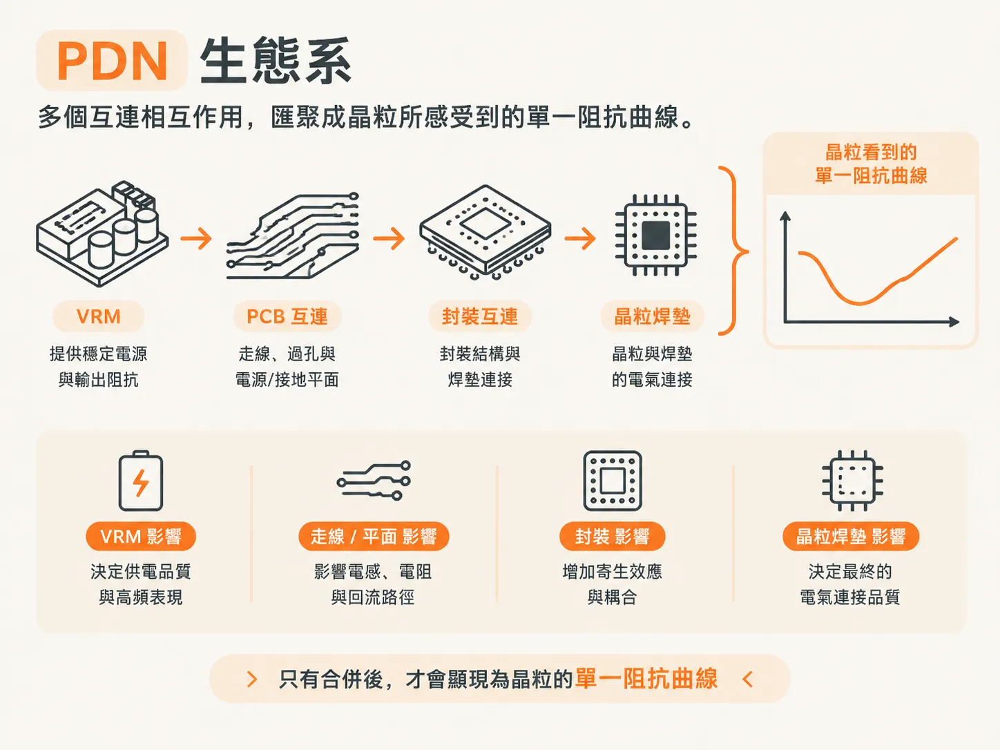
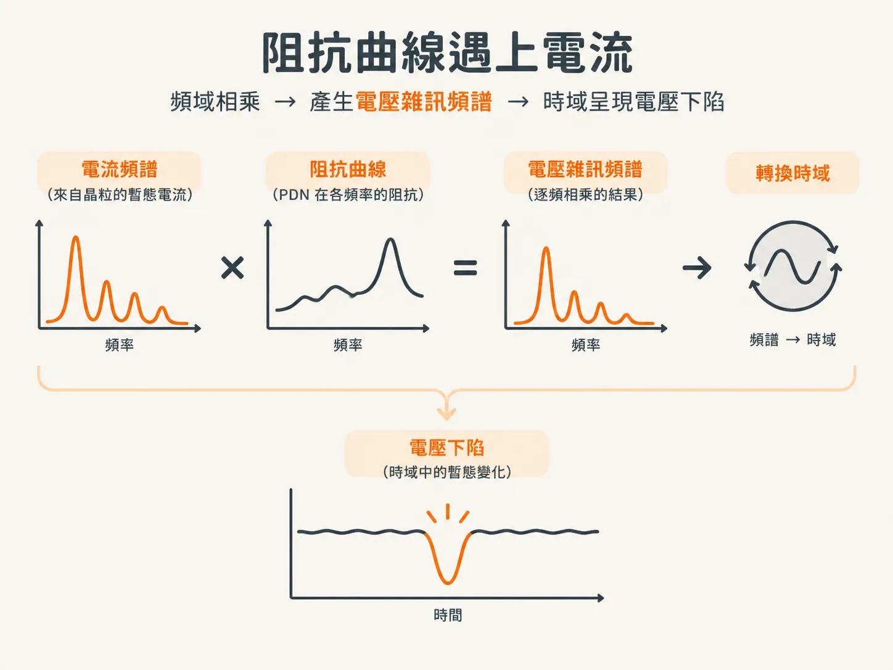
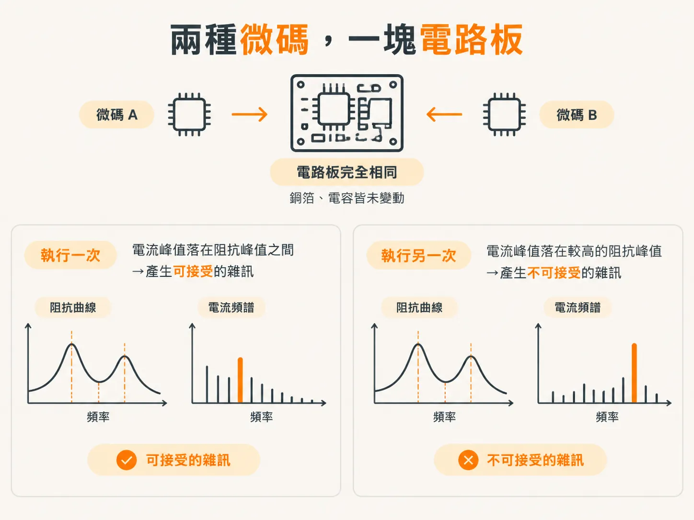

# PDN ecology：transient current 打在阻抗上就是 noise

## 穩壓器不是全部

上一步最後留下了一個疑問：讓 VRM 更安靜，並不能消除雜訊。這一步會說明原因，也會為衡量雜訊的對象取個名字。

先從最明顯的部分談起。在低頻範圍內，PDN 上的電壓雜訊通常來自 VRM 本身。因此，PDN 設計的第一步，確實是挑選一個在適當負載電流下電壓雜訊夠低的 VRM。

這一步不可或缺，但光做到這點還不夠。即使 VRM 穩定得無懈可擊，晶粒焊墊上仍會有電壓雜訊。

## 剩下的雜訊從哪裡來

剩下的雜訊來自電壓降：晶粒上的閘極切換會產生暫態電流，而這些電流流經整個 PDN 的阻抗時，就會造成電壓降。

請仔細讀這句話，因為前後兩部分各有不同的重點：電流來自晶粒，而阻抗則來自 VRM 焊墊到晶粒焊墊之間的整條路徑。

## PDN 生態系

VRM 焊墊與晶粒焊墊之間，包含所有與 PDN 相關的互連。原文將這整個網路稱為「PDN 生態系」。

「生態系」這個詞確實有其用意。這些互連不是一份彼此獨立、互不相關的元件清單。它們會互相作用，共同形成一整套阻抗曲線，而晶粒所看到的正是這套曲線。

因此，板上的電容、平面或連接器，都不能單獨看待。真正重要的是，這些元件組合起來後，在晶粒焊墊上形成什麼樣的曲線。

由此可得兩個結論。第一，評估一個元件時，應看它如何改變晶粒焊墊上的曲線。第二，移動或移除任何元件，都會改變整套曲線，而不只影響元件附近的部分。

## 曲線遇上電流

只要有暫態電流流經這套阻抗曲線，晶粒焊墊上就會產生電壓雜訊。無論 VRM 有多穩定，這個結論都成立。

這是本單元最重要的概念，值得用圖像化的方式說明。在頻域中，晶粒會產生暫態電流頻譜，而 PDN 在每個頻率上都會呈現一個阻抗值。將各頻率的電流逐一乘上對應的阻抗，就能得到電壓雜訊頻譜。再把這個頻譜轉換到時域，就會看到暫態電壓下陷。

如此一來，失效就不再是難以理解的謎，而是幾何上的問題：當電流峰值落在阻抗峰值上時，電壓雜訊就會變大。

## 兩種微碼，一塊電路板

原文以一個實測案例說明這件事。研究人員讓裝置執行特定微碼，同時測量核心電源軌，並將暫態電流頻譜與電流流經的阻抗曲線繪在一起。

圖的左側顯示，電流頻譜峰值與阻抗峰值的組合所產生的雜訊，仍在可接受範圍內。

右側則呈現同一套阻抗曲線。唯一的差異是微碼演算法略有不同，使相同的閘極以稍微不同的頻率運作。這次，電流頻譜峰值與較大的阻抗峰值重疊，導致電源軌上的電壓雜訊超出可接受的上限。

兩種情況下，電路板都沒有任何變動：銅箔完全相同，電容也沒有移動。僅僅是電流頻譜改變，就足以讓原本能正常運作的產品變成失效產品。

## 為什麼這比聽起來更重要

只要雜訊低於指定水準，就不會發生 PDN 引起的錯誤。這就是設計通過測試的完整定義，但它只適用於某一種微碼，並不代表整個產品都沒有問題。

微碼一旦改變，電流峰值的振幅與頻率成分也會跟著變。這些成分若與阻抗峰值重疊，就可能產生更大的電壓雜訊，導致產品失效。

原文在提示中直言：PDN 上的雜訊，既取決於晶粒所面對的阻抗曲線，也取決於流經晶粒的暫態電流頻譜。微碼細節與閘極使用率，都會大幅影響所產生的雜訊。

對設計者來說，這件事有好有壞。你無法完全控制微碼，因此不能只憑一次安靜的測量結果就放心。你能控制的是阻抗曲線，所以必須妥善設計，讓它能承受尚未見過的電流頻譜。

## 下一個問題

如果雜訊等於電流乘上阻抗，而電流又不是你能修正的，那麼設計目標就必須用一個數值來表示阻抗。其他事情都要由這個數值推導出來。

那麼，阻抗應該是多少？下一步會把可接受的電壓轉換成目標阻抗，接著再探討一個更難的問題：符合目標的設計真的夠穩健嗎？還是只是剛好能運作？
