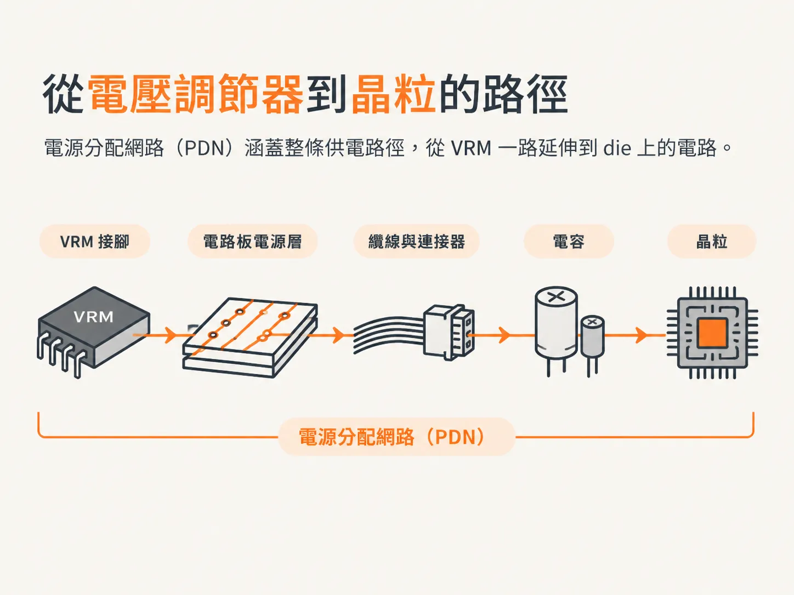
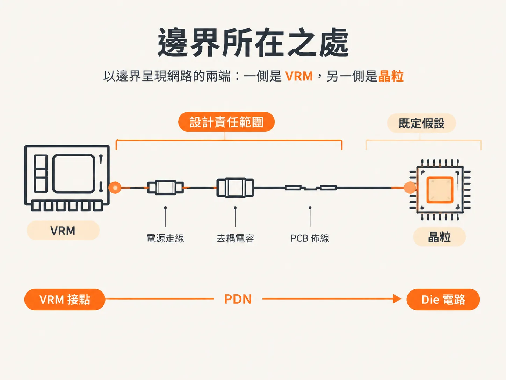
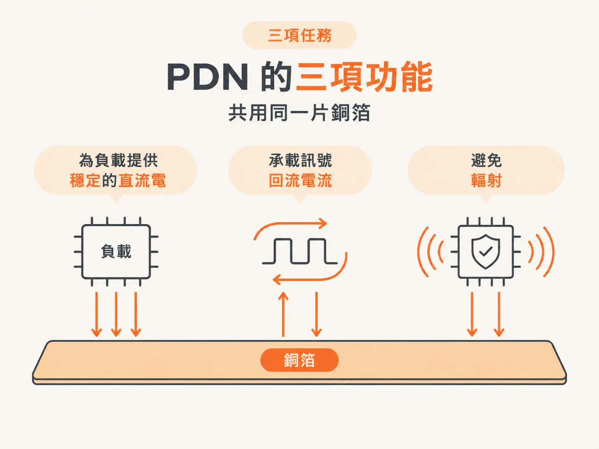

# PDN 是什麼：從 VRM 到 die 的所有 interconnect

## 前言

die 需要穩定的直流電壓。但只要 die 開始切換，電壓就不再穩定。電流會快速變化，而承載電流的路徑具有阻抗；電流變化與阻抗相互作用，便會在電源軌上形成雜訊。

本節探討的就是這條路徑。供電看起來像是已經解決的問題：一個穩壓器、一個電源平面，再加上幾顆電容，似乎就大功告成。但有時，某塊電路板在實驗室測試時運作正常，到了實際使用環境卻發生故障，卻沒有人說得清楚，究竟是路徑上的哪個部分造成了問題。

第一次把探棒接到 Vdd 電源軌，觀察負載變化時電壓如何起伏，你就會遇到這個問題。此時，真正有用的問題不是「少了哪顆電容」，而是「路徑上的哪個部分造成了這種情況？可接受的程度又是多少？」

本節會依序回答四個問題：PDN 涵蓋哪些部分？電源軌雜訊會造成什麼影響？雜訊從哪裡來？又該如何設定它的限制？我們先從最全面的角度開始，看看哪些部分都屬於 PDN。

## 從穩壓器到 die 的路徑

電源分配網路（power delivery network，PDN）是電源供應路徑上的所有互連，從電壓調節模組（voltage regulator module，VRM）一路延伸到 die 上的電路。

這裡的關鍵在於「所有」。一塊常見的電腦主機板上有好幾個 VRM，而每個 VRM 都有自己的路徑，負責將電源與接地連接到各個作用中元件的接點。這整條路徑就是 PDN。

因此，PDN 不是單一元件，而是一條路徑。路徑上包含三類東西：

- 電路板上的電源平面與接地平面。
- 電纜與連接器。
- 所有與供電相關的電容。

路徑上的任何部分都可能增加阻抗。連接器會增加電感，平面則會增加擴散電感；頻率高到一定程度時，平面還會呈現腔體特性。低頻時看起來像短路的電容，在高頻下可能會呈現電感特性。這就是為什麼分析 PDN 時，必須把它視為一個連續的網路，而不是一張元件清單。

## 邊界在哪裡

PDN 從 VRM 的接點開始，一路延伸到 die 上的電路。

這個邊界是人為劃定的，不是物理定律。在邊界內，所有事情都得由你負責；在邊界外，則假設 VRM 會維持應有的輸出，而 die 會依照邏輯需求汲取所需電流。

有趣的故障也常藏在這條邊界之間。如果 die 上的電源軌有雜訊，原因可能出在兩端之間的任何地方：過長的電纜、過薄的平面、位置不佳的電容，或是從未納入設計考量的封裝與 die 電容。

## 三項工作，本書聚焦其中一項

PDN 有三項工作。

第一，將低雜訊的直流電壓與電力送到負責運作的主動元件。人們所說的「電源完整性」，指的就是這項工作。

第二，為所有訊號提供低雜訊的回流路徑。每個離開驅動器的訊號都會回到來源，而接地平面通常就是訊號回流所經過的路徑。接地平面上的雜訊，會同時進入所有回流路徑。

第三，在不增加輻射發射的前提下，降低電磁干擾（electromagnetic interference，EMI）。承載大量高頻電流的平面對可能產生輻射；平面對越安靜，產品就越容易符合輻射限制。

這三項工作共用同一片銅箔。麻煩之處在於，有些改動雖然能改善其中一項工作，卻可能損害另一項。只計算電容的設計，會完全忽略回流路徑與輻射發射方面的問題。

本書聚焦於第一項工作：將直流電壓與電力送到所有需要供電的主動元件，並將雜訊控制在可接受的範圍內。

## 稍後會談到的「可接受」是什麼意思

把雜訊控制在「可接受的範圍內」不是憑感覺決定的，而是要換算成一個數字。這個數字取決於兩件事：die 能承受多少電壓下降，以及連結能容許多少時序偏差。

第二件事常被忽略。電源軌雜訊會讓眼圖往兩個方向移動，而水平方向的移動會帶來代價；可以用每毫伏雜訊所造成的皮秒數來估算。

因此，接下來要問的是：電源軌雜訊實際會造成什麼代價？它會如何影響眼圖？每毫伏的雜訊會帶來多少 jitter？
