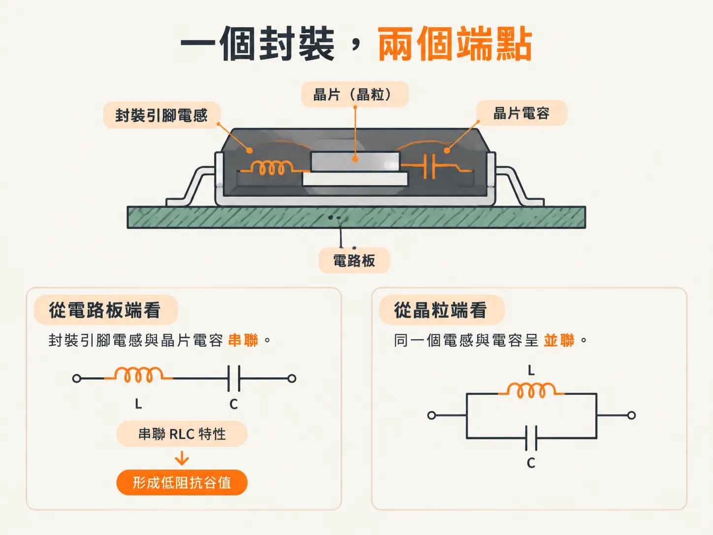
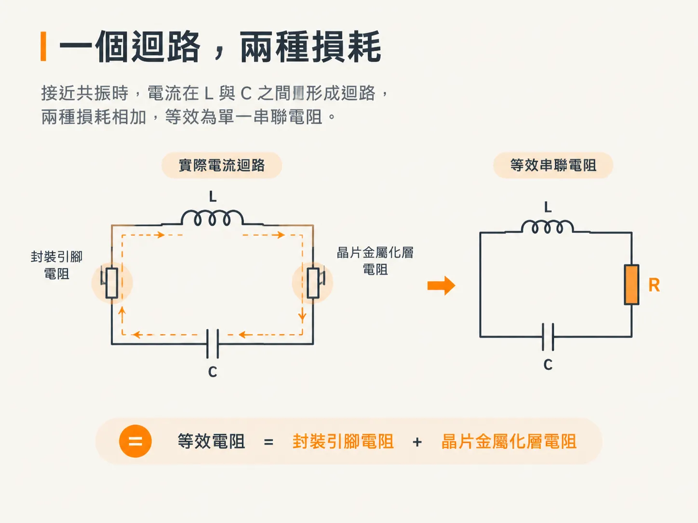
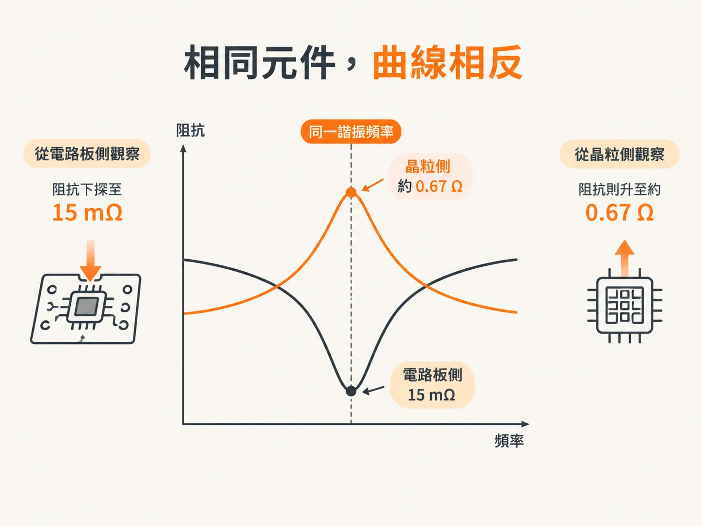

# 從晶片看、從板子看的 PDN

上一個單元最後提出一個說法：從晶片端看，一個封裝引腳電感和一個晶片內電容會形成峰值；從電路板端看，則會形成谷值。本單元將說明其中的原因，並先釐清一個很容易混淆的定義。

## 串聯與並聯描述的是 L 和 C，不是電阻

「串聯」和「並聯」描述的是 L 與 C 元件的拓樸，除此之外沒有其他意思。以並聯方式觀察 L 和 C，諧振時阻抗會達到最大值；以串聯方式觀察，諧振時阻抗則會降到最小值。

電阻是另一回事。在並聯諧振電路中，損耗元件可以接在並聯位置，也可以接在串聯位置；即使 L 和 C 是並聯的，這個電阻通常仍稱為 ESR。

因此，共有四種組合：LC 串聯或並聯，再搭配 R 串聯或並聯。書中先用一張圖呈現這四種組合，之後再逐一說明。

## 先確認量測點在哪裡

選擇模型之前，先確認模擬或量測的取樣點。取樣位置會決定你是從封裝的哪一側觀察，電路拓樸也會隨之確定。

從兩端觀察，同一個 PDN 會呈現不同樣貌。這不是建模技巧造成的差異，而是同一個電路從相反端點觀察時，自然呈現出的結果。

## 從電路板端看：谷值

從電路板端透過封裝往晶片內看時，封裝引腳電感會與晶片內電容串聯。因此，從這個方向看進去，阻抗呈現串聯 RLC 特性，並形成一個低阻抗谷值。

超過這個諧振頻率後，阻抗會再次上升。在高頻端，阻抗主要由封裝引腳電感決定。

這就是為什麼從電路板端只能看到晶片內部環境的低頻阻抗。封裝引腳電感與晶片內電容形成的低阻抗，會阻擋晶片局部 PDN 的高頻特性。

## 從晶片端看：峰值

從晶片端往外看，面對低阻抗的電路板時，晶片內電容會與封裝引腳電感並聯。相同的兩個元件，此時會形成一個阻抗峰值。

超過諧振頻率後，阻抗會下降，並主要由晶片內電容決定，直到晶片內金屬佈線的阻抗開始形成限制。低於諧振頻率時，封裝引腳電感會使晶片本身的阻抗近似被短路，讓晶片連接到低阻抗的電路板。

電路板端的阻抗，包括 VRM 在內，會在低頻時下降。因此，從晶片端看到的低頻阻抗底限，是由封裝引腳的串聯電阻，以及電路板其餘路徑的電阻共同決定。

## 電阻位於何處

有兩個重要的電阻，分別與不同的元件串聯。PDN 電源軌的晶片內金屬佈線電阻與晶片內電容串聯；封裝引腳及通往電路板的導通孔電阻，則與封裝引腳電感串聯。

從串聯的角度來看，四個元件依序相接，因此等效串聯電阻就是晶片內金屬佈線電阻與封裝引腳電阻的總和。對串聯電路而言，元件順序不影響結果。

從並聯的角度來看，答案則取決於頻率。低頻時，晶片會看到封裝引腳電阻與電路板其餘部分的電阻串聯；高頻時，晶片看到的則是晶片內金屬佈線電阻。

接近諧振時，電流會在 L 和 C 之間形成迴路，因此兩者的損耗會相加。此時電路的行為類似並聯 RLC，其等效電阻只有一個：封裝引腳電阻加上晶片內金屬佈線電阻。

## 一組數值，兩條曲線

書中為一顆小型晶片選定以下數值：Cdie = 50 nF、Lpackage = 0.5 nH、Rleads = 0.01 Ω、Rmetalization = 0.005 Ω。等效串聯迴路電阻為 0.015 Ω。

Z0 = √(0.5 / 50) = 0.1 Ω。諧振頻率約為 32 MHz，而 q = 0.1 Ω / 0.015 Ω ≈ 6.7。

q 約為 6.7，代表 Q 值偏高，因此預期會出現明顯的峰值。預測的極值分別是：串聯谷值為 0.015 Ω，並聯峰值則為 0.1 Ω × 6.7 ≈ 0.67 Ω。

書中使用這些數值模擬兩種拓樸，再將曲線與估算結果比較，兩者非常吻合。

## 相同元件，兩種形狀

兩條曲線由相同的元件構成，形狀卻截然不同。在相同的諧振頻率下，一條降到 15 mΩ，另一條則升到約 0.67 Ω。

量測探棒的接點決定你會看到哪一條曲線。書中在本節最後提醒：阻抗量測的接法會改變曲線外觀，也會改變實際量到的內容。

本單元到此告一段落。任何 RLC 電路都可以用四個數值描述，而 q 決定其特徵有多突出。實際電容器可視為串聯 RLC，阻抗底限由 ESR 決定。PDN 則是同一組元件從兩個端點觀察時所呈現的結果；選擇不同的觀察端點，就會把峰值看成谷值，或把谷值看成峰值。

計算方式始終不變，改變的只有拓樸和觀察角度。
