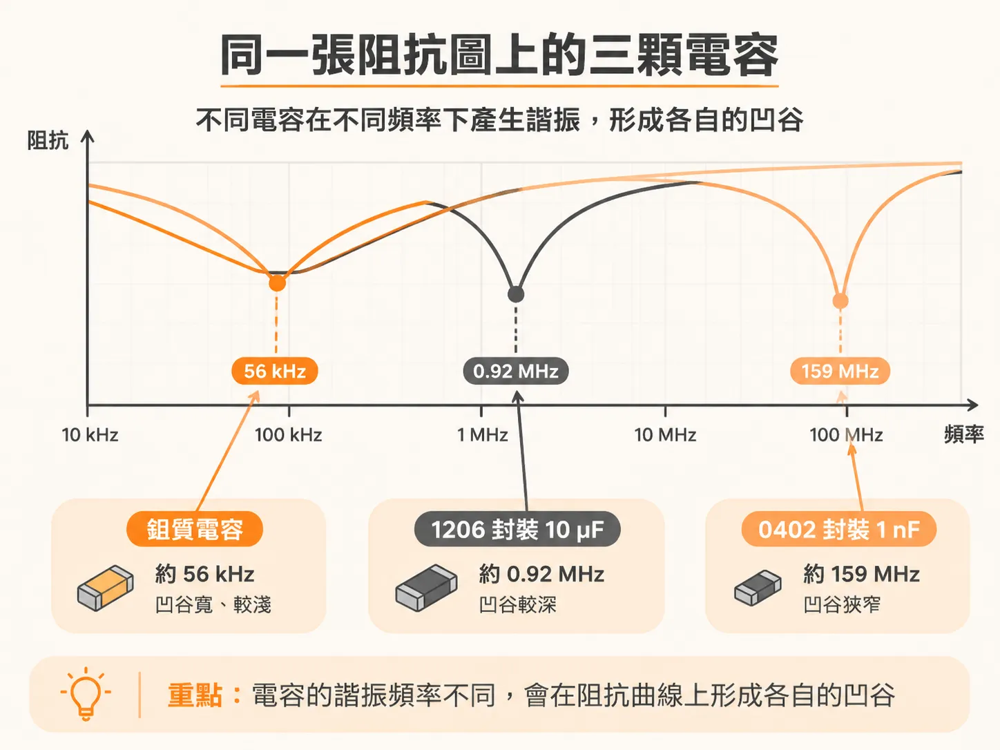
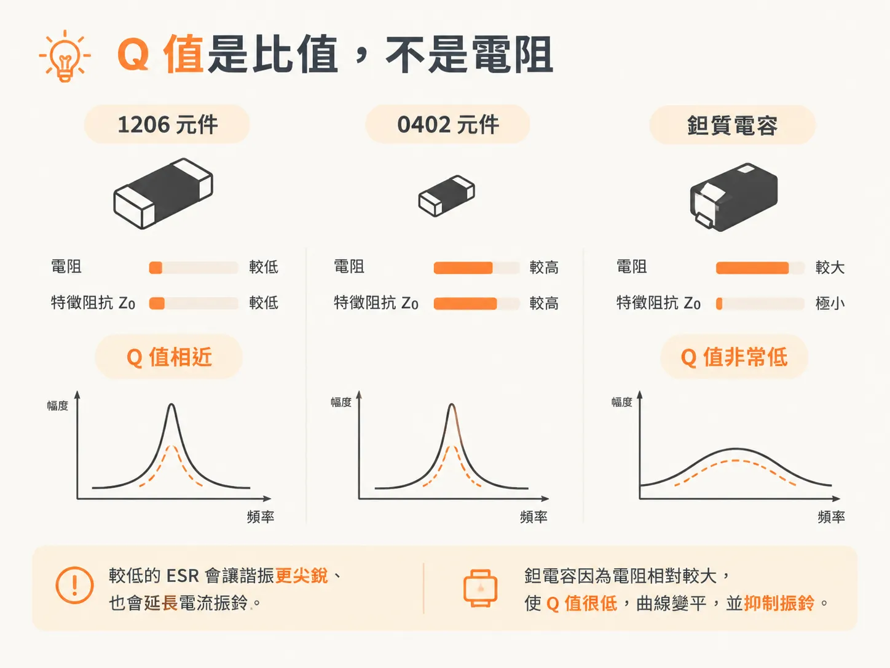
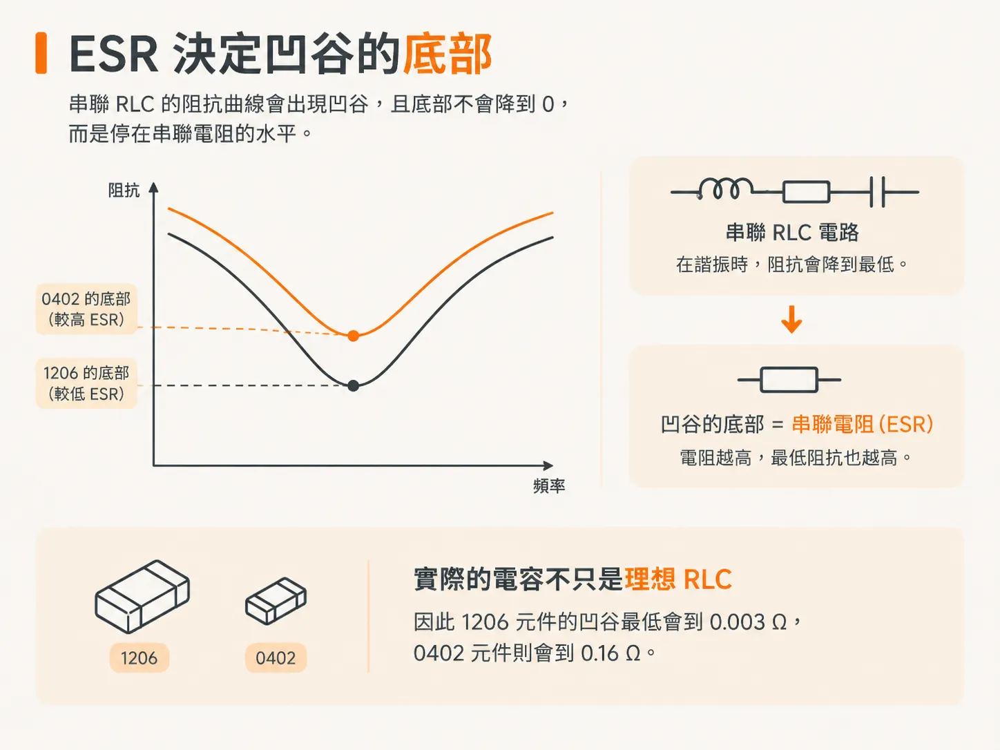

# RLC 電路與真實電容的例子

上一步留下了三個待測元件：一顆鉭電容、一顆 1206 封裝的 10 µF 電容，以及一顆 0402 封裝的 1 nF 電容。問題是，能不能根據四個性能指標，預測每個元件會如何影響阻抗曲線？

這三顆電容都以串聯 RLC 電路建模。電容量為 C；L 代表元件內部及安裝時產生的電感；R 則是串聯電阻，在資料表中通常標示為 ESR。

## 看曲線前，先算出四個數值

任何 RLC 電路都有四個性能指標：諧振頻率、特性阻抗、Q 值，以及最大或最小阻抗。書中的建議是，分析任何電路時，都先計算這四個數值。

公式使用的單位如下：SRF 以 MHz 表示、Z0 以 Ω 表示、C 以 nF 表示、L 以 nH 表示。

Zmin 是串聯電路的最低阻抗，Zmax 則是並聯電路的最高阻抗。由於這三個元件都以串聯 RLC 電路建模，因此這裡要看的性能指標是 Zmin。

## 三個元件，一張表

| | 鉭電容 | 1206 10 µF | 0402 1 nF |
| --- | --- | --- | --- |
| C | 1000 µF = 10^6 nF | 10 µF = 10,000 nF | 1 nF |
| L | 8 nH | 3 nH | 1 nH |
| Rseries | 0.05 Ω | 0.003 Ω | 0.16 Ω |
| Z0 | 2.8 mΩ | 17 mΩ | 1 Ω |
| SRF | 56 kHz | 0.92 MHz | 159 MHz |
| q | 0.057 | 5.8 | 6.3 |
| Zmin | 0.05 Ω | 0.003 Ω | 0.16 Ω |

表中的數值是根據公式計算得出的，並非實測結果。每個數值都是將書中提供的元件參數代入上一步的公式後算出來的。

## 範例 1：大型鉭電容

將這顆鉭電容建模為串聯 RLC 電路，其中 C = 1000 µF，也就是 10^6 nF；L = 8 nH；R = 0.05 Ω。

Z0 = √(8 / 10^6) = 2.8 mΩ。這比上一步提到的 1 Ω 電路低了三個數量級。

q = Z0 / Rseries = 0.0566。阻抗曲線的最低點為 Z0 / q，也就是 0.05 Ω，等於串聯電阻的阻值。

q = 0.057，遠低於代表臨界阻尼的 1/2。因此，預期不會出現尖銳的特徵，而只會形成一道平緩、寬廣的凹谷。

AVX 公布過一款類似電容的阻抗曲線。該電容的 L 更低、SRF 更高，曲線也非常平坦、寬廣，呈現出低 q 值的特徵。

## 範例 2：1206 封裝的 10 µF MLCC

取 C = 10 µF，也就是 10,000 nF；L = 3 nH；Rseries = 0.003 Ω。

Z0 = √(3 / 10,000) = 17 mΩ。SRF 約為 0.92 MHz。q = 17 mΩ / 0.003 Ω ≈ 5.8，而 Zmin 為 0.003 Ω。

書中將這個 q 值描述為相對較高，並直接指出原因：串聯電阻非常低。預期會出現尖銳的諧振。

AVX 繪製這個元件的曲線時，採用的 L 值是 1 nH。對於安裝在電路板上、並透過導通孔連接的 1206 元件來說，這個電感值遠低於一般情況下能達到的程度，因此 AVX 算出的 SRF 會比上述估算值略高。

## 範例 3：0402 封裝的 1 nF MLCC

這裡 C = 1 nF、L = 1 nH、Rseries = 0.16 Ω。

Z0 = √(1 / 1) = 1 Ω。SRF 約為 159 MHz，而 q = 1 Ω / 0.16 Ω = 6.3。Zmin 為 0.16 Ω。

它的電阻約為 1206 元件的 50 倍，原因是其並聯導體層數較少。

較高的特性阻抗使 q 值回升。因此，儘管這兩個元件並不相同，最後的 q 值仍然相近。

## 為什麼 ESR 低不代表一定比較好

q 等於 Z0 除以 Rseries。若 Z0 不變而 R 降低，q 就會升高。對串聯 RLC 電路來說，曲線上會形成更深、更窄的凹谷；對並聯電路來說，則會形成更高、更窄的峰值。

這三個元件的 R 並非單獨逐步變化，因為 Z0 也會跟著改變。從 0402 換成 1206 時，Z0 約下降 60 倍，R 則約下降 50 倍，因此 q 幾乎沒有變化。

所以，單看 ESR 低並不能說明太多。較低的 ESR 會讓元件原本就有的諧振變得更尖銳，也會延長時域中的電流振鈴。鉭電容則呈現另一種取捨：相較於 2.8 mΩ 的 Z0，0.05 Ω 的電阻使 q 降至 0.057，形成平坦的曲線，並抑制振鈴。

## 凹谷不會降到零

真實電容並不是教科書中的理想 RLC 電路。它的最低阻抗就是串聯電阻，因此 1206 元件的凹谷最低會到 0.003 Ω，0402 元件則會到 0.16 Ω。

當要求元件在自身的 SRF 下維持電源軌穩定時，這個最低阻抗就是重要的參考數值。

這些公式並不只適用於電容。下一步會將封裝的一段引線電感與晶片上的電容量放在一起，並從兩個角度觀察同一組元件：從晶片端看，會看到並聯峰值；從電路板端看，則會看到串聯凹谷。
