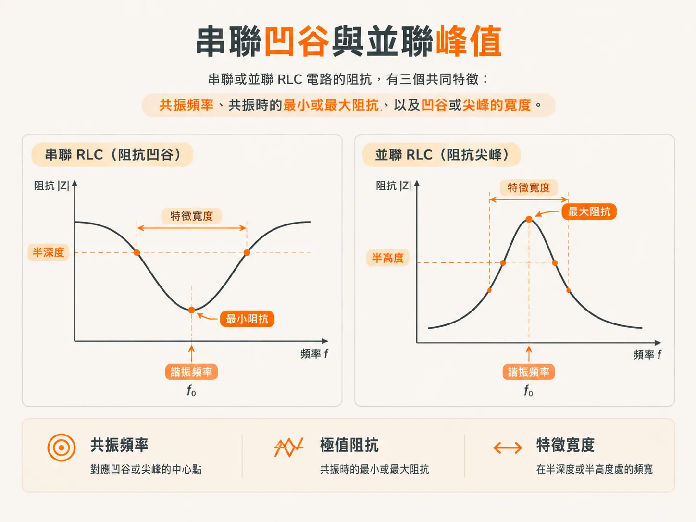
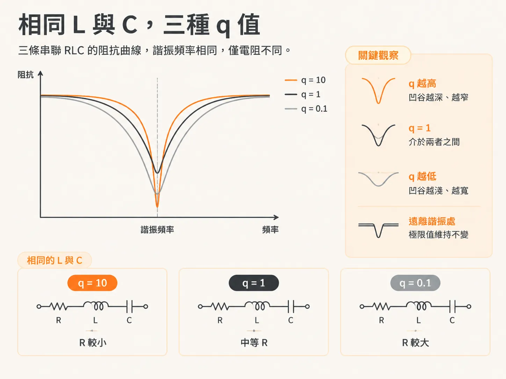
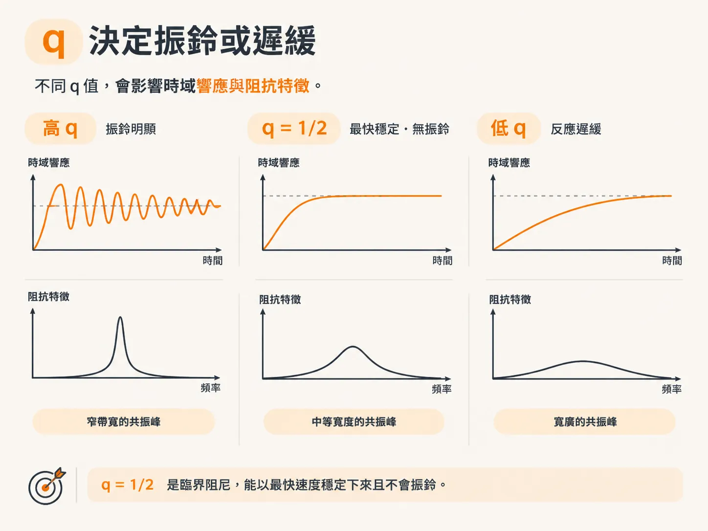
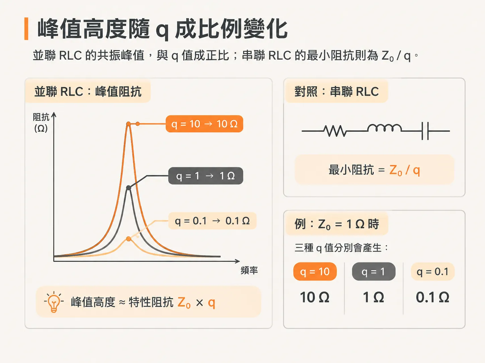

# Series 與 parallel RLC 的共振特性

## 前言

PDN 的阻抗曲線大多相當平坦，但有時會突然出現變化：某個頻率上出現狹窄的尖峰或深凹谷，曲線的其他部分卻幾乎不受影響。如果無法辨認這個尖峰或凹谷代表什麼，就很難判斷它是由什麼原因造成的。

實測阻抗圖上也常會看到這種情況。曲線上出現尖峰，電路板卻仍然運作異常。真正要問的是：這個尖峰為什麼這麼高？是因為電感太大，還是因為阻尼太小？這兩種原因會導致不同的修正方式。

本節會介紹四個用來描述 RLC 電路的數值：共振頻率、特性阻抗 Z0、q-factor，以及共振時的最小或最大阻抗。有了這四個數值，尖峰就不再只是曲線上的形狀，而是能明確辨識的電路特性。

內容會從一般概念逐步延伸到具體案例。首先介紹各項定義，以及 q 如何影響凹谷或尖峰的形狀；接著分析三種實際的電容器，看看使用相同的計算方式，為何會得到差異很大的 q 值；最後則以封裝引線電感搭配晶片內電容為例，分別從晶片端和電路板端觀察。

那麼，這四個數值是什麼？又是哪一個決定尖峰的高度？

## 三個特徵，不只是一條曲線

串聯或並聯 RLC 電路的阻抗，可以用三個特徵描述：共振頻率、共振時的最小或最大阻抗，以及凹谷或尖峰的寬度。

曲線上的其他變化，都由 L、C 和 R 決定。遠低於共振頻率時，阻抗由 C 決定；遠高於共振頻率時，則由 L 決定。

## 凹谷或尖峰出現在哪裡

凹谷或尖峰會出現在串聯共振頻率（SRF）或並聯共振頻率（PRF）。這個頻率由 L 和 C 決定；本書的計算一律以 nH 為 L 的單位，以 nF 為 C 的單位。

fres = 1 / (2π √(L · C))

在這個頻率下，電容與電感的電抗會互相抵銷，電路中只剩下電阻。

## Z0 是電抗，不是傳輸線

在 SRF 或 PRF 時，電感或電容的電抗就是電路的特性阻抗 Z0。本書特別強調：這裡的 Z0 與均勻傳輸線的特性阻抗毫無關係，它只是 RLC 電路的一項阻抗特性。

Z0 = √(L / C)

本節會反覆使用一個 L = 10 nH、C = 10 nF 的電路，其特性阻抗為 1 Ω。

## 電阻決定極值

沒有阻尼時，串聯電路的凹谷會降至零，並聯電路的尖峰則會升至無限大。電阻會將兩者從這些極端拉回來。

在串聯 RLC 電路中，最小阻抗就是電阻值。到了 SRF，電抗互相抵銷，串聯電路只剩下 Rseries。

在並聯 RLC 電路中，最大阻抗就是並聯電阻值。到了 PRF，電抗再次互相抵銷，並聯電路只剩下 R。

## q 用一個數值表示阻尼

q-factor 是特性阻抗與阻尼電阻的比值，也等於共振頻率除以凹谷深度一半時的頻率跨度。

本書使用 q-factor，而不用 Q，讓字母 Q 可以保留給電容器儲存的電荷。對串聯電路而言，q = Z0 / Rseries。

當 L = 10 nH、C = 10 nF、Rseries = 1 Ω 時，q-factor 為 1。本書的串聯電路例子中有三條曲線，分別對應 q = 10、q = 1 和 q = 0.1。三者的 L 和 C 相同，只有電阻不同。

q 是衡量相對阻尼程度的指標。q 值高的電路，每個週期只損失少量儲存的能量，因此會振鈴較久，凹谷也會較尖、較窄。

q 值低的電路，每個週期會損失較多能量，因此振鈴很快就會停止，凹谷也會比較寬。

q = 1/2 時為臨界阻尼。電路能以最快速度穩定下來，而且不會振鈴。q 值越高，振鈴越明顯；q 值越低，反應越遲緩。

有一點會延續到下一節：串聯 RLC 的阻抗凹谷和振鈴都與電流有關；並聯 RLC 的阻抗尖峰和振鈴則與電壓有關。

## 尖峰高度是 Z0 乘以 q

並聯 RLC 的尖峰高度約為 Z0 乘以 q。

Zmax ≈ Z0 × q

當 Z0 = 1 Ω 時，三種 q 值分別會產生 10 Ω、1 Ω 和 0.1 Ω 的尖峰。

串聯電路則恰好相反：最小阻抗是 Z0 除以 q，因此 q 值越高，最小阻抗就越遠低於 Z0。

這個關係適用於電阻與 L、C 並聯的情況。如果電阻改為與並聯電路中的電容或電感串聯，兩者的關係就會改變。

只需兩個性能指標，就能描述整個電路：Z0 和 q。並聯電路的尖峰與 Z0 × q 成正比；串聯電路的最小阻抗則為 Z0 / q。

## 為什麼電阻越大，凹谷看起來越寬

Rseries 增大時，凹谷會變淺，但曲線兩端的阻抗幾乎不變。

視覺上，這會讓凹谷看起來變寬；依照半高寬的定義，它確實會變寬。

相位也會隨之改變。在阻抗平坦、幾乎維持不變的寬廣頻率範圍內，相位會接近 0 度，也就是理想電阻的相位。本書會將此現象與 Kramers-Kronig 關係連結起來。

## 這些概念對 PDN 設計有什麼幫助

尖峰高度是設計選擇的結果，並非元件本身固定不變的特性。若要壓低並聯電路的尖峰，可以增加阻尼：提高串聯電阻，或降低並聯電阻。

目標是讓 q 接近 1。這會使 R 接近 Z0；達成這個目標的方式包括提高 R、降低 L，或提高 C。接下來，這三項會成為設計目標。

接下來會把抽象概念套用到實際料號上。同樣的計算將用於鉭電容、1206 封裝的 10 µF 電容，以及 0402 封裝的 1 nF 電容，並檢視它們的 q 值如何影響尖峰高度。
