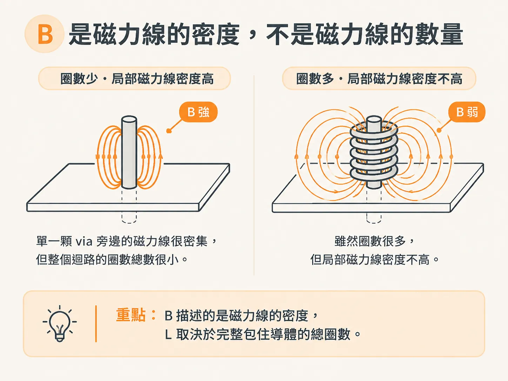
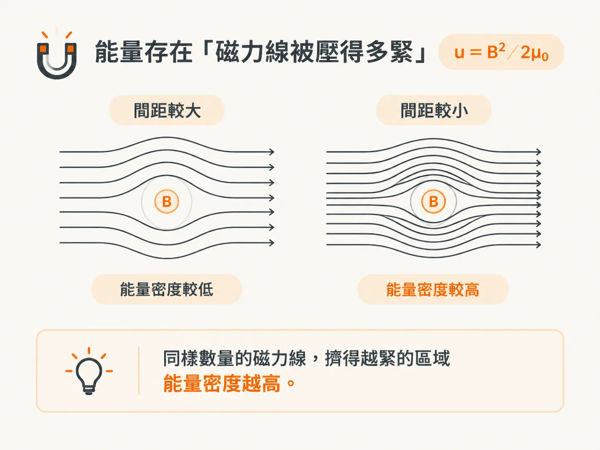
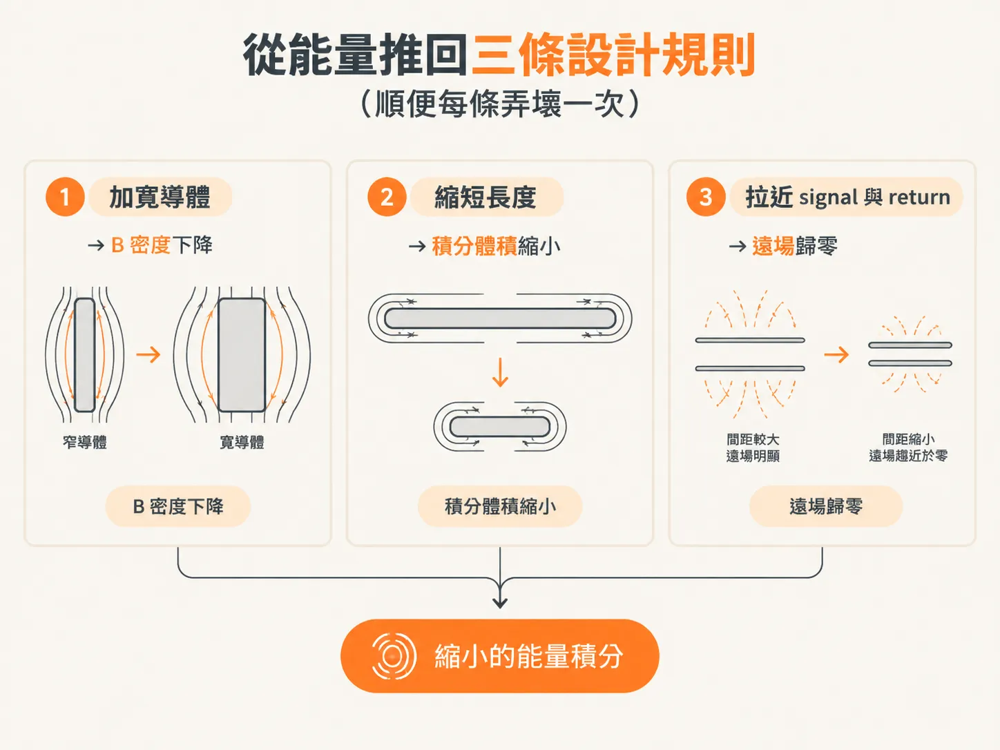

# 電感與磁場中的能量

第 4 步最後提到，理解機制要從能量著手。不過，在談能量之前，得先分清楚 B 和圈數——這兩個量在第 2 步一起出現，之後卻一直混著使用。

## B 是磁力線的密度，不是磁力線的數量

在準靜態近似下，無論電流是恆定還是變化，磁力線都是閉合迴路。

B 的定義是「穿過單位面積的磁通量」，也就是磁力線的密度。當面積趨近於無限小，B 就能定義在空間中的每一點。SI 單位是 Wb／m²，稱為 Tesla；cgs 單位是 Maxwells／cm²，稱為 Gauss。

把 B 稱為「磁場」容易造成誤解。B 代表的是密度，而密度不等於線的數量。同樣數量的線擠在更小的面積裡，B 就會更大。

這裡有一個常被忽略的推論：L 的大小與某一處 B 的大小無關。某處的 B 比較大，不代表 L 就比較大；決定 L 的，是「每安培完整包住導體的磁力線總數」。

一顆 via 旁邊的 B 很強，不代表這顆 via 的 L 就很大。

把 B 從導體到無窮遠的半空間積分，就能得到總磁通量，再用 L = flux／I 求得 L。數圈數，其實就是在做這個積分。

所以，B 告訴你能量分布在哪裡，圈數則告訴你 L 有多大。不要把這兩個問題混為一談。

## 能量存在於「磁力線被壓得有多緊」：u = B²／2µ0

能量密度由 B 決定，單位是 J／m³：

u = B²／2µ0

µ0 = 4π×10⁻⁷ H／m，也就是 1.257 nH／mm、32 nH／inch、32 pH／mil。後兩個數字很實用；之後看到「一層介質有多厚」時，就能用它們估算量級。

關鍵在於：儲存的能量密度取決於 B，而不是圈數。

單一條磁力線本身不帶能量。能量存在於磁力線排列的密集程度之中——磁力線形成的壓力越大，儲存的能量也越多。

「壓縮磁力線」不是比喻，而是在描述能量的計算方式。要降低 L，就得避免讓 B 被壓得那麼緊。

## U = ½LI²：把能量和 L 綁在一起

總能量是將能量密度對整個空間積分後得到的結果。

由於磁場與迴路的電感、電流有關，總能量可以用 L 與 I 表示：

U = ½LI²

這也提供了另一種理解電感的方式：看每安培平方能儲存多少能量。L 越大，儲存的能量越多；L 越小，儲存的能量越少。

在電流固定時，L 減半，U 也會減半。所以，「降低 L」不只是降低阻抗，也會改變這個結構需要從電源取得多少能量。

## 電感密度：把 L 攤回空間裡看

loop L 是整個迴路的性質，對應完整包住導體的磁力線總數；儲存的能量則是整個空間的性質。

B 密度高、磁力線擠得緊的地方，能量密度也高。

同樣地，可以把電感想成分布在導體周圍的空間裡：將「電感密度」對整個空間積分，就能得到總 L。

dL／dv 是電感密度，量的是與單位電流所產生的 B 密度平方成正比的量，而不是 B 本身。

要設計低電感結構，就得降低導體周圍的電感密度。

兩層 plane 靠得很近時，B 被限制在很薄的體積裡，整片 plane 的 L 就會比較低；把兩層拉開，同一片 plane 的 L 就會立刻變大。這就是「間距」這個設計槓桿的能量觀點。

## 從能量推導出三條設計規則（順便把每條規則都破壞一次）

能產生高 B 密度的導體配置，也會產生高電感密度。

在電流固定時，有兩種方式可以降低 L：加大導體在垂直於電流方向上的尺寸，以降低周圍的 B 密度；或縮短信號與回流路徑之間的距離，讓只有很小的體積內存在可觀的 B 密度。

整理成三條規則：

1. 加寬導體：降低 B 密度。
2. 縮短導體：減少積分體積。
3. 拉近 signal 與 return：讓遠場的 B 降到接近零，縮小積分體積。

對照第 2 步的三個槓桿——寬度對應 B 密度，長度對應積分體積，間距對應遠場歸零。這三種做法其實都在做同一件事：縮小 B² 的積分值。

真正重要的是總 L；只要能降低整個迴路周圍的電感密度，總 L 自然也會降低。

現在試著把這些條件破壞掉：切開 return plane、拉開兩層、拉長走線，分別讓一條規則失效，再回頭看看 Z(f) 上哪一段被抬高了。

這三條設計規則不是口訣，而是「把 B 關進小體積」的三種做法。回頭看第 1 步的那條 Z(f)，高頻區段的高度就是這個積分的結果。

這個 node 只提供方向與機制。至於如何把「更短、更寬、更近」換算成能填進 layout review 表格的 nH 數字，就留待下一個 node。
