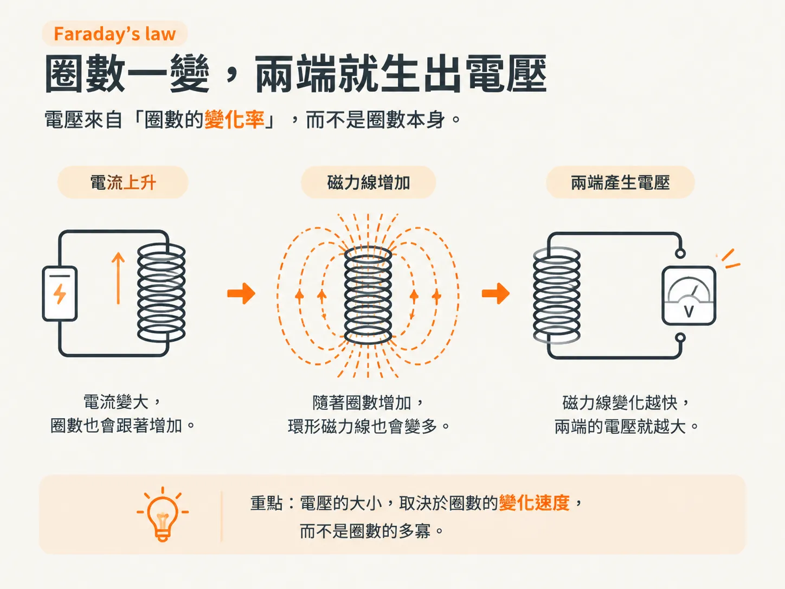
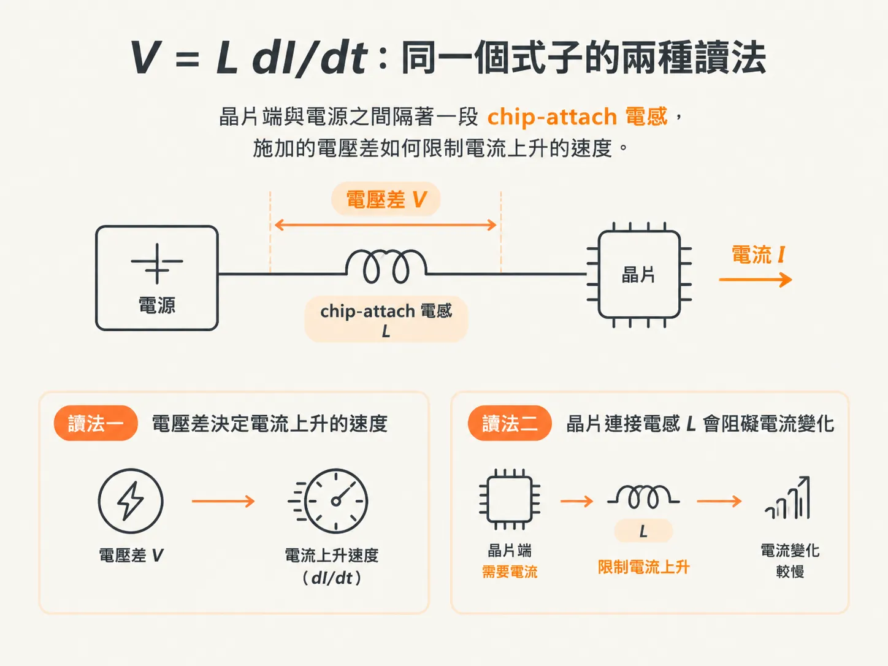
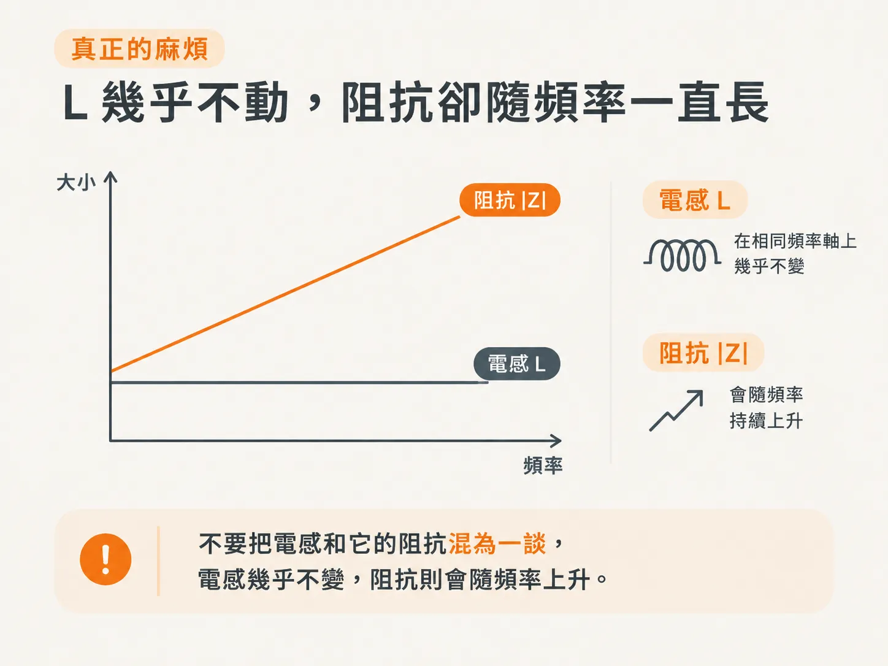

# 電感的阻抗

第 2 步將 L 定義為「每安培所圈住的磁力線數」，也確認了它只取決於幾何形狀。但還有一塊拼圖尚未補上：圈數是靜態量，阻抗描述的則是動態行為。要從圈數推導出 Z(f)，還需要一條基本原則。

## 法拉第定律：圈數一變，兩端就會產生電壓

電感器的電氣行為，建立在電感的定義與一條基本原則之上：導體周圍所圈住的磁力線數一旦改變，就會產生電壓。這就是法拉第定律（Faraday's law），也是 Maxwell 方程之一。

簡單來說，電壓是電場 E 沿著路徑的線積分；而這個電壓，是由該路徑所圍住的磁力線總數隨時間變化所造成的。

簡化後，可以用 ΔV 表示電壓與圈數變化率、時間間隔之間的關係。ΔV 就是導體兩端產生的電壓差。

改變圈數的方法之一，是改變電流：電流上升，圈數也會跟著增加；圈數變化得越快，兩端產生的電壓就越大。

電流爬升時會有電壓；電流維持不變時則沒有。這就是 dI/dt 的字面意思，也說明了為什麼只有電流變化時，才會出現這種現象。

電感並不是「阻擋電流」；只有圈數改變時，它才會產生作用。

## V = L dI/dt：同一個式子的兩種讀法

將法拉第定律與電感的定義結合，就能得到電感器的 I-V 關係：

V = L dI/dt

電感兩端的電壓與電流變化會同時發生。這個式子可以有兩種讀法。

讀法一：電流變化時會產生電壓，這個電壓也稱為反電動勢（back emf）。

讀法二：若忽略導體電阻，兩端施加的電壓會驅動電流變化。這兩種效應會同時發生，並非二選一。

書中特別提醒，第二種讀法對理解晶片連接電感（chip-attach inductance）特別有用。晶片端突然需要電流，換個角度來看，就是施加的電壓差決定電流能多快跟上；而阻礙電流變化的，正是晶片連接處那段 L。

面對同一個 V = L dI/dt，選擇最能解釋眼前現象的讀法即可。

## 時域阻抗看波形，頻域阻抗只剩 jωL

時域阻抗仍遵循阻抗的定義，但會隨電流的實際波形而變，形式也比較複雜。

和電容一樣，在頻域中使用正弦與指數形式表示，關係就簡單得多。因此可以推導出：

Z = jωL

同一段 L 面對脈衝和正弦波時，得到的時域「阻抗」並不相同；只有在頻域中，才能得到一個可以標示在 Z(f) 上的值。

要畫出 Z(f)，就必須進入頻域。這也正是第 2 步最後一節埋下的伏筆。

## 真正的麻煩：L 幾乎不動，阻抗卻隨頻率一路上升

Z = jωL 說明了一件事：電感的阻抗會隨頻率上升。

頻率越高，互連線（interconnect）的阻抗就越容易由導體電感主導。這就是降低電感為何是 PDN 設計的重要一環。

但 L 本身並不會大幅變化。一般來說，互連線的電感對頻率而言近似為常數，只會因電流重新分布而稍微下降。

所以，不要把電感和它的阻抗混為一談：電感幾乎不變，阻抗則會隨頻率上升。

比較兩種結構：如果 L 相差兩倍，那麼在高頻段，Z(f) 也會相差兩倍，而且頻率越高，差距越大。這就是第 1 步所說「高頻由 loop L 主宰」的數學版本。

降低 L 並不是只讓某個頻率點的阻抗下降，而是把整段高頻範圍往下移。

不過，這整套推導都假設 L 是一個「元件」——也就是一個可以寫成 Z = jωL 的集總值。這個假設什麼時候會失效？
