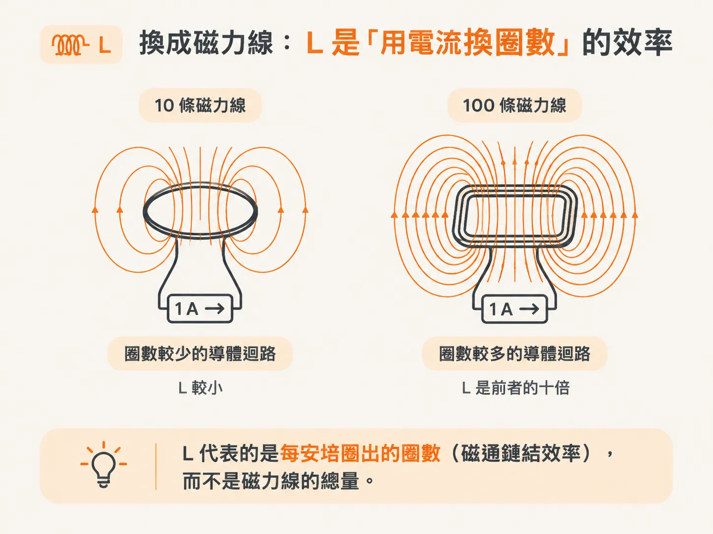
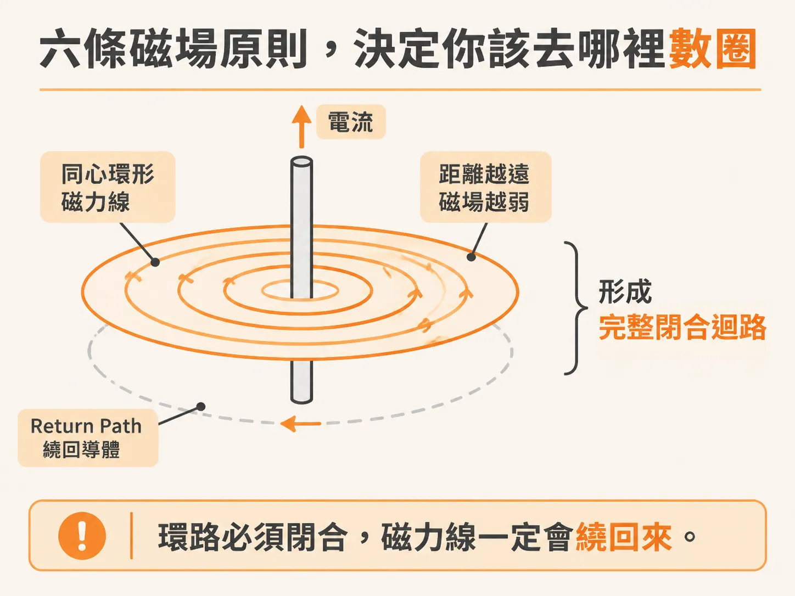
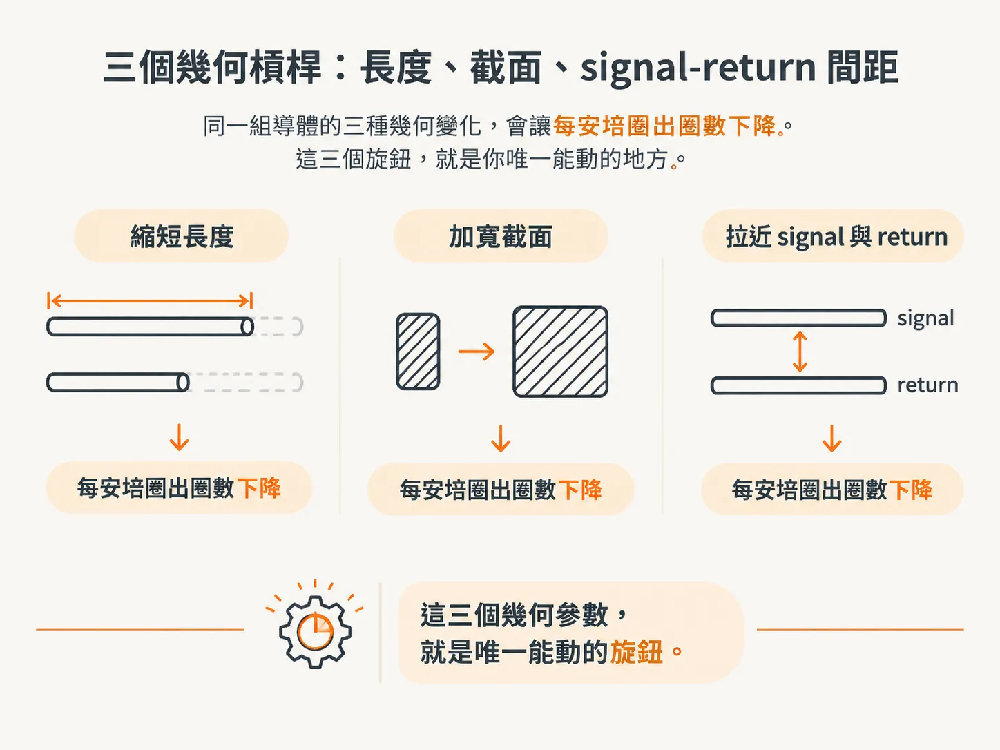

# 電感是什麼：磁場與電感的基本原理

上一頁留下的問題是：電感憑什麼只由幾何決定？要回答這個問題，得先把「圈」數清楚。書上的做法，是先回頭看電容——把同一句話換成磁力線，答案就出來了。

## 先從電容借一句話：C 是「用電壓換電荷」的效率

每一對 signal 與 return path 導體，除了有電感，也同時有電容。這不是巧合，而是同一個幾何結構在兩種場中呈現的兩種效率。

電容的定義，連結了兩導體之間的電荷分離與電壓差。這裡最容易誤讀的是：電容不是「電荷差」的量度。兩邊等量、反號的電荷加倍，電壓也會加倍，比值不變，C 仍是原來的數值。

所以，C 量度的其實是一種效率：用電壓換取儲存電荷的效率。C 大，代表只要增加一點電壓，就能容納很多電荷；C 小，則代表還沒容納多少電荷，電壓就已經升高。

C 只與幾何和介質分布有關，與電壓無關。電荷與電壓是外加的條件：兩片銅箔上完全沒有電荷，或是充到 1 kV，C 都是同一個數字。

這個句式要記住，下一步就原封不動地換成磁力線。

## 換成磁力線：L 是「用電流換圈數」的效率

loop inductance 由磁通鏈結與電流的關係定義：把 B 在迴路面積上積分，再除以電流。這個定義不難寫，卻不容易直接使用——它藏在非均勻 B 的表面積分裡，而 B 的分布又強烈取決於迴路的大小、形狀與電流。

換成效率的說法，就清楚多了：C 是兩導體用電壓換電荷的效率；L 則是一個導體迴路用電流換取磁通鏈結的效率。

L = ψ／I

ψ 是磁通鏈結（flux linkage），可視為迴路所鏈結的磁通總量；I 是電流。單位是 Wb／A，也就是 Henry。實務上多半使用 nH 或 pH。

注意「效率」這兩個字：L 不是磁力線的總數，而是導體產生磁通鏈結的效率。同樣是 1 A 流過兩個結構，一個鏈結 10 條磁力線，另一個鏈結 100 條，後者的 L 就是前者的十倍。

所以，「每安培的圈數」可以用來比較兩個 layout。

## 六條磁場原則，決定你該去哪裡數圈

磁力線的形狀，以及它與哪些因素有關，可以歸納成六條：

1. 磁力線在自然界中只以閉合環路的形式出現。
2. 任何電流都會在周圍產生同心環路，且環流方向固定。
3. 磁力線不與介質作用。
4. 環繞導體的磁力線總數與電流成正比。
5. 磁力線環數一旦改變，就會在導體兩端產生電壓。
6. 能量儲存在磁力線中，磁力線越多，能量越多。

第 5 條先擱著，第 3 步會用到；第 6 條也先擱著，第 5 步才會展開。

長直導線周圍的磁力線呈同心圓分布，離電流越遠就越稀疏，而且沿著導線長度一路延伸。環流方向由右手定則決定：拇指指向電流方向，四指彎曲的方向就是環流方向。

既然磁力線只以環路的形式出現，就可以數。從導體旁邊延伸出一個直達無窮遠的平面，數穿過這個平面的磁力線，就能得出完整環繞導體的圈數。數圈，其實就是在做那個表面積分。

這裡有個容易漏掉的重點：環路必須閉合，所以磁力線一定會繞回來。

loop 天生就包含 return path。你數的不是「附近有多少條線」，而是「完整包住這對導體的圈」——從這一步起，return path 就已經進入畫面。

## L 只認幾何：電流再大、介質再換都動不了它

1 µA 與 1 MA 會讓磁力線圈數大幅改變，但 L 不變。甚至沒有電流時，L 也一樣。

L 是導體的本質性質，只取決於幾何。磁力線不與介質作用，因此介質分布不會影響 L。

嚴格來說，介質仍有極輕微的 diamagnetic／paramagnetic 效應；但在非鐵氧體的絕緣介質中，影響遠小於 0.01%，實務上可視為介質對磁力線透明。

有兩類例外。ferrite 是高導磁率陶瓷，會大幅提高 L，常用於 common mode choke，以及需要在小體積內取得高電感的離散電感；需要低電感的地方則絕不使用。另一類是鐵、鎳、鈷等鐵磁性金屬，但它們只會影響導體內部的 self-inductance。

同一條走線，流過 1 µA 或 1 MA，磁力線圈數會差很多，L 卻絲毫不變。把介質換成介電常數更高的材料，C 會改變，L 幾乎不動。

這個對照一次就能把 C 與 L 分開：「加大電流」與「換材料」都不是降低 L 的方法，你能調整的只剩形狀。

## 三個幾何槓桿：長度、截面、signal-return 間距

一般而言，只有三個幾何特徵會影響 L：

- 長度：越短，L 越低。
- 截面：電流分布得越廣，L 越低。
- signal 與 return 之間的距離：越近，L 越低。

簡單說，就是更短、更寬、更近。

把它接回第 1 步那條 Z(f)：高頻段由 loop L 撐起來的高度，就只能靠這三個旋鈕壓低。這裡先不問「為什麼有效」——第 5 步會用能量把原因講完整。

## 為什麼後面一律在頻域談：時域阻抗認波形，頻域阻抗認頻率

阻抗是電壓與電流的比值。這個概念在時域也成立，但對電容而言，時域中的電壓與電流關係取決於電壓如何隨時間變化，因此不能單靠一個固定比值來描述元件特性。

把訊號寫成正弦波，並用複數表示後，頻域阻抗的形式就簡單得多，也能表示為與頻率有關的量。

兩種寫法都成立，只是頻域的表示簡單得多。同一個電容，面對方波與正弦波時，電壓與電流的關係並不相同；到了頻域，則可以用阻抗隨頻率變化的方式來表示。

之後談 L 的阻抗，一律在頻域談——因為只有在那裡，才有 Z(f) 這條曲線可供判讀。

既然 L 是「每安培的圈數」，又只由幾何決定，那麼它在頻域會呈現什麼樣的阻抗？為什麼到了高頻，非得考慮它不可？
