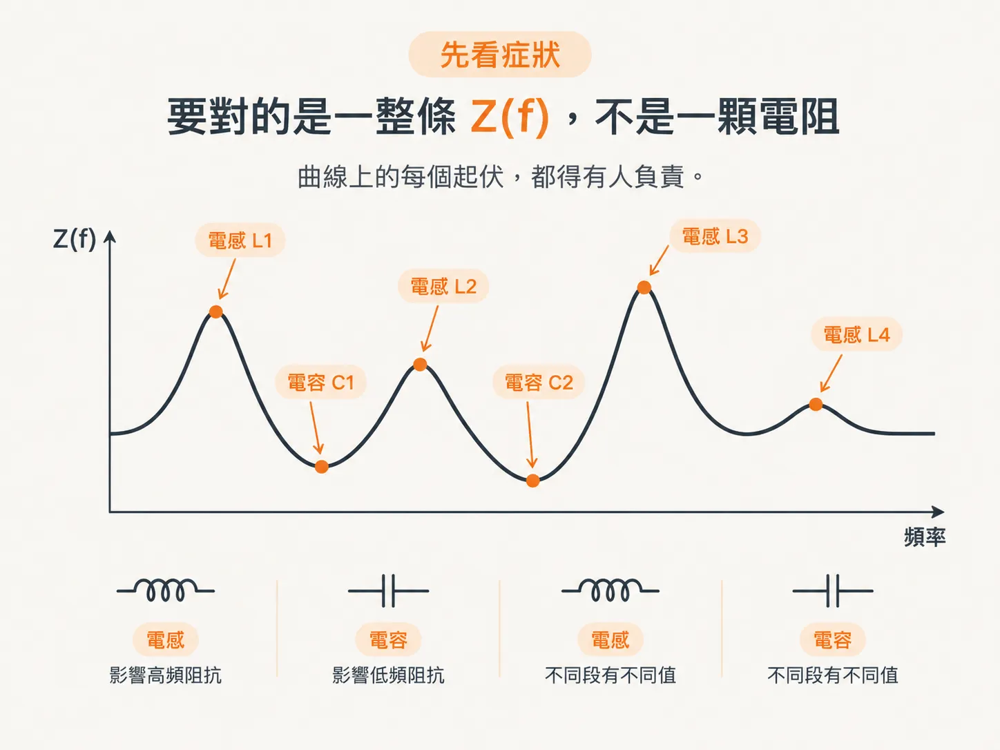
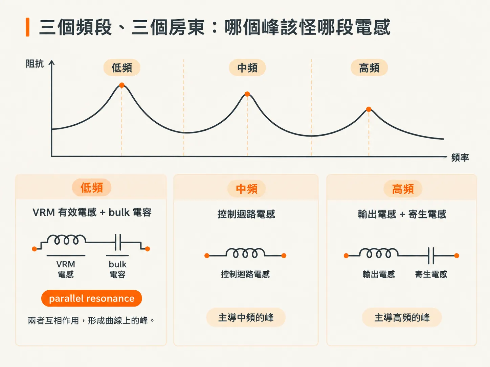
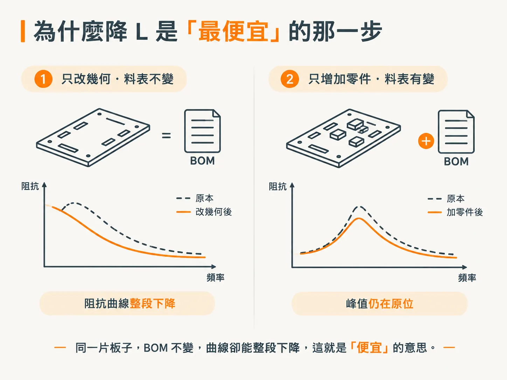

# 降低電感是平衡效能與成本的關鍵

## 前言

PDN 的設計目標，是符合目標阻抗曲線（target impedance profile）。實務上，目標阻抗不是單一數字，而是一整條 Z(f) 曲線。透過元件與互連（interconnect）的正確模型，可以模擬出這條曲線；而真實互連的阻抗主要由電感決定，且電感的影響會隨頻率升高而更加明顯。

問題是，曲線本身不會說明原因。某個頻段的阻抗降不下來時，最常見的反應是加電容；但如果那個峰不是由電容容值造成的，加了電容之後，BOM 變貴、板上空間變擠，曲線卻幾乎沒有變化。接下來要談的就是這種情況：面對一條有峰有谷的曲線，你得說得出每個起伏是由什麼造成的，也得知道先調整哪個地方最划算。

你可能會在幾種情境中遇到這個問題：查看模擬得出的 Z(f)、檢視一片板子的電源層與 via，或是被問到「這個 peak 是誰造成的」。本節會依序回答五個問題：每個峰背後是哪一段電感；電感是什麼，為什麼只由幾何決定；Faraday's law 如何推導出 Z = jωL；lumped L 的假設在多大的結構、多高的頻率下會開始失效；能量又為什麼能說明「更短、更寬、更近」這些方向的合理性。讀到最後，你會有一套歸因方法和三個幾何調整方向，但還沒有能填進 review 表格的 nH 數字。

先從症狀開始：Z(f) 上的每個起伏，分別是由哪一段電感造成的？

## 先看症狀：要看的是一整條 Z(f)，不是一顆電阻

PDN 設計的目標，是符合目標阻抗曲線。通常會透過模擬來檢視：元件使用正確的模型，互連則先建模為 transmission line 段；在頻率夠低時，這些段落可以再近似為 L 與 C。離散元件也一樣，可以近似為 L 與 C。

有句話值得記住：一條訊號導線及其回流路徑（return path）構成的迴路，其 L 是描述互連的基本電氣特性。任何一段路徑——從 VRM 到 die、從 die 到 plane，或是從 plane 穿過 via 到另一層——都由這一對導體構成，也都有自己的 L。

因此，讀阻抗曲線時，要換個角度問：這一段是誰在主導？曲線上的谷與峰不是量測雜訊；每一個都有對應的元件，也有對應的電感。

曲線上的每個起伏，都得有人負責。

## 三個頻段、三個房東：哪個峰該怪哪段電感

低頻部分由 VRM 的有效電感與 bulk 電容互相作用，兩者形成 parallel resonance，造成曲線上的那個峰。

中頻的 parallel resonance 及其對應的峰，來自真實電容元件本身的電容與電感。真實電容在某個頻率以上就不再只是電容；它的電感開始發揮作用，於是曲線上多出一個峰。

高頻則由互連結構的 loop inductance 主導，包含電容、plane 和 via。頻率越高，這部分的影響越明顯。

整理成一張對照表：

| 頻段 | 誰在管事 | 能動的地方 |
|---|---|---|
| 低頻 | VRM 的有效電感 × bulk 電容的容值 | bulk 容值、VRM 迴路 |
| 中頻 | 電容元件本身的 C 與 L | 電容本身 |
| 高頻 | caps／planes／vias 的 loop L | 幾何 |

如果你手上有一份可以調整的模擬，不妨做個小實驗：只改變 bulk 電容的容值，看看低頻的峰會往哪裡移動。你會看到低頻峰隨之移動，而中頻與高頻的兩個峰幾乎不受影響。親自做一次，就能理解「哪個峰該怪誰」，而不只是聽到一句說法。

## 為什麼降低 L 是「最便宜」的那一步

降低 PDN 的電感，是降低高頻阻抗、同時降低整個頻段 peak impedance 的重要方法之一。書上把話說得更重：在工程上，降低電感是平衡效能與成本的關鍵。

這句話有個條件，而這個條件正是它好用的原因：「尤其是在設計低電感結構不會增加成本的時候。」降低電感之所以便宜，關鍵不在公式，而在調整的位置：許多降低 L 的做法都藏在幾何形狀裡。走線短一點、plane 近一點、via 換個位置，料表完全不必改。

同一片板子，BOM 不變，曲線卻能整段下降，這就是「便宜」的意思。

反面例子更容易辨認：預算全花在增加零件上，卻沒有調整造成那個峰的主要因素——帳單變高了，峰卻還在原來的位置。review 時常會看到這種情況，因為加零件是看得見的動作，調整幾何形狀則不是。

書上的 tip 把電感的重要性說得很直接：電感可以說是 PDN 元件最重要的電氣特性。電感值越大，parallel resonance 的 peak 就越高；它也是決定高頻最低阻抗的主要因素，而且有時只要花一點成本，就能把它降低。

## 為什麼這個詞特別容易說錯

電感是 SI 裡最令人困惑、同時也是最重要的主題之一。它之所以令人困惑，一方面是因為概念複雜，另一方面是因為業界許多相關用詞常被誤解或誤用，讓人建立錯誤的直覺。本章要建立的是工程直覺與扎實的基礎，而不是再寫一本電感教科書。

最容易破壞直覺的一句話是「高頻時電感會變大」。先把它當成一個問號留著：第 3 步會把 L 與 L 的阻抗分開來看。到時你會發現，隨頻率上升的是阻抗，電感本身幾乎不變。

不過，要說清楚「哪段電感是誰」，得先回答一個更基本的問題：電感到底是什麼？為什麼它只由幾何決定？
