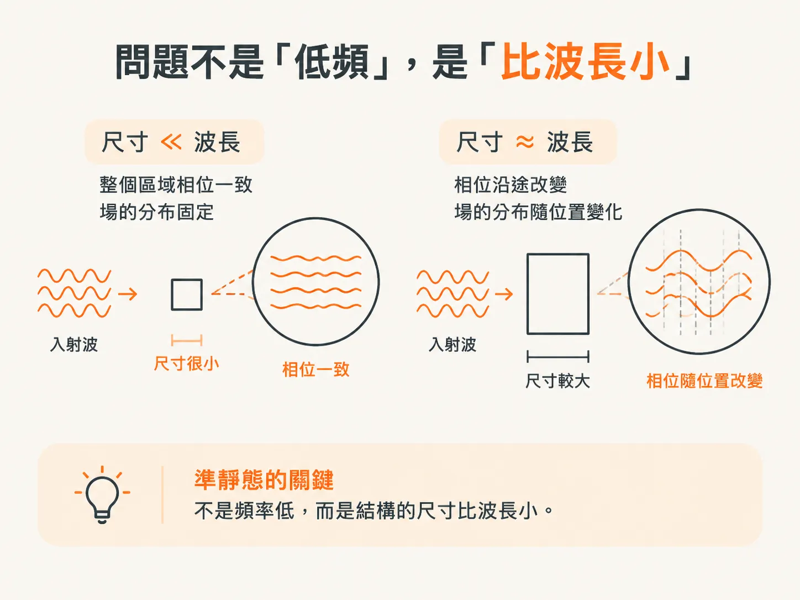
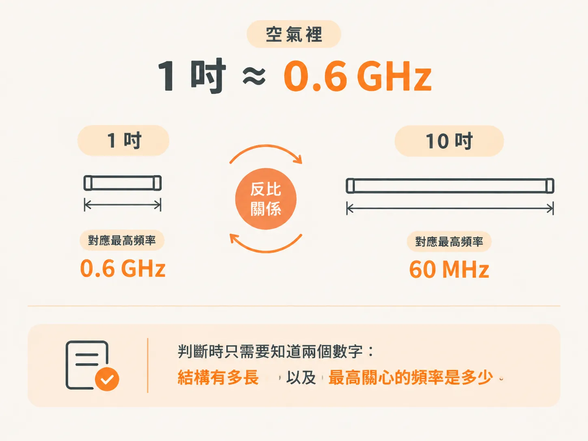
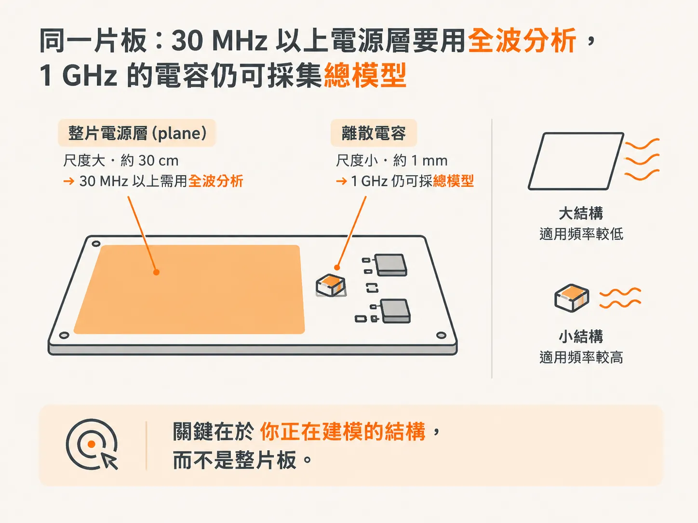

# 電感的 quasi-static 近似

第 3 步最後留下的問題是：`Z = jωL` 假設 L 是一個 lumped 元件，這個假設什麼時候會失效？答案不在於頻率高低，而在於尺寸與波長的比值。

## 問題不是「低頻」，而是「尺寸遠小於波長」

空間中某個區域的電場或磁場一旦改變，這個變化就會以有限的速度傳播到其他區域。這就是電磁波傳播的本質。

要完整描述這個過程，需要使用四個 Maxwell 方程，考慮電磁場隨時間與空間的變化，並處理電磁波在自由空間中的傳播。這屬於 full-wave 分析：它可以計算任意尺寸的問題，代價則是需要更複雜的工具，也需要更長的求解時間。

如果一個區域內的傳播時間遠短於一個週期，整個區域的相位變化就會很小，因此可以忽略傳播效應。相位幾乎處處相同，不代表場在每個位置都一樣；而是指場的空間分布不隨時間改變。

這個假設稱為 quasi-static；不採用這個假設，就稱為 full-wave。quasi-static 的適用條件是：問題尺寸必須遠小於最高關心頻率所對應的波長。它的好處是能更快得到答案。

同一條 10 cm 的迴路，在 MHz 等級的頻率下，整段幾乎維持相同相位；頻率提高後，迴路上不同位置的相位就會開始出現差異。

所以，這不是低頻假設，而是尺寸遠小於波長的假設。同一個結構，頻率一高，這個假設就可能失效。

## 1/20 的三種說法，其實都是同一條界線

這個條件可以用三種等價的方式描述：

1. 問題區域內的相位變化很小，小於 1/20 個週期。
2. 問題區域的尺寸遠小於最短波長，小於波長的 1/20。
3. 電磁波穿過問題區域所需的時間很短，小於振盪週期的 1/20。

實務上的經驗法則（rule of thumb）是：結構尺寸小於最高關心頻率所對應波長的 1/20；或者，傳播延遲短於週期的 1/20；又或者，相位延遲小於 360／20，也就是 18 度。

書上給猶豫不決的人一條很乾脆的規則：如果你還在猶豫該用 1/10 還是 1/20，就別用 quasi-static，直接用 full-wave。

記住其中一條，另外兩條就能自行換算。

## 在空氣中，1 吋 ≈ 0.6 GHz

把條件改寫成尺寸、波速與頻率之間的關係，其中 Len 代表物體長度，v 是介質中的波速，f 是場變化的頻率。

空氣中的波速約為每奈秒 12 吋。因此，依照「長度小於波長的 1/20」這個條件換算，1 吋大的結構在約 0.6 GHz 以下可以使用 quasi-static。

這個頻率上限與結構長度成反比。尺寸縮小到 0.1 吋，門檻頻率就會提高一個數量級。

所以，判斷時只需要知道兩個數字：結構有多長，以及最高關心的頻率是多少。

## 同一片板子：30 MHz 以上的 plane 要用全波分析，1 GHz 的電容仍可視為 lumped 元件

在空氣中，1 GHz 時，即使是長達 1 cm 的結構，仍可近似為 lumped 元件。因此，即使頻率超過 1 GHz，把離散電容建模為 lumped RLC，仍然有效。

如果結構埋在 FR4 這類介質中，波的傳播速度會減半，quasi-static 適用的最高頻率也會降至一半。

一片長寬各約 30 cm（12 吋）的典型電路板，在約 30 MHz 以上就會開始出現 full-wave 效應。因此，30 MHz 以上，power 與 ground plane 的電氣特性就必須納入全波分析與傳播效應的考量——這正是 power／ground cavity 共振的來源。

把這兩件事放在一起看，似乎互相矛盾：離散電容在 1 GHz 以上仍可用 quasi-static 建模，大型電路板卻在 30 MHz 以上就需要使用全波分析。

其實並不矛盾，因為判斷的對象是「你正在建模的結構」。整片 plane 是一個長達 30 cm 的結構；板上的電容則是 1 mm 等級的元件。在同一個頻率下，一個結構可能已超出適用範圍，另一個卻還差得很遠。

「多大的板子需要全波分析」沒有固定答案，因為判斷依據不是板子的整體尺寸，而是每個需要建模的結構。

## 用一條 10 cm 的線圈，看看這條規則有多準

書上的例子是：使用 18-gauge、外徑 49 mil 的銅線，繞成直徑約 10 cm 的圓環，周圍介質為空氣；圓環周長約 0.3 m，也就是 12 吋。

依照 1/20 規則預測，full-wave 效應大約會從 0.6／12 GHz，也就是 50 MHz 左右開始出現。

使用 VNA 的 two-port 方法量測阻抗，再由阻抗反推出 L 隨頻率變化的情形。結果顯示，在 40 MHz 以下，量測值與理想電感的差距小於 10%；在 60 MHz 以下，差距小於 20%。超過這個範圍後，full-wave 效應就會開始影響反推出來的 L。

預測值是 50 MHz，實測則落在 40～60 MHz 左右。這個門檻不是一道懸崖，而是一條誤差逐漸增加的界線。

1/20 指的是「誤差開始變得明顯」的位置。若要提高準確度，可以在這個門檻以下使用 quasi-static，或直接改用全波分析。

現在你知道什麼時候可以把 L 當成一個數字了。但為什麼「更短、更寬、更近」會讓 L 變小？這得從能量看起。
