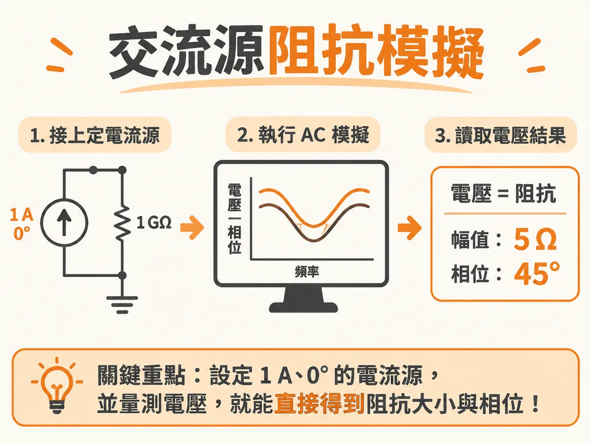

# 交流源阻抗模擬

## 問題

當電路只有單一元件時，用手算頻率對應的阻抗很簡單。但是電路每增加一個元件，計算量就會成倍暴增，人工計算非常困難且容易出錯。

## 前置條件

- 待測網路必須完全由理想、線性且非時變（linear, time-invariant）的元件組成。
- 準備好一套支援交流分析的電路模擬工具，例如免費開源的 QUCS 或高階工程工具 Keysight ADS。

## 步驟

1. 在待測電路的輸入端接上一個理想的定電流交流源（constant current AC source）。
2. 將該交流電流源的振幅設定為 1 A，相位設定為 0 度。
3. 在電流源輸出端與地線之間，並聯一顆 1 GΩ 的接地電阻。
4. 設定並執行交流頻域模擬（AC simulation）。
5. 讀取電流源輸出節點的電壓曲線。此時節點的電壓振幅（伏特）在數值上直接等於阻抗（歐姆），電壓相位也完全等於阻抗相位。

## 例子

在 QUCS 模擬器中分析一組多元件電路時，接上振幅 1 A、相位 0 度的交流電流源，並在節點掛上一顆 1 GΩ 接地電阻。啟動模擬後，若特定頻率下的輸出電壓為 5 V、相位為 45 度，就代表該電路在該頻率下的阻抗大小剛好是 5 Ω，阻抗相位為 45 度。

## 失敗模式

- **未接 1 GΩ 接地電阻**：許多 SPICE 模擬器要求每個節點都必須有一條通往地線的直流路徑（DC path to ground）。如果待測端開路或接上純電容，節點會失去對地直流路徑，導致模擬器矩陣無法求解而報錯當掉。
- **量測極高阻抗失真**：因為並聯了一顆 1 GΩ 電阻，電路能測量的阻抗上限會被限制在 1 GΩ 左右。如果待測負載本身的阻抗接近或大於 1 GΩ，測得的數值就會失真。

## 進階

根據交流電路的數學關係，電壓等於電流乘以阻抗：

$$V(\omega) = I(\omega) \times Z(\omega)$$

在頻域中，電壓、電流與阻抗都是包含振幅與相位的複數。只要把電流 $I(\omega)$ 固定設為振幅 1 A、相位 0 度，算式中的複數電壓數值就會與複數阻抗完全相等。這代表不需要額外運算，只要量測電壓就能直接得到阻抗大小與相位。無論使用輕巧的 QUCS 還是高階的 ADS，計算出來的結果完全一致。
