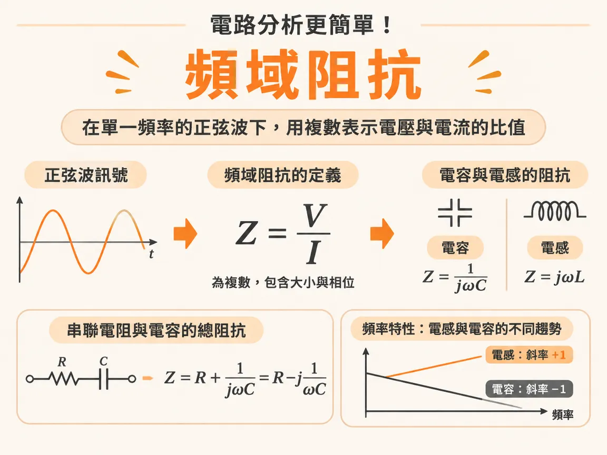

# 頻域阻抗

## 定義

頻域阻抗是電路元件在單一頻率正弦波訊號下，電壓與電流的比值。

在電學中，阻抗（$Z$）的定義永遠是電壓（$V$）除以電流（$I$）。當訊號被限定為特定頻率的正弦波時，原本隨時間變化的複雜微積分運算，會簡化成包含 $j\omega$ 的純代數算式，例如電容阻抗 $1/j\omega C$ 與電感阻抗 $j\omega L$。

## 為什麼重要

如果直接在時域（隨時間變化的世界）分析電路，過程會非常棘手。

以電容為例，流過電容的電流取決於電壓變化的速率（斜率 $dV/dt$）。真實電路的電壓波形常有雜訊、震盪或階躍，斜率會劇烈跳動，導致時域阻抗與波形形狀緊密綁在一起，計算時必須解複雜的微分方程。

將訊號切換到頻域後，微分運算變成了單純的代數乘法。工程師不必花費大量時間解微積分，就能快速推導出系統響應。

## 如何運作

正弦波有一個特殊的數學特性：對正弦波進行微分，得到的依然是同頻率的正弦波，只是振幅乘上了角頻率 $\omega$（$\omega = 2\pi f$），且相位旋轉了 90 度。

在複數運算中，旋轉 90 度以虛數單位 $j$（即 $\sqrt{-1}$）表示。因此，時域中的微分運算 $d/dt$，在頻域中直接變成了乘上 $j\omega$：

- 電容電流公式從 $I(t) = C \cdot (dV(t)/dt)$ 變成代數形式，推導出電容阻抗為 $Z = 1 / j\omega C$。
- 電感阻抗同樣簡化為 $Z = j\omega L$。

因為公式中含有 $j$，代表頻域阻抗是一個複數，同時包含「大小與相位」，也可以拆成「實部與虛部」。其中虛數部分稱為「電抗」（$X$），由電感與電容的效應決定。

## 例子

以一個電阻（$R$）與電容（$C$）串聯的電路為例，其總頻域阻抗為：

$$Z = R + \frac{1}{j\omega C} = R - j\frac{1}{\omega C}$$

這個算式中，實部就是電阻值 $R$，虛部（電抗 $X$）則是 $-1/\omega C$。

在對數座標圖（波德圖）上觀察時：
- 理想電容的阻抗大小與頻率成反比。頻率增加 10 倍，阻抗縮小為 1/10（衰減 20 dB），呈現斜率為 $-1$ 的直線（每十倍頻下降 20 dB）。
- 理想電感的阻抗大小與頻率成正比。頻率增加 10 倍，阻抗增加 10 倍，呈現斜率為 $+1$ 的直線（每十倍頻上升 20 dB）。

## 邊界與常見誤解

常見的誤解是認為「阻抗在時域與頻域是不同的物理量」。事實上，無論在時域還是頻域，阻抗的物理定義完全相同，都是電壓除以電流（$Z = V / I$）。

頻域阻抗的簡化有一個前提：訊號必須被限定為純粹的單一頻率正弦波。如果訊號包含非正弦的動態跳變，雖然在頻域容易運算，但電路的最終實際效能（例如電源軌上的電壓漣波峰對峰值）通常還是需要在時域中評估。

## 進階

在電源完整性（PDN）分析中，阻抗定義還能擴展到多個位置之間。例如量測不同位置的兩個平面之間的電壓與注入電流之比，即可計算出「轉移阻抗」（transfer impedance）。

此外，工程師在雙對數座標圖上分析電源分配網路時，只要觀察阻抗曲線的斜率是 $+1$ 還是 $-1$，就能立刻辨認出該頻率區間是由電感效應還是電容效應所主導。
