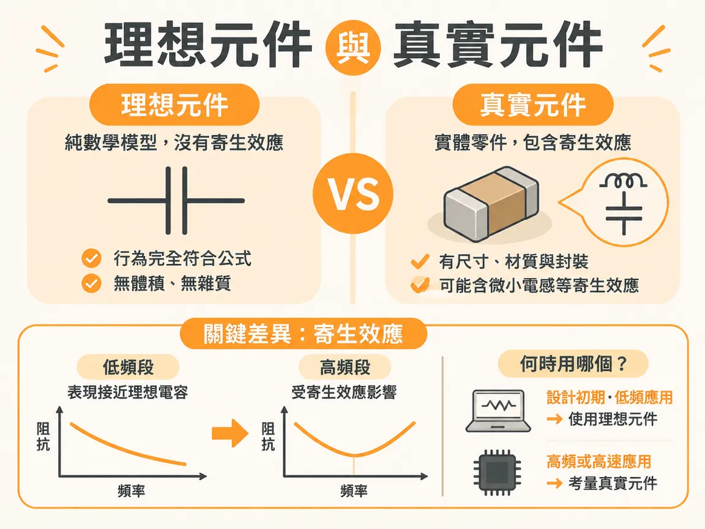

# 理想元件與真實元件

## A 是什麼

理想電路元件是只存在於電腦模擬中的純數學模型。

它具有精確且固定的數學定義。舉例來說，在模擬軟體中拉出一顆理想電容，它的阻抗就會完全按照理論公式運作：頻率越高，阻抗就越低。它沒有體積、沒有重量，也沒有任何多餘的雜質，是工程師用來簡化問題、近似真實世界的抽象工具。

## B 是什麼

真實電路元件是實際看得到、摸得到的實體零件，例如焊接在電路板上的晶片電容。

它具有特定的長寬大小、封裝形狀以及製造材質，實際的物理行為完全遵循馬克士威方程式。正因為它是實體結構，所以必然包含非預期的額外特性，也就是「寄生效應」（例如接腳結構帶來的微小電感）。真實元件的阻抗不能只靠公式空想，必須透過向量網路分析儀等儀器實際量測。

## 關鍵差異

兩者最大的差別在於「寄生效應」是否存在。雖然電路圖符號和實體零件都叫做電容，但真實電容的本質其實是「理想電容加上寄生效應」，只有在特定頻段才會表現得像理想電容。

以一顆焊接在四層板上的 0603 封裝積層陶瓷電容（MLCC）為例：
- 在 3 MHz 以下的低頻段，真實電容的量測阻抗與一顆 182 nF 的理想電容幾乎完全重疊。
- 在 3 MHz 以上的高頻段，真實電容受到內部結構與封裝的寄生效應影響，阻抗不再隨著頻率上升而下降，徹底偏離了理想電容的特性。

## 何時用哪個

- **使用理想元件**：適合在電路設計初期進行概念驗證，或是電路運作頻率非常低、寄生效應微小到可以忽略的時候。此時直接用理想電路模型模擬，運算最快速且容易理解。
- **考量真實元件**：當電路運作頻率提高（例如超過數個 MHz），或者正在處理高速數位訊號與電源完整性時，寄生效應會大幅改變訊號行為，此時絕不能只依賴理想元件，必須改用真實量測數據或考慮寄生效應的模型。

## 進階

若想在模擬軟體中還原真實元件的行為，一種常見做法是將網路分析儀量測到的阻抗轉換為「S 參數」（一種描述高頻電氣特性的行為模型）。

不過，要將 S 參數與傳統的電阻、電感、電容和傳輸線放在同一個電路中模擬，需要專門的模擬工具支援。此外，行為模型完全仰賴量測品質，如果不知道當初的量測環境與設定細節，直接套用 S 參數往往會帶來極大的模擬誤差與風險。
