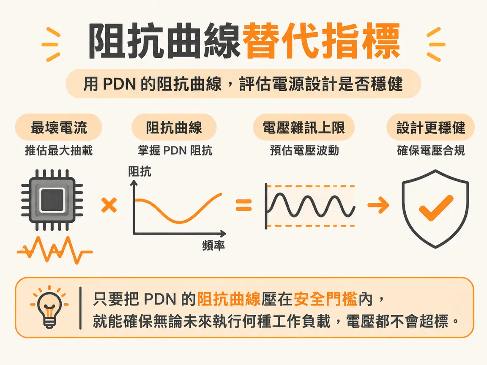

# 阻抗曲線替代指標

## 定義

阻抗曲線替代指標，是指在無法預測或窮舉晶片所有用電情境時，改用電源分配網路（PDN）在各頻率下的阻抗大小，來代表並評估整體電源設計是否穩健的量化標準。

電源分配網路就是把電源乾淨送到晶片的導線與元件路徑。因為電阻與感抗會隨頻率改變，這條路徑在不同頻率下的阻力分佈，就稱為阻抗曲線。

## 為什麼重要

電源設計的最終合格標準，是晶片端收到的電壓必須維持在規格內，也就是平均工作電壓加上允許的交流漣波。

但在實際測試時，光靠實測電壓根本無法保證系統安全：
- 終端使用者執行的微碼與運算情境千變萬化，工程師不可能在實驗室測完所有可能出現的電流波形。
- 在電路板上跑某段程式時電壓合格，換了另一段微碼可能就超標。
- 晶片焊墊端實際承受的電壓雜訊，通常比電路板上量到的還要嚴重。

如果只被動量測單一條件下的電壓，就無法確定電源設計是否真正穩健。

## 如何運作

這個方法是回歸電路的一階近似原理：晶片運作時產生的電壓雜訊，本質上就是晶片抽取的電流頻譜，流經電源網路阻抗時所形成的壓降。

整個評估流程如下：
1. **推估最壞電流**：雖然無法知道每一種運算情境，但可以透過邏輯閘使用率，推估或模擬出晶片在最壞情況下的最大抽載電流。
2. **掌握網路阻抗**：電源分配網路本身的阻抗曲線，可以透過計算、模擬或儀器量測精準取得。
3. **壓低雜訊上限**：將最壞電流乘上網路阻抗，就能算出預期的電壓雜訊上限。

因此，只要把電源分配網路的阻抗曲線壓在安全門檻內，無論晶片未來執行何種工作負載，電壓雜訊都不會超出允許範圍。

## 例子

工程師在測試高速數位系統時，晶片執行特定一段測試程式碼，電路板上量到的電壓波動完全合格。

如果只看電壓合格就結案，當使用者未來執行不同的微碼時，瞬間抽載的頻率可能剛好落在電源網路阻抗偏高的頻段，導致晶片焊墊處電壓崩跌而當機。

改用阻抗曲線作為替代指標時，工程師在設計階段就量測並模擬整條電源路徑，確認所有頻段的阻抗都低於安全門檻。如此一來，即使晶片換跑完全不同的微碼，系統也能承受極端的電流變化。

## 邊界與常見誤解

最常見的誤解是「只要在電路板上量到的電壓漣波過關，電源設計就算完成」。事實上，電路板量測點往往無法反映晶片焊墊端真實承受的嚴重雜訊，而且單一程式的測試結果無法代表所有工作情境。

另一個誤解是以為必須窮舉並量出晶片在每種功能下的真實動態電流波形才能做設計。實際上，只要掌握最壞情況的抽載電流，並把阻抗曲線控制好，就能確保設計安全。

## 進階

當阻抗曲線被確立為評估穩健性的替代指標後，原本難以捉摸的動態電壓漣波問題，便能簡化為具體的「目標阻抗」（target impedance）設計。

工程師不必再追著千變萬化的程式碼測試電壓，而是專注於被動元件挑選與電路板實體佈局，透過控制阻抗的物理細節，打造兼顧穩定性與成本效益的電源分配網路。
