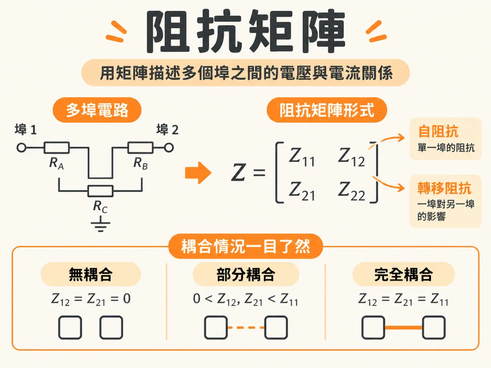

# 阻抗矩陣

## 定義

阻抗矩陣（Impedance Matrix，常簡稱 Z 矩陣）是用來描述多個接線端口（埠）之間電壓與電流關係的數學表格。

在電路中，每一對端點稱為一個「埠」（port）。在一個 $n$ 埠電路中，阻抗矩陣把每個埠的電壓和電流關聯起來，其通式為：

$$Z_{jk} = \frac{V_j}{I_k}$$

其中 $V_j$ 是埠 $j$ 的電壓，$I_k$ 是流入埠 $k$ 的電流。矩陣對角線上的元素稱為「自阻抗」，代表單一埠本身的阻抗；非對角線上的元素稱為「轉移阻抗」，代表一個埠的電流在另一個埠所感應出的電壓比例。

## 為什麼重要

當電路只有一對端點時，阻抗只是單純的電壓除以電流。但現代電路（例如電源分配網路或高速晶片接腳）往往有非常多對端點，彼此還會互相干擾。

如果端點數量增加，電路分析的複雜度會呈指數增長。使用阻抗矩陣，工程師可以用統一的結構記錄所有埠的自身反應與互相串擾的程度。只要看矩陣裡的數值，就能清楚知道某個位置抽換電流時，會在另一個位置產生多少雜訊電壓。

## 如何運作

以包含兩個埠的雙埠電路為例，系統共有兩個電壓與兩個電流，可以寫成聯立方程式：

$$V_1 = Z_{11} I_1 + Z_{12} I_2$$
$$V_2 = Z_{21} I_1 + Z_{22} I_2$$

要測量或計算矩陣中的各個元素，方法是讓其他埠保持「開路」（電流為 0，不接負載）：

1. **自阻抗（$Z_{11}$、$Z_{22}$）**：當埠 2 開路（$I_2 = 0$）時，在埠 1 注入電流 $I_1$ 並測量埠 1 的電壓 $V_1$，此時 $Z_{11} = V_1 / I_1$。這代表只看該埠時本身的阻抗。
2. **轉移阻抗（$Z_{12}$、$Z_{21}$）**：當埠 1 開路（$I_1 = 0$）時，在埠 2 注入電流 $I_2$，測量埠 1 感應到的電壓 $V_1$，此時 $Z_{12} = V_1 / I_2$。

透過轉移阻抗與自阻抗的相對大小，可以判定埠之間的耦合狀態：
- **無耦合**：轉移阻抗為 $0\ \Omega$（$Z_{12} = Z_{21} = 0$），代表兩埠完全獨立，彼此不影響。
- **完全耦合**：轉移阻抗等於自阻抗（$Z_{12} = Z_{21} = Z_{11} = Z_{22}$），代表兩埠如同直接短接。
- **部分耦合**：轉移阻抗介於 0 與自阻抗之間，數值越大代表耦合越強。

## 例子

考慮兩個純電阻分支匯流到同一個接地電阻的電路：
- 埠 1 串接電阻 $R_A$。
- 埠 2 串接電阻 $R_B$。
- 兩者在接回返回路徑前，共同流經一個共用電阻 $R_C$。

當埠 2 開路時，$I_1$ 同時流經 $R_A$ 與 $R_C$，所以埠 1 的自阻抗為：

$$Z_{11} = R_A + R_C$$

同理，埠 2 的自阻抗為 $Z_{22} = R_B + R_C$。

當埠 1 開路（$I_1 = 0$）而在埠 2 注入電流 $I_2$ 時，電流 $I_2$ 流經共用電阻 $R_C$，在 $R_C$ 兩端產生電壓 $I_2 \cdot R_C$。因為埠 1 沒有電流，所以電阻 $R_A$ 沒有壓降，這個電壓會完整出現在埠 1 端點上（$V_1 = I_2 \cdot R_C$）。因此轉移阻抗為：

$$Z_{12} = \frac{V_1}{I_2} = R_C$$

整個阻抗矩陣即為：

$$\mathbf{Z} = \begin{bmatrix} R_A + R_C & R_C \\ R_C & R_B + R_C \end{bmatrix}$$

若共用電阻 $R_C$ 為 0，轉移阻抗就變成 0，表示兩埠完全無耦合。

## 邊界與常見誤解

常見的誤解是把轉移阻抗當成「直接跨接在兩個埠之間的實體電阻」，或以為拿三用電表量測兩埠正端之間測得的電阻就是轉移阻抗。

事實上，轉移阻抗不是實體元件，而是「在一處注入電流、在另一處感應到電壓」的比例比值。例如在共用路徑的電路中，轉移阻抗是由共用回流阻抗造成的，而不是兩埠之間有直接連線。

此外，阻抗矩陣方法適用於線性、被動且非時變（LTI）的系統。電路內部的元件特性必須固定，輸入特定頻率的正弦波時，輸出也只會落在該頻率上。除了少數鐵氧體（ferrite）元件外，絕大多數被動互連結構都符合這個條件。

## 進階

在實際高速電路中，元件常包含電感與電容，阻抗元素會隨頻率變化，在頻域中以複數表示：

$$Z_{jk}(f) = \frac{V_j(f)}{I_k(f)}$$

在模擬軟體（如 SPICE）中，提取方式是在待測埠加上振幅為 $1\ \text{A}$ 的交流電流源，其餘埠保持懸空開路，此時各埠量測到的電壓數值就直接等於該欄對應的阻抗值。

例如，當兩個含有電容與電感的支路共用一個 $5\ \text{nH}$ 的引線電感回流時：
- 低頻時，各埠的自阻抗由各自的電容主導。
- 高頻時，電容短路，自阻抗變成自身電感加上共用電感。
- 在整個頻段上，轉移阻抗 $Z_{12}$ 與 $Z_{21}$ 的響應曲線都剛好等於該顆 $5\ \text{nH}$ 共用引線電感的阻抗。

這套架構不僅可用於集總元件，也能完整描述傳輸線與電源平面構成的腔體結構。
