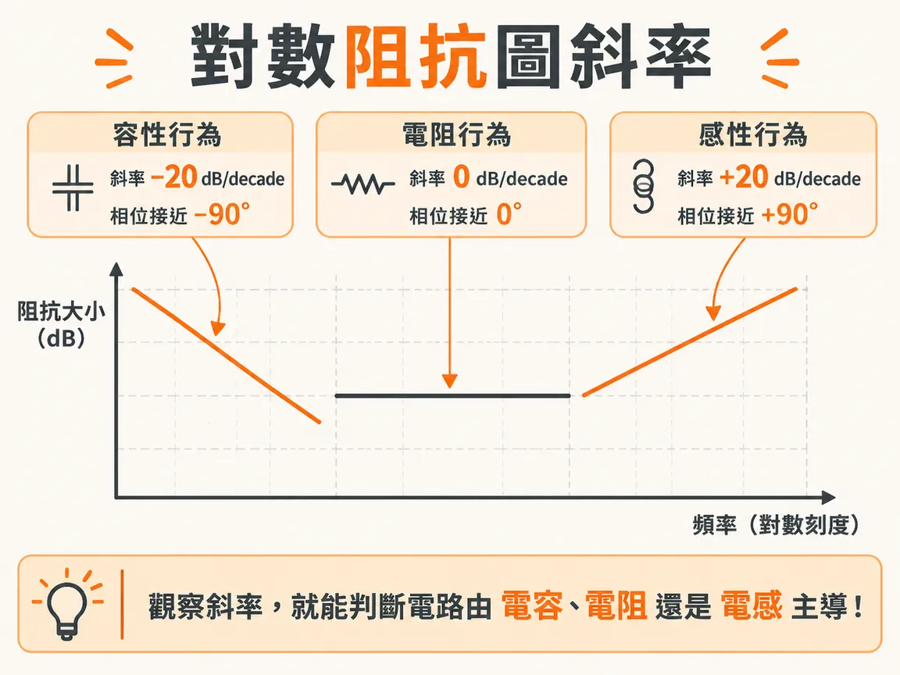

# 對數阻抗圖斜率

## 問題

在分析電源分配網路或高頻電路時，工程師常看阻抗對頻率的走勢圖。阻抗就是電壓除以電流的比值。如果圖表上只有阻抗大小而沒有畫出相位，當曲線上下起伏時，我們很難一眼看出電路在某個頻率下到底是由電容主導還是電感主導。

## 前置條件

- 圖表必須是雙對數座標（橫軸頻率與縱軸阻抗大小皆取對數）。
- 理解阻抗在頻域中同時包含「大小」與「相位」。

## 步驟

1. **鎖定目標頻段**：在圖表上選出想要分析的頻率範圍，觀察阻抗大小曲線的走向。
2. **判讀曲線斜率**：計算頻率每增加 10 倍（每十倍頻）時，阻抗大小的變化量：
   - **斜率為 $-20\text{ dB/decade}$**（即對數斜率為 $-1$）：代表電路呈現「容性」，阻抗相位接近 $-90$ 度。
   - **斜率為 $+20\text{ dB/decade}$**（即對數斜率為 $+1$）：代表電路呈現「感性」，阻抗相位接近 $+90$ 度。
   - **斜率為 $0\text{ dB/decade}$**（水平線）：代表電路呈現純電阻特性，阻抗相位接近 $0$ 度。
3. **確認主導元件**：依據斜率反推電路當下是由電容、電感還是電阻效應主導。

## 例子

- **理想電容**：阻抗大小為 $1/\omega C$。當頻率增加 10 倍，阻抗縮小為原來的十分之一，也就是下降 20 dB。在雙對數圖上會畫出一條斜率為 $-20\text{ dB/decade}$ 的直線，相位固定為 $-90$ 度。
- **理想電感**：阻抗大小為 $\omega L$。當頻率增加 10 倍，阻抗放大 10 倍，也就是上升 20 dB。在雙對數圖上呈現斜率為 $+20\text{ dB/decade}$ 的直線，相位固定為 $+90$ 度。

## 失敗模式

- **混淆阻抗與元件數值**：誤以為斜率上升或下降代表電感量（$L$）或電容量（$C$）在變動。實際上，理想電容的電容值與理想電感的電感值都是固定常數，隨頻率改變的是它們的「阻抗大小」，而不是元件本身的值。
- **未使用雙對數座標**：若在線性座標下觀察，電容與電感的阻抗變化不會呈現筆直的直線，無法直接套用每十倍頻變化 20 dB 的規則來快速判讀。

## 進階

光看阻抗曲線斜率就能反推相位，背後的物理法則是「克拉莫—克羅尼希關係式」（Kramers-Kronig relationship）。真實物理系統必須遵守因果律（反應永遠發生在刺激之後），這項限制讓頻域中阻抗的實部與虛部相互綁定。因此，阻抗大小的變化形狀直接決定了它的相位。這也是為什麼工程軟體模擬時，工程師往往只需要觀察雙對數阻抗大小圖，就能掌握電路完整的行為模式。
