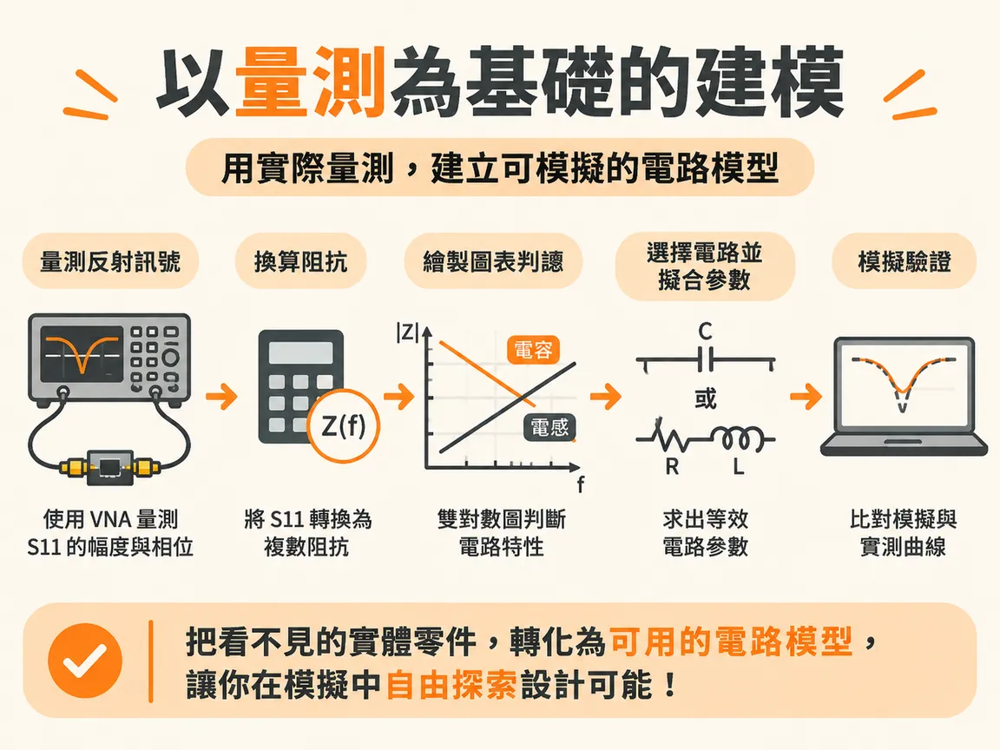

# 以量測為基礎的建模

## 問題

實體的金屬導線或晶片接腳在高頻訊號下，會表現出看不見的電阻、電感與電容。因為沒有現成的電路模型，工程師無法直接將這些實體線路放進模擬軟體中，也無法修改參數來探索「如果尺寸改變會怎樣」的假設情境。

## 前置條件

- 待測零件與測試治具：將待測物（例如封裝接腳或銅線）焊接在標準接頭（如 SMA 接頭）上。
- 向量網路分析儀（VNA）：能夠逐步發出各頻率的正弦波，並量測反射回來的散射參數（$S_{11}$ 的振幅與相位）。
- 先行建立物理預期：遵守工程原則，量測前必須根據零件尺寸先推估行為。例如判斷結構在低頻是偏向電容還是電感，並計算尺寸達到十分之一波長（$\frac{1}{10}$ 波長）的頻率上限，確定集中參數模型在哪個頻段內有效。

## 步驟

1. 量測反射訊號：將待測物接上單埠 VNA，在設定頻率範圍內量測反射損耗（$S_{11}$ 的大小與相位）。
2. 逐頻換算阻抗：利用複數代數運算，將每個頻率點測得的 $S_{11}$ 換算成待測物的複數輸入阻抗 $Z(f)$。
3. 繪製雙對數座標圖判讀特性：將阻抗大小對頻率畫在雙對數圖上。若曲線斜率為 $-1$，代表該頻段呈現理想電容特性；若斜率為 $+1$，代表呈現理想電感特性。
4. 選擇電路拓撲並反推參數：
   - 若為純電容行為，比對電容公式擬合出等效電容值 $C$。
   - 若為電阻與電感串聯（$Z = R + j\omega L$），以阻抗實部當作電阻 $R$，阻抗虛部除以角頻率（$\text{Im}(Z) / \omega$）計算出電感 $L$。
5. 在模擬軟體中驗證：將提取出的理想電路元件放入 SPICE 等模擬軟體，比對模擬阻抗曲線與實測曲線是否重合。

## 例子

- 陶瓷雙列直插封裝（DIP）接腳：將相鄰兩隻接腳焊上 SMA 治具，封裝內部保持開路。因為末端完全開路，量測到的 $S_{11}$ 振幅全程幾乎都是 0 dB，阻抗資訊全編碼在相位中。阻抗在雙對數圖上呈現斜率 $-1$ 的直線，在低頻段成功擬合出約 4.8 pF 的單一理想電容，直到 800 MHz 附近才轉折呈現電感性。
- 直徑 1 吋的圓形銅線迴路：圓周長約 3 吋，在 400 MHz 以下尺寸小於十分之一波長。阻抗斜率為 $+1$，將其簡化為電阻串聯電感（R+L），成功從阻抗實部提取出串聯電阻，並從虛部除以角頻率提取出穩定的等效電感值。

## 失敗模式

- 混淆反射相位與阻抗相位：$S_{11}$ 的相位不等於阻抗的相位。兩者雖然都是複數，但轉換關係非常複雜，不能直接看 $S_{11}$ 的相位曲線來猜測阻抗走勢。
- 超出集中參數適用頻率：當頻率升高導致波長縮短，使零件尺寸超過十分之一波長時（例如 1 吋迴路超過 400 MHz），分布參數效應會讓計算出的電感值急遽飆升，模型隨之失效。
- 極低阻抗的儀器限制：當待測物阻抗低於約 0.1 Ω 時，單埠量測容易受限於儀器動態範圍與接觸電阻，使提取出來的數據產生劇烈跳動與雜訊假象。
- 治具寄生感應干擾：萃取出的數值如果沒有扣除 SMA 接頭與焊接處的寄生特徵，會誤把治具的電感當作零件本身的電感。

## 進階

完成建模並確認擬合良好後，這個過程相當於成功拆解了實體互連線（hacking the interconnect）。因為原本看不見的實體零件已經轉化為可縮放的理想電路模型，工程師可以在模擬環境中自由調整 R、L、C 數值，快速評估不同的設計變更與假設情境（what-if questions），找出高頻雜訊或電氣特性的根本物理成因。
