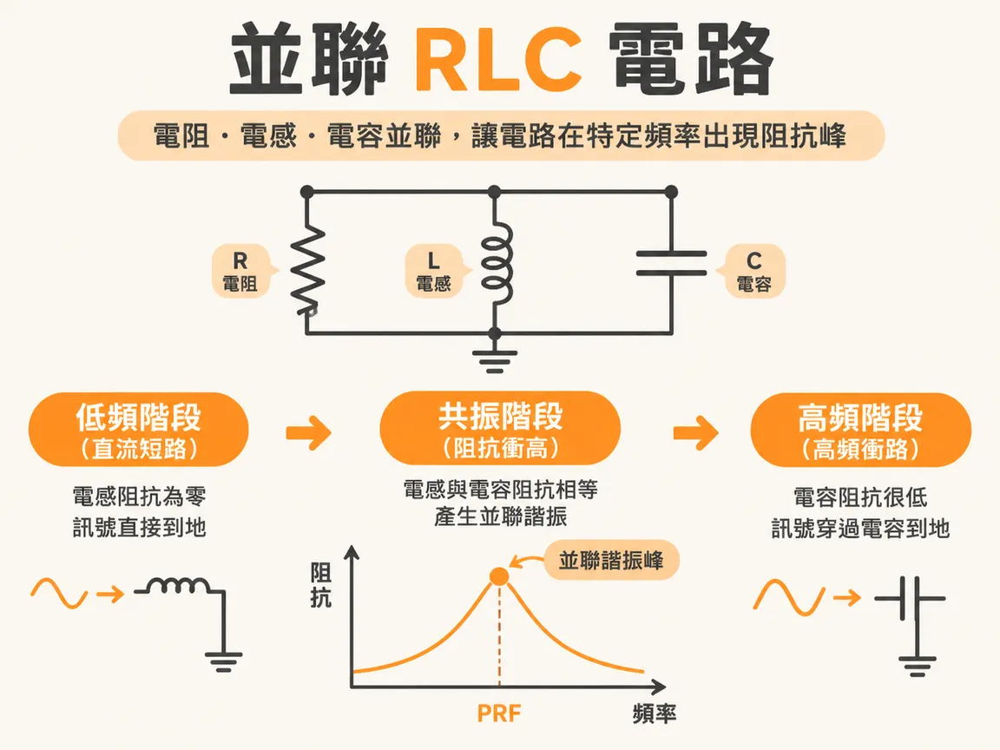

# 並聯 RLC 電路

## 定義

並聯 RLC 電路是一種把電阻（R）、電感（L）與電容（C）三個元件並排接在一起的電路架構。

在這種電路中，電流有三條平行的路徑可以走。訊號在極低頻與極高頻時都會直接流向接地端，只有在特定頻率時，電路才會出現巨大的阻力。

## 為什麼重要

在高速電路的電源分配網路（PDN）中，阻抗如果突然飆高，電源電壓就會產生嚴重的波動與雜訊，導致晶片無法正常運作。

電源電路中出現的阻抗高峰，幾乎全是由並聯 RLC 特性所造成。只要懂得並聯 RLC 的原理，工程師就能主動壓低這些阻抗峰值，讓電源保持乾淨穩定。

## 如何運作

並聯 RLC 電路的阻抗會隨著頻率改變，主要分成三個階段：

1. **低頻階段（直流短路）**：訊號頻率很低時，電路行為完全由電感決定。因為電感對直流電（DC）的阻抗是零，就像一條完全沒有阻力的導線，訊號會直接被短路到地。
2. **高頻階段（高頻短路）**：訊號頻率很高時，電路的行為改由電容主導。因為頻率越高，電容的阻抗就越低，極高頻訊號會穿過電容短路到地。
3. **共振階段（阻抗衝高）**：從低頻到高頻的過程中，電感的阻抗持續上升，電容的阻抗持續下降。當兩者的阻抗大小剛好相等時，電路會產生並聯諧振，阻抗會瞬間飆到最高點，形成「並聯諧振峰」。此時並聯的電阻會跳出來發揮阻尼作用，把最高阻抗限制在電阻本身的數值以內。

## 例子

假設電路包含一個 1 kΩ 的電阻、10 nH 的電感與 1 nF 的電容，三個元件彼此並聯。

阻抗達到最高點的頻率稱為「並聯諧振頻率（PRF）」，計算公式如下：

PRF = 1 / (2π × √(L × C))

將電感 10 nH 與電容 1 nF 代入公式後，算出的並聯諧振頻率剛好約為 50.3 MHz。

在 50.3 MHz 這個頻率點上，電路的整體阻抗會衝到最高峰，而這個峰值的大小會剛好被限制在 1 kΩ。

## 邊界與常見誤解

常見的誤解是認為並聯諧振點的阻抗一定會變成無限大。如果電路中只有電感與電容，理論上的阻抗確實是無限大；但只要有並聯電阻存在，最高阻抗就會被卡在電阻值本身，不會無限上升。

另一個容易混淆的點是頻率公式。雖然並聯電路在共振時阻抗最大，與串聯電路在共振時阻抗最小剛好相反，但兩者計算諧振頻率的數學條件與基本公式完全一樣。

## 進階

在高速數位系統中調整 PDN 特性時，可以把電路拆成兩個控制重點：

- **頻率位置**：由電感（L）與電容（C）的大小決定。改變這兩個數值，就可以移動諧振峰出現的頻率。
- **峰值高度**：由電阻（R）決定。電阻扮演吸收能量的阻尼角色，改變電阻值就能決定阻抗峰值會衝得多高。
