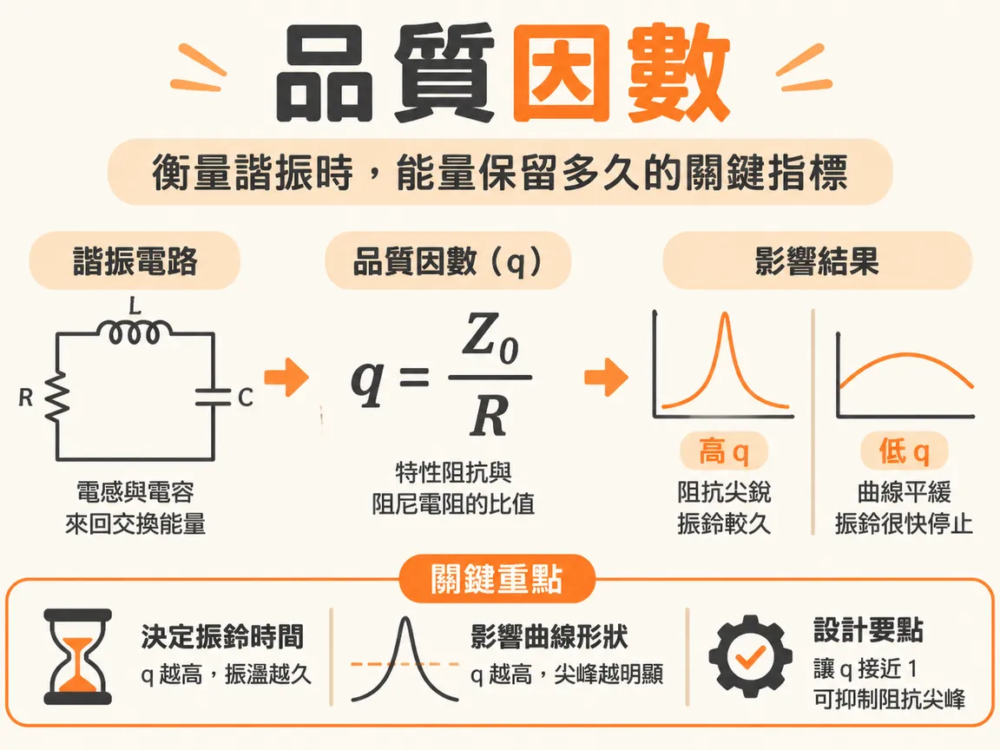

# 品質因數

## 定義

品質因數（q-factor）是用來衡量電路中「阻尼大小」與「相對電阻」的指標。

簡單來說，當電路發生諧振（能量在電感與電容之間來回震盪）時，品質因數代表系統每走一個週期能保留多少能量。它等於電路的特性阻抗與阻尼電阻的比值，也可以表示成諧振頻率與半功率頻寬（阻抗極值一半處的頻率跨度）的比值。

## 為什麼重要

品質因數決定了諧振時電路的兩大特徵：
1. **曲線有多尖銳**：它決定阻抗曲線在共振頻率附近是陡峭突起、深陷下凹，還是平緩寬闊。
2. **振鈴會響多久**：當電路受到訊號衝擊時，能量震盪（稱為振鈴）需要多久才會停下來，完全由品質因數決定。

在電源分配網路設計中，並聯諧振的阻抗尖峰會引發嚴重的電源雜訊與電壓漣波。只要掌握品質因數，就能迅速評估振鈴時間並算出阻抗極限。

## 如何運作

品質因數的數值高低，直接對應到電路的阻尼狀態：

- **高品質因數（例如 q = 10）**：阻尼極小，能量消耗得很慢。電路會持續振鈴很長一段時間，阻抗曲線上會出現又尖又窄的尖峰或深谷。串聯電路的振鈴表現在電流，並聯電路則表現在電壓。
- **低品質因數（例如 q = 0.1）**：阻尼很大，能量在每個振盪週期迅速耗散，振鈴很快就停止，阻抗曲線平緩且下凹較淺。
- **臨界阻尼（q = 0.5）**：這是完全不產生振鈴的前提下，訊號收斂最快的平衡點。當 q 大於 0.5 時電路開始出現振鈴，小於 0.5 時電路反應則會變得遲緩。

在串聯 RLC 電路中，特性阻抗計算為 $Z_0 = \sqrt{L / C}$，品質因數為 $q = Z_0 / R_{\text{series}}$，共振時的最低阻抗恰好等於 $Z_0 / q$。在並聯電路中，諧振時的阻抗峰值則約為 $Z_0 \times q$。

## 例子

假設一個電路的電感 $L = 10\text{ nH}$、電容 $C = 10\text{ nF}$，其特性阻抗為：

$$Z_0 = \sqrt{10\text{ nH} / 10\text{ nF}} = 1\ \Omega$$

當串聯電阻分別改變時，電路的表現截然不同：
- 若電阻為 $0.1\ \Omega$，算出的 $q = 1 / 0.1 = 10$。這是一個高 q 系統，串聯最低阻抗僅有 $0.1\ \Omega$，並聯時峰值阻抗則會衝上 $10\ \Omega$。
- 若電阻增加為 $1\ \Omega$，$q = 1 / 1 = 1$，阻抗曲線明顯變得平緩。
- 若電阻高達 $10\ \Omega$，$q = 1 / 10 = 0.1$。這是一個強阻尼系統，時域振鈴幾乎瞬間消失。

在實際元件中，大型鉭質電容擁有超大電容量，其品質因數極低，阻抗曲線非常平緩；而 1206 封裝的陶瓷電容（MLCC）因等效電阻僅有數毫歐姆，品質因數相對極高，共振點會呈現極為尖銳的深谷。

## 邊界與常見誤解

- **大寫 Q 與小寫 q 的差別**：一般文獻常以大寫 $Q$ 代表品質因數，但在電源完整性領域，為避免與電容器儲存的「電荷量 $Q$」混淆，工程上更習慣寫作小寫的 q-factor。
- **電阻變大，q-factor 不一定變小**：品質因數看的是電阻與特性阻抗的相對關係。例如 0402 封裝的小型 MLCC，其等效電阻比 1206 MLCC 高出約 50 倍，但因為電容值大幅降低，電路的特性阻抗 $Z_0$ 同步飆高。兩者相互抵消後，0402 電容的品質因數依然與大型 MLCC 差不多。

## 進階

在高速數位電路的電源設計中，核心目標是壓低並聯諧振的阻抗尖峰。工程上常把品質因數控制在接近 1，也就是讓電阻值貼近電路的特性阻抗 $Z_0$。

實務上抑制阻抗尖峰的手段包括增加串聯電阻、降低並聯電阻、選用較小的電感或較大的電容。此外，根據 Kramers-Kronig 關係，阻抗曲線越平坦、維持恆定阻抗的頻率範圍越寬，電路的相位就越接近理想電阻的 0 度。
