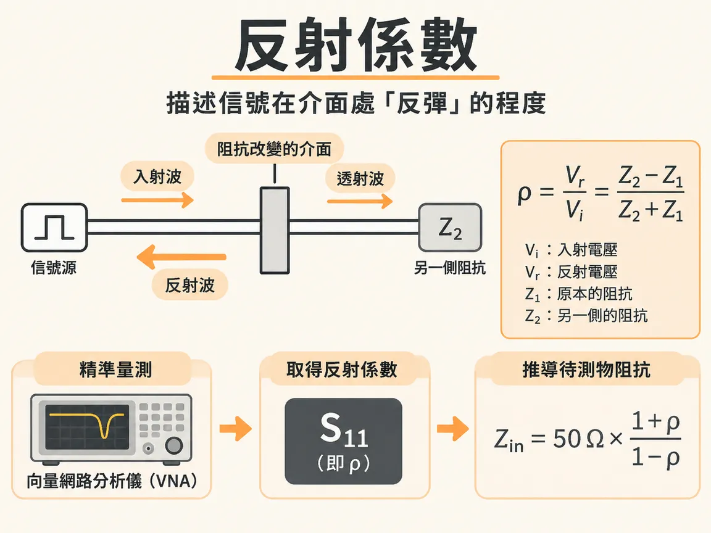

# 反射係數

## 定義

反射係數是信號傳遞時，從介面彈回來的反射電壓與原本打進去的入射電壓的比值，通常用符號 $\rho$ 表示。

當電磁波在傳輸線上前進，抵達兩個阻抗不同的交界面時，因為瞬間阻抗改變，就會產生反射波。反射係數的數學式為：

$$\rho = \frac{V_r}{V_i} = \frac{Z_2 - Z_1}{Z_2 + Z_1}$$

其中 $V_i$ 是入射電壓，$V_r$ 是反射電壓，$Z_1$ 是信號原本所在區域的瞬間阻抗，$Z_2$ 是介面另一側的瞬間阻抗。

## 為什麼重要

在極高頻與高速數位系統中，信號是以動態電磁波的形式高速傳播，而不是靜止的電位。工程師很難直接拿探針去量測特定點的電壓與電流比值（$V/I$）。

一般示波器只能量到量測點當下的總電壓，也就是正向波與反向波重疊後的數值，無法區分信號方向。如果我們能測出反射係數，並且已知來源端的參考阻抗（例如標準 50 Ω），就能不用實體碰觸待測點內部，直接由反射信號精準推導出待測物的輸入阻抗。

## 如何運作

信號在傳輸線前進時，隨時都在感受沿途每一步的瞬間阻抗。只要阻抗處處相等，電壓與電流波就會順暢前進。一旦遇到阻抗不連續的介面，邊界條件就會迫使一部分信號反射回訊號源。

如果把訊號源端的阻抗 $Z_1$ 固定為已知的標準阻抗（常見為 50 Ω），將反射係數公式移項整理，就能反推待測物（DUT）的輸入阻抗 $Z_{in}$：

$$Z_{in} = 50\ \Omega \times \frac{1 + \rho}{1 - \rho}$$

在實際儀器（如向量網路分析儀，VNA）中，儀器內部透過精密 50 Ω 電阻分壓獨立取得入射波電壓 $V_{incident}$，再量測包含入射與反射的總電壓 $V_{total}$。利用向量減法算出反射波：

$$V_{reflected} = V_{total} - V_{incident}$$

在頻域中，發出的信號為正弦波，反射係數是一個包含振幅與相位的複數。在單埠量測中，這個反射係數也就是散射參數中的 $S_{11}$（亦稱反射損耗）。藉由複數代數運算，能直接將 $S_{11}$ 換算成對應頻率下的複數阻抗。

## 例子

量測一個焊接在 SMA 治具上的陶瓷雙列直插封裝（DIP）接腳：
* 接腳末端保持開路時，能量無法被吸收，信號幾乎全數彈回。
* 測得的 $S_{11}$ 振幅在 10 MHz 到 1 GHz 之間幾乎是一條 0 dB 的平坦直線。
* 雖然振幅沒有變化，但接腳的物理特徵完整記錄在 $S_{11}$ 的相位中。將其換算為阻抗後，低頻呈現電容性（約 4.8 pF），到 800 MHz 附近轉折為電感性。

量測直徑 1 吋的微型銅線迴路：
* 迴路在 400 MHz 以下呈現電阻與電感串聯（$R + j\omega L$）行為。
* 藉由單埠量得的反射損耗換算出阻抗 $Z$ 後，阻抗實部即為等效電阻 $R$，虛部除以角頻率（$\mathrm{Im}(Z) / \omega$）即可反推等效電感 $L$。

## 邊界與常見誤解

* **反射係數的相位不等於阻抗的相位**：這是最常見的觀念混淆。雖然兩者都是複數，但阻抗的相位是由 $S_{11}$ 的振幅與相位經由複數公式綜合運算得出的，絕對不能把 $S_{11}$ 的相位曲線直接當作阻抗相位。
* **極低阻抗量測限制**：單埠反射量測在待測物阻抗極低（例如小於 0.1 Ω）時，受限於儀器動態範圍與治具接觸阻抗，計算出的數據會出現劇烈跳動與雜訊假象。
* **尺寸與頻率限制**：當待測物尺寸超過訊號波長的十分之一（例如 1 吋迴路在 400 MHz 以上），集中參數模型便不再適用，會出現分布參數效應，萃取出的電感值會迅速飆升。

## 進階

當待測物不是單一集中元件，而是包含治具與延伸導線的複雜結構時，正弦波進入結構後會在每個不連續點引發多次反射與來回彈跳（multiple bounces）。

線性系統有一項特性：頻率相同、振幅與相位不同的正弦波疊加後，合成波依然是同頻率的正弦波。因此，傳回訊號源的所有彈跳波疊加後，儀器量到的淨反射係數，完整打包了該結構的「總整合輸入阻抗」。這讓反射係數方法比單純的節點電壓電流比更具一般性，量測頻率可擴展至 50 GHz 以上。
