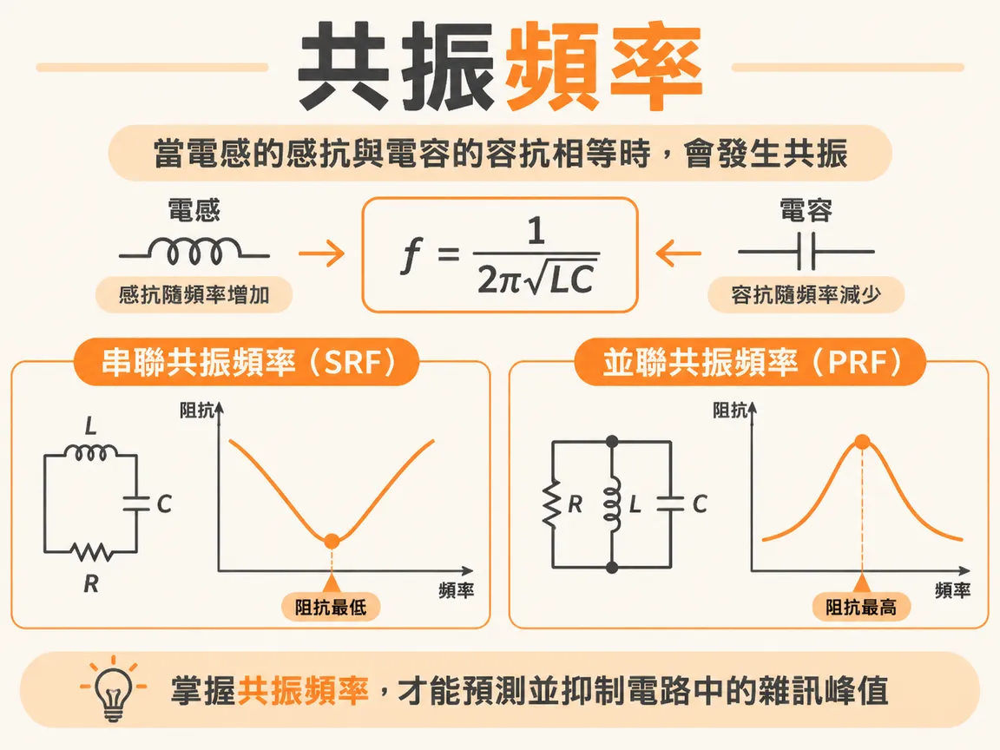

# 共振頻率

## 定義

共振頻率是指在同時含有電感與電容的電路中，電感抗拒交流電的「感抗」，剛好等於電容抗拒交流電的「容抗」時的特定頻率。

如果電感與電容是串聯在一起，這個點稱為串聯共振頻率（SRF）；如果是並聯在一起，則稱為並聯共振頻率（PRF）。

## 為什麼重要

在高速數位電路的電源設計中，電路的阻抗（對交流電的總阻力）會直接影響電壓是否穩定。如果阻抗太高，就會引發嚴重的電壓漣波與雜訊。

當訊號頻率碰上共振頻率時，電路的阻抗會出現極端變化：串聯時阻抗會摔到谷底，並聯時阻抗則會衝上最高峰。掌握共振頻率的位置，工程師才能提早預測並壓制雜訊峰值。

## 如何運作

電感與電容對頻率的反應剛好相反：

- 電感在低頻時阻抗極低（直流電時直接短路），頻率越高阻抗越大。
- 電容在極高頻時阻抗極低（高頻時直接短路），頻率越低阻抗越大。

當訊號頻率從低慢慢升高時，電感的感抗會不斷增加，電容的容抗則不斷縮小。到了某個特定的頻率點，感抗與容抗的大小剛好完全相等，這時就發生了共振。

計算共振頻率 $f$ 的公式為：

$$f = \frac{1}{2\pi\sqrt{LC}}$$

其中 $L$ 是電感值，$C$ 是電容值。

在共振頻率發生時，阻抗的極端值完全由電路中的電阻 $R$ 決定：
- 串聯電路的最低阻抗值，剛好等於串聯電阻值 $R$。
- 並聯電路的最高阻抗峰值，則剛好受限於並聯電阻值 $R$（電阻在此提供阻尼效果，避免阻抗衝到無限大）。

## 例子

考慮一個並聯 RLC 電路，三個元件數值如下：
- 電阻 $R = 1\text{ k}\Omega$
- 電感 $L = 10\text{ nH}$
- 電容 $C = 1\text{ nF}$

將電感與電容代入公式計算：

$$f = \frac{1}{2\pi\sqrt{10\text{ nH} \times 1\text{ nF}}} \approx 50.3\text{ MHz}$$

算出的並聯共振頻率（PRF）約為 $50.3\text{ MHz}$。在這個頻率點上，電路的阻抗會達到最高峰值，而這個峰值的大小剛好會被限制在 $1\text{ k}\Omega$。

## 邊界與常見誤解

- **電阻不會改變共振頻率的位置**：共振頻率只由電感值 $L$ 與電容值 $C$ 決定。電阻的角色是提供阻尼，負責決定共振時的波峰有多高或波谷有多深，而不是決定它發生在幾兆赫（MHz）。
- **RLC 特性阻抗不是傳輸線阻抗**：在共振點時，感抗或容抗的絕對值稱為該電路的「特性阻抗」$Z_0 = \sqrt{L/C}$。這純粹是描述該 RLC 電路本身的數值，與均勻傳輸線的特性阻抗完全無關，兩者不能混為一談。

## 進階

在分析真實電容（如鉭質電容或積層陶瓷電容 MLCC）時，工程師會先計算四項核心品質指標：共振頻率、特性阻抗（$Z_0$）、品質因子（q-factor）與極值阻抗。

品質因子決定了共振點附近的阻抗走勢是銳利還是平緩：
- 超大電容量的鉭質電容算出的 q-factor 很低，共振頻率附近的阻抗輪廓寬廣且平緩。
- 1206 封裝的陶瓷電容串聯電阻極低，算出的 q-factor 相當大，會在共振頻率處形成非常陡峭且尖銳的阻抗波谷。
