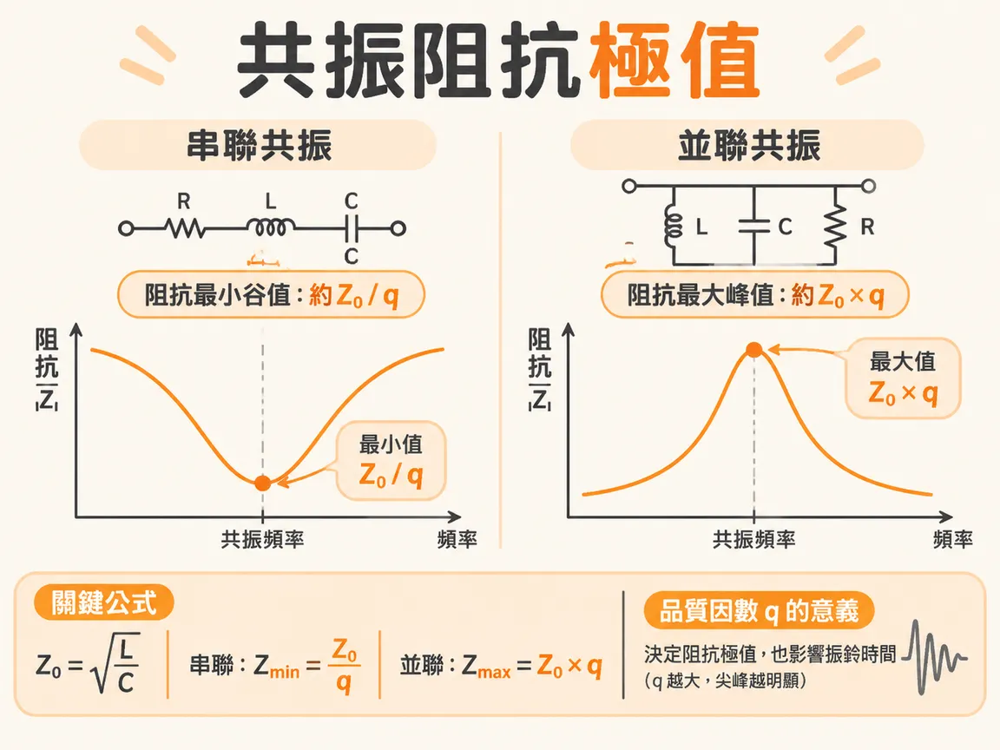

# 共振阻抗極值

## 主張

在 RLC 電路發生共振時，阻抗曲線的最高點或最低點，完全由電路的阻尼電阻與特性阻抗決定：

- 並聯共振的阻抗最大峰值約為 $Z_0 \times q$。
- 串聯共振的阻抗最小谷值約為 $Z_0 / q$。

其中 $Z_0 = \sqrt{L/C}$ 是電路的特性阻抗，$q$ 是品質因數（q-factor，用來衡量電路阻尼大小的數值）。

## 為什麼成立

當電路達到共振頻率時，電感產生的感抗與電容產生的容抗大小完全相等，方向相反，兩者剛好互相抵消。

這時候，阻抗大小就完全交給電路中的電阻來決定：

1. **串聯電路**：感抗與容抗抵消後，整體的最小阻抗就是串聯電阻 $R_{series}$。因為串聯電路的品質因數是 $q = Z_0 / R_{series}$，把公式換算一下，最低阻抗就是 $R_{series} = Z_0 / q$。當 $q$ 很大時，最低阻抗會遠小於 $Z_0$，在曲線上形成一個很深很尖的谷底。
2. **並聯電路**：在並聯共振時，電抗互相抵消，阻抗會向上衝到最高點：
   - 如果阻尼來自並聯電阻 $R_{parallel}$，此時 $q = R_{parallel} / Z_0$，峰值阻抗就是 $R_{parallel} = Z_0 \times q$。
   - 如果阻尼來自電感或電容支路上的串聯電阻 $R_{series}$，此時 $q = Z_0 / R_{series}$，換算後的等效峰值阻抗為 $Z_0^2 / R_{series} = Z_0 \times q$。

因此，無論是哪種電阻架構，並聯峰值都可以簡化為特性阻抗乘上品質因數。

## 適用範圍

這個原則適用於電源分配網路（PDN）中的串聯與並聯 RLC 諧振架構。

當你需要快速評估以下情況時特別好用：
- 電容自諧振頻率（SRF）處的最小谷底阻抗。
- 電感與電容並聯諧振頻率（PRF）處的最大尖峰阻抗。
- 已知電感 $L$、電容 $C$ 與電阻，想要快速推算電路會衝出多高的阻抗突波。

例如當 $L = 10\text{ nH}$ 且 $C = 10\text{ nF}$ 時，特性阻抗 $Z_0 = \sqrt{10\text{ nH} / 10\text{ nF}} = 1\ \Omega$。若 $q$ 分別為 0.1、1 與 10，並聯諧振的阻抗峰值就會直接對應為 $0.1\ \Omega$、$1\ \Omega$ 與 $10\ \Omega$。

## 反例

如果認為「只要改變電感 $L$ 或電容 $C$，就能任意壓低共振峰值的高度」，這是不成立的。

因為電感與電容主要決定的是共振發生的頻率位置，以及基準的特性阻抗 $Z_0$。若電路中完全沒有電阻帶來的阻尼效果（電阻為零或無窮大），並聯峰值理論上會衝到無限大，串聯谷值則會跌到零。若不改變電阻或控制 $q$ 值，單靠微調頻率無法消除尖銳的共振峰。

另一個常見誤解是把這裡的特性阻抗 $Z_0$ 當成傳輸線的特性阻抗。兩者雖然符號相同，但 RLC 電路的 $Z_0$ 純粹是電抗在共振時的大小（$\sqrt{L/C}$），與均勻傳輸線完全無關。

## 進階

品質因數 $q$ 除了決定阻抗極值，也直接決定了電路在時域中的「振鈴」（ringing，像敲鐘後持續震動的現象）時間：

- **高 $q$ 系統（如 $q = 10$）**：阻尼很小，能量耗散慢。串聯電路的電流振鈴時間長，並聯電路的電壓振鈴時間長，頻域曲線呈現又尖又窄的突波。
- **低 $q$ 系統（如 $q = 0.1$）**：阻尼很大，能量在每個振盪週期迅速耗散，振鈴很快停下，阻抗曲線寬而平緩。
- **臨界阻尼（$q = 0.5$）**：此時系統達到完全不振鈴的前提下收斂最快（settling time 最短）的平衡點。$q > 0.5$ 會產生振鈴，$q < 0.5$ 則會讓電路反應變得遲緩。

在實際工程設計中，為了避免過高的阻抗尖峰引發電源雜訊，工程師通常會透過增加串聯電阻、降低並聯電阻、選用較小電感或較大電容，將 $q$ 控制在接近 1 左右，以此壓低峰值阻抗。
