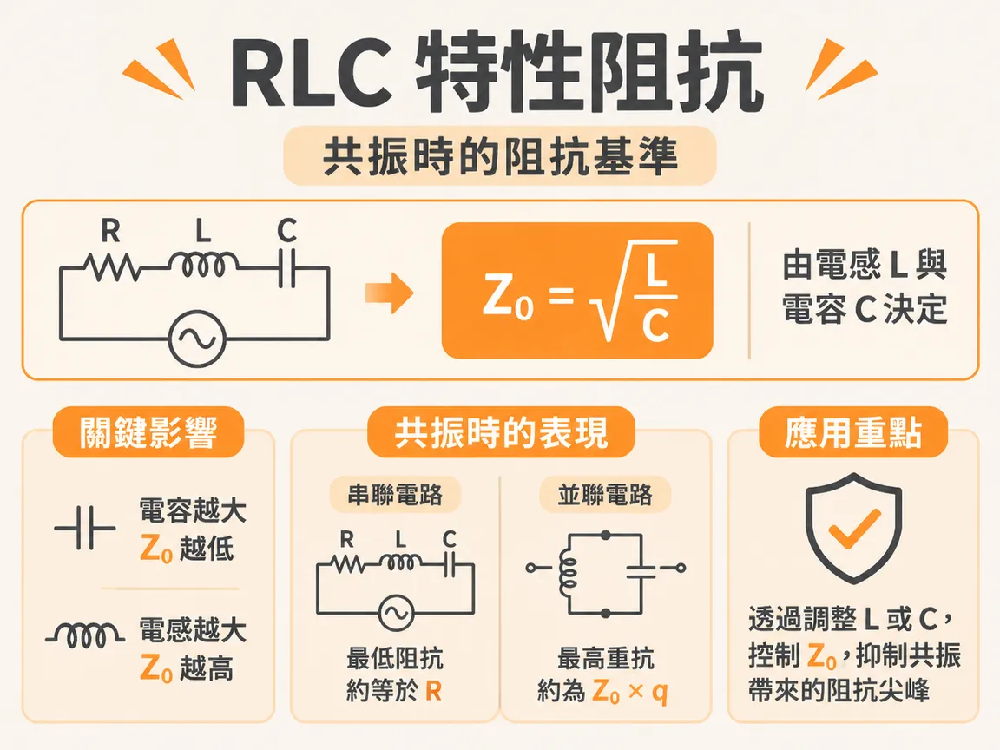

# RLC 特性阻抗

## 定義

在電感與電容組成的電路（RLC 電路）中，當訊號頻率達到共振點時，電感阻礙交流電的能力（感抗）與電容阻礙交流電的能力（容抗）大小剛好相等。

此時，感抗或容抗的絕對值大小，就稱為這個電路的「特性阻抗」，通常記作 $Z_0$。它的計算公式為：

$$Z_0 = \sqrt{\frac{L}{C}}$$

其中 $L$ 是電感值，$C$ 是電容值。

## 為什麼重要

特性阻抗是評估 RLC 電路特性的四項關鍵指標之一。它代表了電路在共振時的阻抗基準尺度。

在電源分配網路（PDN）設計中，電路常會因為電感與電容而產生共振。共振會讓阻抗暴增（並聯共振）或驟降（串聯共振）。只要算出特性阻抗，再配合電阻大小，就能快速估算出共振時的阻抗峰值有多高，或是波谷有多深，省下大量繁複的模擬時間。

## 如何運作

特性阻抗完全由電路的電感值 $L$ 與電容值 $C$ 決定：

- 電容值 $C$ 越大，或者電感值 $L$ 越小，特性阻抗 $Z_0$ 就越低。
- 電容值 $C$ 越小，或者電感值 $L$ 越大，特性阻抗 $Z_0$ 就越高。

在電路分析中，特性阻抗是計算「品質因數」（q-factor，描述共振尖銳程度的數值）的核心基準：

- **串聯電路**：品質因數為 $q = Z_0 / R_{\text{series}}$。共振時電感與電容互相抵消，最低阻抗剛好等於串聯電阻值 $R_{\text{series}} = Z_0 / q$。
- **並聯電路**：若電阻是串聯在電容或電感端，共振時的阻抗最高峰值為 $Z_{\text{peak}} = Z_0 \times q$。若阻尼電阻直接與 $L$、$C$ 並聯，峰值阻抗同樣等於該並聯電阻值。

因為特性阻抗決定了計算的基準，所以只要知道 $Z_0$ 與 $q$，就能立刻掌握阻抗突波的規模。

## 例子

假設電路中的等效電感 $L = 10\text{ nH}$，等效電容 $C = 10\text{ nF}$：

代入公式計算特性阻抗：

$$Z_0 = \sqrt{\frac{10\text{ nH}}{10\text{ nF}}} = 1\ \Omega$$

這代表此電路共振時的特性阻抗基準是 $1\ \Omega$。

如果電路中包含一個 $1\ \Omega$ 的串聯電阻，此時品質因數 $q = Z_0 / R = 1 / 1 = 1$。在並聯共振時，阻抗峰值約為 $Z_{\text{peak}} = Z_0 \times q = 1\ \Omega$。如果串聯電阻只有 $0.1\ \Omega$，$q$ 會飆升到 10，並聯共振峰值就會衝高到 $10\ \Omega$。

## 邊界與常見誤解

最常見的誤解是把 RLC 電路的特性阻抗與傳輸線的特性阻抗混為一談。雖然兩者都常寫成符號 $Z_0$，但意義完全不同。RLC 電路的特性阻抗純粹是描述該集總元件電路在共振時的電抗絕對值，與訊號在均勻傳輸線中行進的特性阻抗無關。

另一個常見誤解是認為電阻會改變特性阻抗。事實上，$Z_0$ 僅取決於電感 $L$ 與電容 $C$。電阻扮演的角色是提供阻尼，決定共振峰值究竟有多尖銳，但不會改變特性阻抗數值本身。

## 進階

在高速數位系統的電源分配網路中，並聯共振產生的高阻抗尖峰會引發嚴重的電壓雜訊與振鈴。工程師的主要設計目標就是壓低這個峰值。

要抑制並聯共振峰值，最有效的方式是將品質因數控制在接近 1 左右，也就是讓阻尼電阻接近特性阻抗 $Z_0$。實務上，可以透過採用較小的電感 $L$ 或較大的電容 $C$ 來降低電路的特性阻抗 $Z_0$，這樣即使電路的等效電阻很小，依然能達到足夠的阻尼效果，避免阻抗曲線衝出過高的突波。
