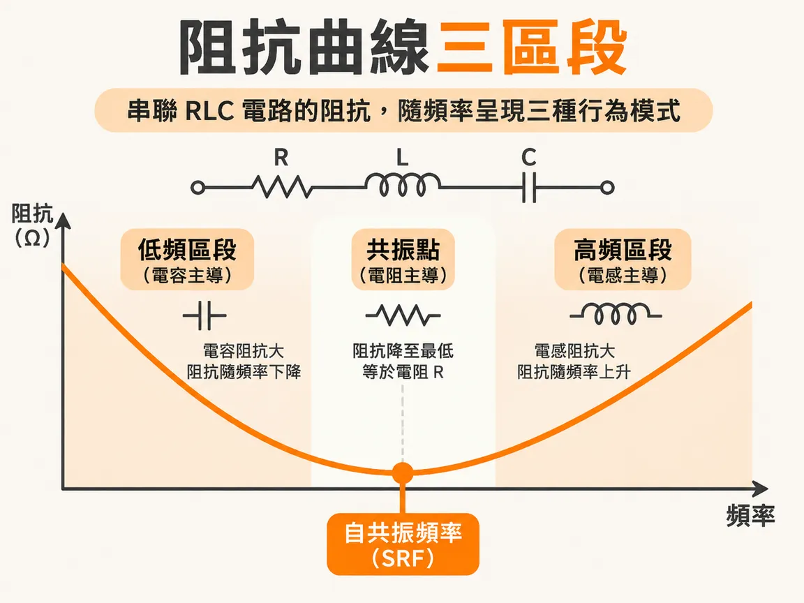

# 阻抗曲線三區段

## 定義

阻抗曲線三區段，是指把電阻、電容和電感串聯在一起（串聯 RLC 電路）時，整體阻抗隨頻率高低呈現的三種不同行為模式：低頻由電容主導、中間最低點只剩電阻、高頻則由電感完全掌控。

阻抗就是電路對交流電訊號的阻礙能力。這條曲線看起來就像一個深谷，兩端高、中間低。

## 為什麼重要

在高速電路中，工程師常放上積層陶瓷電容（MLCC）來穩定電源。但真實電容不是理想元件，在高頻環境下，它的表現完全不像一顆純電容。

如果模擬時只把電容當作理想電容，頻率一拉高，阻抗估算就會完全失真。了解這三個區段，工程師就能一眼看出真實電容在不同頻率下由誰作主，迅速掌握抑制雜訊的能力。

## 如何運作

串聯 RLC 電路的總阻抗由三個區段依序接力：

1. **低頻區段（電容主導）**：頻率很低時，電容的阻抗非常大，電路整體行為跟純電容一樣。頻率越高，阻抗越往下掉，訊號相位落在 -90 度。
2. **共振點（電阻主導）**：當頻率上升到特定點時，電容與電感的反向阻抗剛好互相抵消為零。這時整條曲線來到谷底，阻抗降到最低，數值剛好等於電阻值 $R$。這個谷底頻率稱為自共振頻率（SRF）。
3. **高頻區段（電感主導）**：過了谷底後，寄生電感開始發威。頻率越高，電感的阻抗越大，整體阻抗轉為隨頻率線性反彈上升，相位落在 +90 度。

因為這三個區段分工明確，電容量 $C$ 的大小只會上下搬移低頻區段，電感量 $L$ 的大小只會上下拉升高頻區段，兩者各管各的，互不干擾。

## 例子

以一顆電阻 $R = 0.01\ \Omega$、電感 $L = 1\text{ nH}$、電容 $C = 1\text{ nF}$ 的串聯電路為例：

- 當頻率還很低時，曲線呈現容抗特性，阻抗隨頻率上升而持續下降。
- 當電容量從 $1\text{ nF}$ 增加到 $100\text{ nF}$ 時，只有低頻區段的阻抗整體往下移，超過共振點後的高頻區段曲線完全重疊。
- 若電容量固定，將電感由 $1\text{ nH}$ 提高到 $100\text{ nH}$，則只有高頻側的阻抗往上抬升，低頻側完全不受影響。

這組參數的自共振頻率算出來剛好是 159 MHz，代表阻抗的最低谷底出現在 159 MHz，此時電路阻抗只有電阻的 $0.01\ \Omega$。

## 邊界與常見誤解

常見的誤解是認為「把電容量加大，高頻濾波效果一定更好」。

事實上，電容量變大只能降低低頻阻抗，高頻端的阻抗完全由電感決定。在高頻區段，就算把電容換得再大，阻抗也不會下降半分。

另一個誤解是以為電路內部元件的數值會隨頻率改變。在串聯 RLC 模型中，$R$、$L$、$C$ 都是不隨頻率變動的常數，變化的只是整體對外表現出的阻抗大小與相位。

## 進階

在自共振頻率（SRF）下，雖然電感與電容的阻抗互相抵消，讓對外呈現的總阻抗只剩電阻，但這兩個元件各自內部的抗值依然存在。

這個單一元件在共振時的抗值大小為 $\sqrt{L/C}$，常被稱為該 RLC 電路的「特性阻抗」。必須注意的是，它純粹是該電路在共振時電抗的大小指標，與傳輸線的特性阻抗是完全不同的物理概念。

自共振頻率的計算公式為：

$$\text{SRF} = \frac{1}{2\pi \sqrt{LC}}$$

工程上若以 nH 為電感單位、nF 為電容單位，頻率單位即可直接得出 MHz，方便快速評估電路的轉折頻率。
