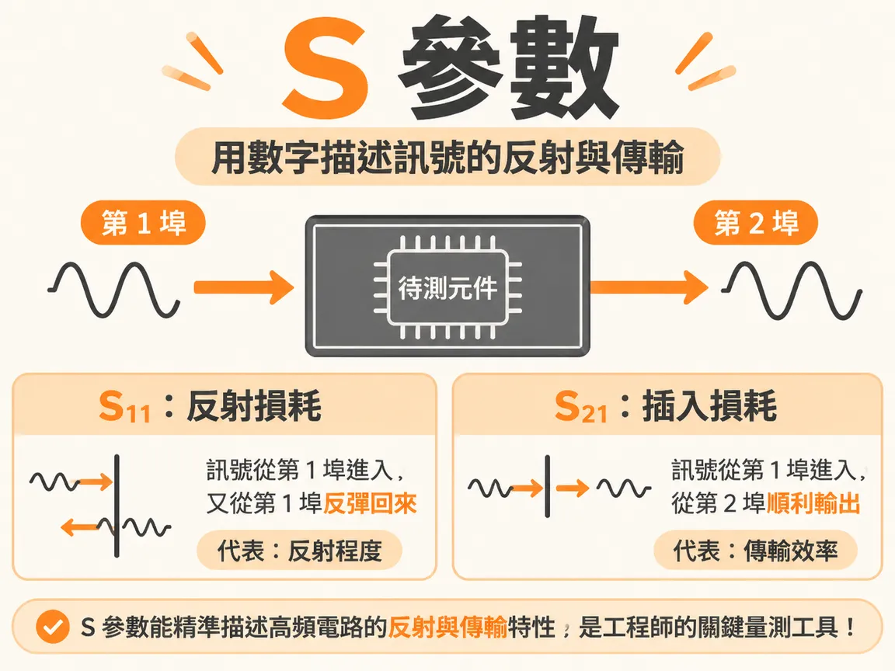

# S 參數

## 定義

S 參數（全名散射參數，Scattering parameter）是用來描述電波進入與離開電子零件時，兩者比例關係的量測語言。

當高頻訊號傳入一個電路零件時，一部分能量會穿透過去，另一部分則像撞到牆壁的回音一樣反彈回來。S 參數用兩個數字代號作為下標，標明訊號流動的方向：第一個數字代表訊號流出的出口（埠，port），第二個數字代表訊號進入的入口。

例如 $S_{11}$ 代表訊號從第 1 埠打進去、又從第 1 埠反射彈回來的比值，在工程上稱為反射損耗（return loss）或反射係數；$S_{21}$ 則代表訊號從第 1 埠打進去、順利從第 2 埠流出來的比值，稱為插入損耗（insertion loss）。

## 為什麼重要

一般示波器量測電路板時，螢幕上只會顯示單一位置的總電壓，無法分辨訊號到底是向左傳還是向右傳。

在極高頻率下，工程師很難直接用傳統「電壓除以電流」的方式來測量阻抗（交流電路對訊號的阻礙程度）。S 參數搭配向量網路分析儀（VNA），能在同一個接口上把前進的波與彈回的波精確拆開，測出它們的大小（振幅）和時間落後（相位）。

因為 S 參數能在極寬的頻率範圍內精準量測（甚至超過 50 GHz），並直接換算成零件的阻抗，它已經成為全球電子工業描述高速線路高頻特性的標準共通語言。

## 如何運作

向量網路分析儀的連接埠在校正後，會維持極為精密的 50 歐姆（Ω）基準阻抗。

量測開始時，儀器向待測零件發出弦波訊號。只要零件的輸入阻抗不是 50 Ω，界面就會因為阻抗不匹配而產生反射波。

儀器內部並非靠實體閘門拆開電波，而是利用純電阻分壓電路：
1. 訊號剛出發時，儀器先在內部量出基準電壓，這就是打入待測物的入射波電壓（$V_{\text{incident}}$）。
2. 電波彈回時，儀器在同一條電纜上量測總電壓（$V_{\text{total}}$）。因為總電壓是入射波與反射波的相加，儀器透過向量減法就能算出彈回來的反射波：$V_{\text{reflected}} = V_{\text{total}} - V_{\text{incident}}$。
3. 反射波除以入射波，便得到同時包含振幅與相位的複數 $S_{11}$。

拿到 $S_{11}$ 後，只要利用純代數公式移項，就能直接換算出待測零件的輸入阻抗（$Z_{\text{in}}$）：

$Z_{\text{in}} = 50 \times \frac{1 + S_{11}}{1 - S_{11}}$

這項計算不需要事先猜測零件內部構造，純粹靠數學運算就能求出各頻率下的真實阻抗。

## 例子

在陶瓷雙列直插封裝（DIP）的開路接腳測試中，工程師將接腳焊上連接治具，外側完全懸空開路。在 10 MHz 到 1 GHz 的量測頻段中，因為末端沒有負載吸收能量，電波幾乎百分之百全數彈回，$S_{11}$ 的振幅全程都維持在 0 dB 的平坦直線。但只要把 $S_{11}$ 的振幅與相位逐頻換算成阻抗，就能清楚看見接腳在低頻呈現約 4.8 pF 的電容特性，到了 800 MHz 附近則轉折變成電感特性。

另一個例子是直徑 1 吋的圓形銅線迴路。在 400 MHz 以下，迴路周長小於波長的十分之一，經由單埠 $S_{11}$ 換算出來的阻抗呈現標準的電感斜率，工程師便能直接將阻抗拆解為實部的串聯電阻與虛部的等效電感。

## 邊界與常見誤解

最常見的誤解是「以為 $S_{11}$ 的相位就等於阻抗的相位」。雖然兩者都是包含大小與角度的複數，但彼此的轉換公式牽涉複雜的代數運算，反射波的相位曲線絕對不能直接當作阻抗的相位曲線。

另一個常見誤解是「以為 $S_{11}$ 振幅平坦就代表沒有阻抗資訊」。就像開路的 DIP 接腳，即使振幅是一條毫無變化的 0 dB 直線，所有隨頻率變化的阻抗細節實際上全都完整編碼在 $S_{11}$ 的「相位」之中。

S 參數在單埠量測極低阻抗（例如小於 0.1 Ω）時有其物理邊界，容易因為儀器動態範圍極限與接觸電阻，出現劇烈的雜訊假象。此外，當待測物尺寸超過訊號波長的十分之一時，電路會出現分布參數效應，無法再簡化為單純的集中電容或電感模型。

## 進階

取得 S 參數並換算成阻抗後，工程師常會把數據帶入模擬環境中，用理想的電容、電感或電阻元件去擬合實測曲線，反推實體導線的電氣參數。

這種藉由量測反射損耗、換算阻抗並提取電路結構的流程，在業界稱為「以量測為基礎的建模」（measurement-based modeling），有時也被生動地稱作「拆解互連線」。替高頻互連線建立出可縮放的等效模型後，工程師就能自由更動參數、測試各種假設情境，徹底釐清高速訊號劣化的根本物理成因。
