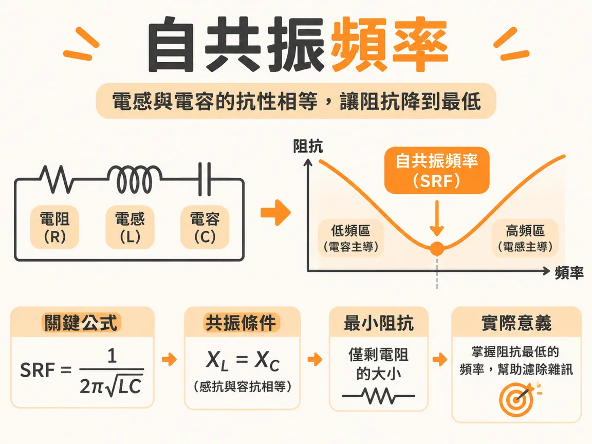

# 自共振頻率

## 定義

自共振頻率（Self Resonance Frequency，簡稱 SRF）是串聯電路中阻抗降到最低點的頻率。阻抗就是電路對交流電產生的總阻礙。在這個頻率點上，電容產生的容抗與電感產生的感抗剛好大小相同、彼此抵消，讓整體的阻抗達到最小。

## 為什麼重要

在分析電源完整性或挑選去耦電容時，我們常常需要讓電路在某個特定頻率擁有極低的阻抗，藉此排掉雜訊。阻抗隨頻率變化的曲線通常像一個深谷，而自共振頻率正是那個谷底。知道這個頻率在哪裡，工程師就能準確掌握電路阻抗最低的時機。

## 如何運作

串聯 RLC 電路（由電阻、電感與電容串在一起的電路）的阻抗曲線，可以切分成三個區段：

- **低頻區段**：阻抗完全由電容決定。頻率越高，阻抗越小。
- **共振點**：當感抗（電感對交流電的阻力）與容抗（電容對交流電的阻力）大小剛好相等時，兩者互相抵消為零。此時整個電路的阻抗降到谷底，只剩下純電阻的大小。
- **高頻區段**：阻抗完全由電感主導。頻率越高，阻抗越大，電路的相位為 +90 度。

自共振頻率的標準計算公式如下：

$$\text{SRF} = \frac{1}{2\pi \sqrt{LC}}$$

其中電感 $L$ 的單位是亨利（H），電容 $C$ 的單位是法拉（F）。

在實際計算時，如果把電感單位用 nH、電容單位用 nF 代入，就能直接算出以 MHz 為單位的頻率：

$$\text{SRF (MHz)} = \frac{1000}{2\pi \sqrt{L\text{ (nH)} \times C\text{ (nF)}}}$$

## 例子

假設一個串聯電路中的電感 $L$ 為 1 nH，電容 $C$ 為 1 nF：

1. 把電感值 1 nH 與電容值 1 nF 代入計算公式。
2. 算式為 $1000 / (2\pi \sqrt{1 \times 1})$。
3. 計算得出的自共振頻率為 159 MHz。

這表示當訊號頻率達到 159 MHz 時，這個電路的感抗與容抗完全抵消，阻抗達到最小值。

## 邊界與常見誤解

一個常見的誤解是認為在高頻時調整電容可以改變阻抗。事實上，高頻端的阻抗只受電感控制。例如把電容固定在 1 µF，電感由 1 nH 增加到 100 nH，整條曲線上只有高頻側的阻抗會往上抬升，低頻側則完全不受影響。

另一個誤解是以為共振時電容與電感就失去了作用。雖然整體電路只剩下電阻阻抗，但那是因為兩者串聯互相抵消，個別電感與電容身上的抗值依然存在。

## 進階

在自共振頻率下，單獨量測電感或電容本身的抗值大小時，數值為 $\sqrt{L/C}$。

這個數值在分析 RLC 電路時常被稱為「特性阻抗」（characteristic impedance）。請特別注意，這個名詞純粹代表共振點上電感與電容各自的阻抗大小，與傳輸線上所講的特性阻抗完全不同，兩者不能混為一談。
