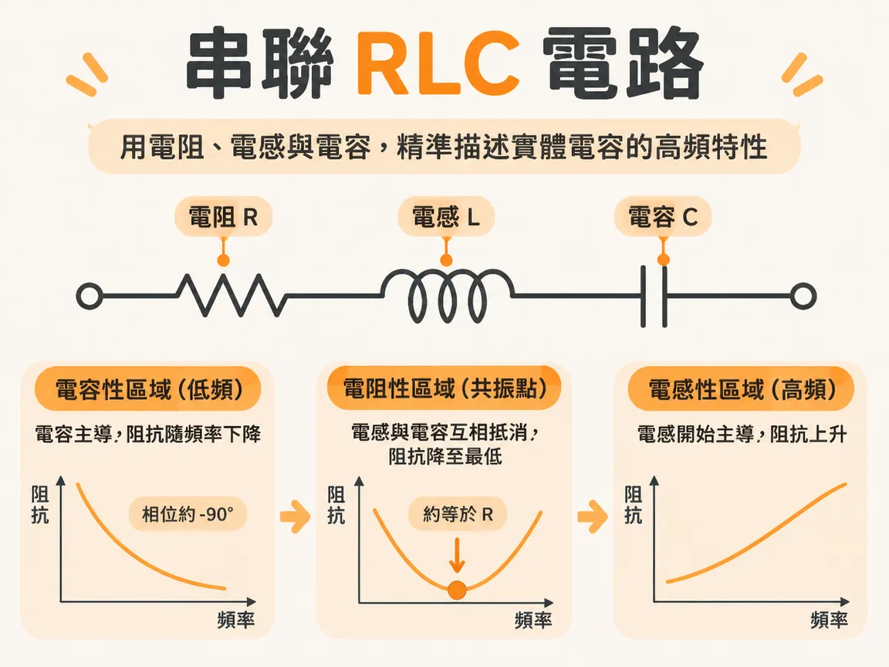

# 串聯 RLC 電路

## 定義

串聯 RLC 電路是一種把理想電阻（R）、理想電感（L）與理想電容（C）依序頭尾相連的電路結構。

在高速數位產品的電源設計中，工程師常用它來當作一個精簡的數學模型，把實體電容在各個頻率下的阻抗（對交流電流通的阻礙程度）完整表現出來。

## 為什麼重要

在真實電路裡，一顆標稱容量的陶瓷電容在高頻環境下的表現，往往不再像一顆純電容。如果只把它當成理想電容模擬，頻率拉高時，算出來的阻抗就會完全失真。

串聯 RLC 模型的強大之處在於，它裡面的電阻、電感與電容數值全部都是固定不變的常數。我們不需要複雜的未知黑盒子，只要挑對結構與這三個固定數值，就能精準捕捉實體元件內部複雜的寄生效應。

## 如何運作

串聯 RLC 電路的總阻抗非常單純，就是將電阻、電感與電容各自的阻抗直接相加。隨著訊號頻率從低到高變化，電路會依序通過三個特徵頻段：

1. **電容性區域（低頻）**：在頻率很低時，電容的阻抗最大，主導整個電路。阻抗會隨著頻率變高而下降，阻抗相位維持在 -90 度。
2. **電阻性區域（共振點）**：當頻率到達某個特定點，電容與電感的效應剛好互相抵消。這時整體阻抗達到最低點，數值就等於電阻 $R$。
3. **電感性區域（高頻）**：超過共振點後，寄生電感開始支配整體電路。阻抗不再下降，反而隨著頻率上升而線性增加。

## 例子

以一顆 0603 封裝的積層陶瓷電容（MLCC）為例：

如果只用一顆理想的 182 nF 電容去模擬，只有在低頻吻合；一旦頻率升高，實測阻抗就會反彈向上。

如果改用一組串聯 RLC 模型，設定數值為：
- 電阻 $R = 18\text{ m}\Omega$
- 電容 $C = 182\text{ nF}$
- 電感 $L = 1.3\text{ nH}$

模擬出來的阻抗大小與相位，就能從 3 MHz 一路到量測儀器的上限 200 MHz，都與實測曲線高度吻合。

## 邊界與常見誤解

常見的誤解是認為只要把電容量加大，電容在所有頻率下的阻抗都會變小。

事實上，如果固定寄生電感（例如 $L = 1\text{ nH}$），把電容值從 1 nF 逐步放大到 100 nF，改變的只有共振點之前的低頻段阻抗。一旦超過共振點進入高頻電感性區域，所有阻抗曲線會完全重疊，絲毫不受電容量大小影響。在高頻區域，決定阻抗的是寄生電感，而不是電容。

另一個誤解是以為模擬需要讓 R、L、C 的數值隨頻率不斷改變。事實上模型中的三個參數都是固定常數，隨頻率劇烈變化的只是整體的總阻抗。

## 進階

在電源分配網路（PDN）中，絕大多數結構都可以簡化為 RLC 的串聯或並聯組合。這裡的串聯或並聯，是指從量測儀器或訊號源看進去時，電感 $L$ 與電容 $C$ 這兩個電抗元件的連接方式。

此外，串聯 RLC 電路在低頻電容性區域的阻抗特性與 -90 度相位，完全符合物理因果系統的克拉莫-克羅尼希關係（Kramers-Kronig relationship）。而要確認這套模型在多高的頻寬內依然準確，唯一的驗證途徑就是透過實際儀器量測。
