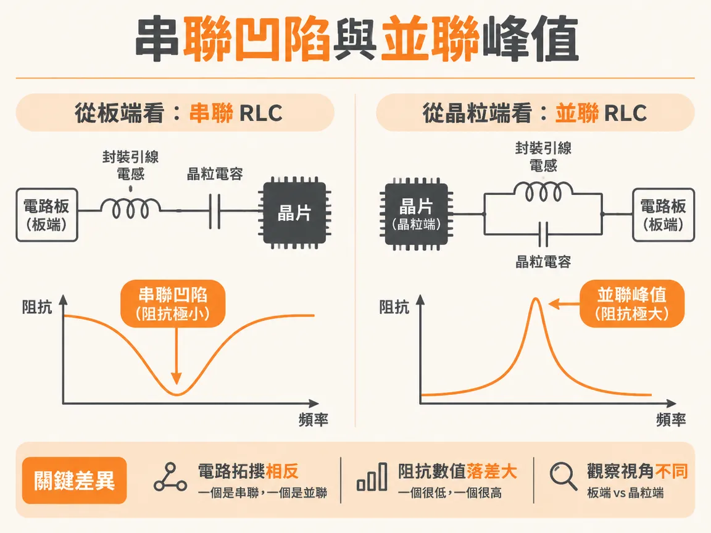

# 串聯凹陷與並聯峰值

## A 是什麼

串聯凹陷是指從電路板端往晶片看進去時，在特定頻率下測得的阻抗極小值。

在電路板的視角下，封裝引線電感與晶粒上的電容是前後相接的「串聯」關係。當訊號達到諧振頻率時，電感的感抗與電容的容抗會剛好互相抵消。這時整個路徑的阻抗會掉到最低點，在阻抗頻譜圖上形成一個深谷（凹陷），數值只剩下金屬導線本身的電阻。

## B 是什麼

並聯峰值是指從晶片內部的晶粒（die）端往電路板看進去時，在同一個特定頻率下看到的阻抗極大值。

當站在晶粒內部往外看時，晶粒電容與封裝引線電感相對於晶粒負載變成了左右並排的「並聯」關係。在諧振頻率處，電感與電容之間會產生強烈的能量交換，電流在兩者之間循環震盪，使得外部電流極難流進去，導致晶粒端看到的阻抗大幅竄升，在頻譜上衝出一個尖銳的高峰。

## 關鍵差異

兩者的核心差異在於「觀察視角」決定的電路拓撲，以及隨之而來的巨大阻抗差距：

* **電路拓撲相反**：面對完全相同的一組封裝電感與晶粒電容，從板端量測是串聯 RLC 電路；從晶粒端量測則是並聯 RLC 電路。
* **阻抗數值落差巨大**：在同一諧振頻率下，串聯電路呈現阻抗極小值，並聯電路卻呈現阻抗極大值。
* **實際數值對比**：以一顆 $50\text{ nF}$ 的晶粒電容搭配 $0.5\text{ nH}$ 的封裝電感、總迴路電阻 $0.015\ \Omega$ 為例，其品質因子（$Q$）約為 6.67。在諧振點上，板端看到的串聯凹陷只有 $0.015\ \Omega$，但晶粒端看到的並聯峰值卻高達約 $0.667\ \Omega$。兩者相差了 $Q^2$ 倍（約 44 倍）。

## 何時用哪個

* **評估板端供電路徑時看串聯特性**：當需要確認電路板至封裝接點的直流阻抗與低頻特性時，從板端觀察。但要注意，板端無法反映晶片內部的高頻特性，因為高頻訊號會被封裝電感阻擋。
* **評估晶片電源穩定性時必須看並聯峰值**：晶片核心電路運作時抽取的動態電流，直接面對的是晶粒端的阻抗。如果只因為板端量測到極低的阻抗凹陷，就誤以為電源完整性良好，便會完全忽略晶片端實際上正面臨嚴重的並聯阻抗峰值，進而引發巨大的電壓波動。

## 進階

真實電路中的損耗由兩部分構成：晶粒內部的金屬化電阻，以及封裝引線與板端貫孔的電阻。

從板端看進去時，這兩筆電阻與電感、電容串聯在一起，因此等效串聯電阻就是兩者直接相加：

$$R_{\text{equivalent}} = R_{\text{leads}} + R_{\text{metalization}}$$

諧振點的最小阻抗就等於 $R_{\text{equivalent}}$。

從晶粒端看進去時，低頻阻抗由引線電阻主導，高頻阻抗由晶粒金屬化電阻主導。但在並聯諧振頻率附近，電流會在並聯的電感與電容迴路中循環震盪，同時流經這兩個電阻。這使得該頻率下的阻抗峰值大小受控於同一個等效電阻，其極大值可由特徵阻抗（$Z_0 = \sqrt{L/C}$）與等效電阻推導得出：

$$Z_{\max} \approx \frac{Z_0^2}{R_{\text{equivalent}}}$$
