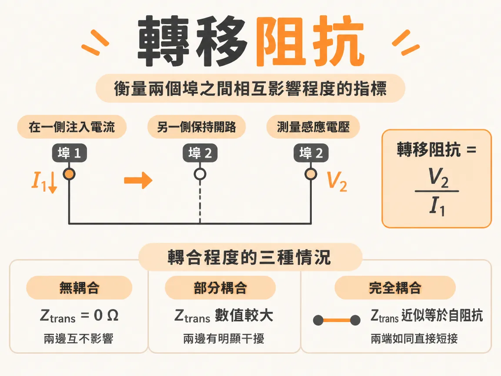

# 轉移阻抗

## 定義

轉移阻抗是衡量兩個接線端點對（稱為「埠」）之間相互影響程度的數值。

它的算法非常單純：在第一個埠注入電流，同時讓第二個埠保持懸空開路，接著測量第二個埠感應出的電壓。這個「感應電壓」除以「注入電流」的比值，就是轉移阻抗。

## 為什麼重要

在電路板上，一顆晶片抽換電流時，雜訊往往會傳遞到隔壁的零件。轉移阻抗可以精確量化兩個位置之間的耦合程度：

- **無耦合**：轉移阻抗為 $0\ \Omega$，代表在其中一邊注入電流，完全不會在另一邊產生雜訊電壓。
- **部分耦合**：轉移阻抗數值越大，代表兩邊的雜訊干擾與耦合越強烈。
- **完全耦合**：轉移阻抗數值上升到等於端點本身的自阻抗，此時兩邊的電氣行為就如同直接短接在一起。

## 如何運作

在多埠系統的阻抗矩陣（Z 矩陣）中，轉移阻抗位於非對角線的位置（如 $Z_{12}$ 與 $Z_{21}$）。

以雙埠電路為例，端點電壓與注入電流的關係如下：

$$V_1 = Z_{11} I_1 + Z_{12} I_2$$

$$V_2 = Z_{21} I_1 + Z_{22} I_2$$

若要提取轉移阻抗 $Z_{21}$，我們會將埠 2 保持開路不接負載（讓 $I_2 = 0$），並在埠 1 注入電流 $I_1$。因為電路內部存在共用路徑或電磁耦合，流經內部的電流會在埠 2 建立感應電壓 $V_2$：

$$Z_{21} = \left. \frac{V_2}{I_1} \right|_{I_2 = 0}$$

## 例子

想像一個電阻電路：埠 1 連接電阻 $R_A$，埠 2 連接電阻 $R_B$，兩條路徑在連回地面之前，匯流經過一個共用電阻 $R_C$。

當埠 1 開路懸空（$I_1 = 0$）時，我們在埠 2 注入電流 $I_2$。因為埠 1 沒有電流，$R_A$ 兩端沒有壓降。電流 $I_2$ 只能流經共用電阻 $R_C$，在 $R_C$ 兩端產生電壓 $V = I_2 \cdot R_C$。

這個電壓會完整出現在懸空的埠 1 上，使 $V_1 = I_2 \cdot R_C$。兩埠之間的轉移阻抗即為：

$$Z_{12} = \frac{V_1}{I_2} = R_C$$

如果兩條路徑各自獨立接地，共用電阻為 $0\ \Omega$，轉移阻抗就會變成 0。

## 邊界與常見誤解

初學者最容易產生的誤解，是把轉移阻抗當成「跨接在兩個埠之間的實體元件阻抗」，或是以為拿三用電表去量兩埠正端就能測得轉移阻抗。

事實上，轉移阻抗不是實體跨接的單一零件，而是「A 處注入電流，B 處量到多少感應電壓」的整體電路比值。

此外，這套分析方法僅適用於線性、被動且非時變的系統，阻抗數值不會隨端點上的電壓或電流大小而改變。

## 進階

- **共用引線電感**：在真實的高頻電路中，若兩條獨立支路匯流經過一個大小為 $5\ \text{nH}$ 的共用引線電感，該電路的轉移阻抗在頻譜上就會直接等於單一顆 $5\ \text{nH}$ 電感的阻抗響應。
- **模擬提取方法**：在 SPICE 軟體中，只要在埠 1 掛上振幅為 $1\ \text{A}$ 的交流電流源，並將埠 2 懸空，此時模擬出的埠 2 電壓數值就會直接等於該頻率下的轉移阻抗 $Z_{21}$。
- **跨領域應用**：轉移阻抗也常出現在電纜屏蔽評估中，用來表示屏蔽層外側的電流滲透至內側所感應出的電壓比例；亦可用於分析電源平面與接地平面構成的波導腔體雜訊。
