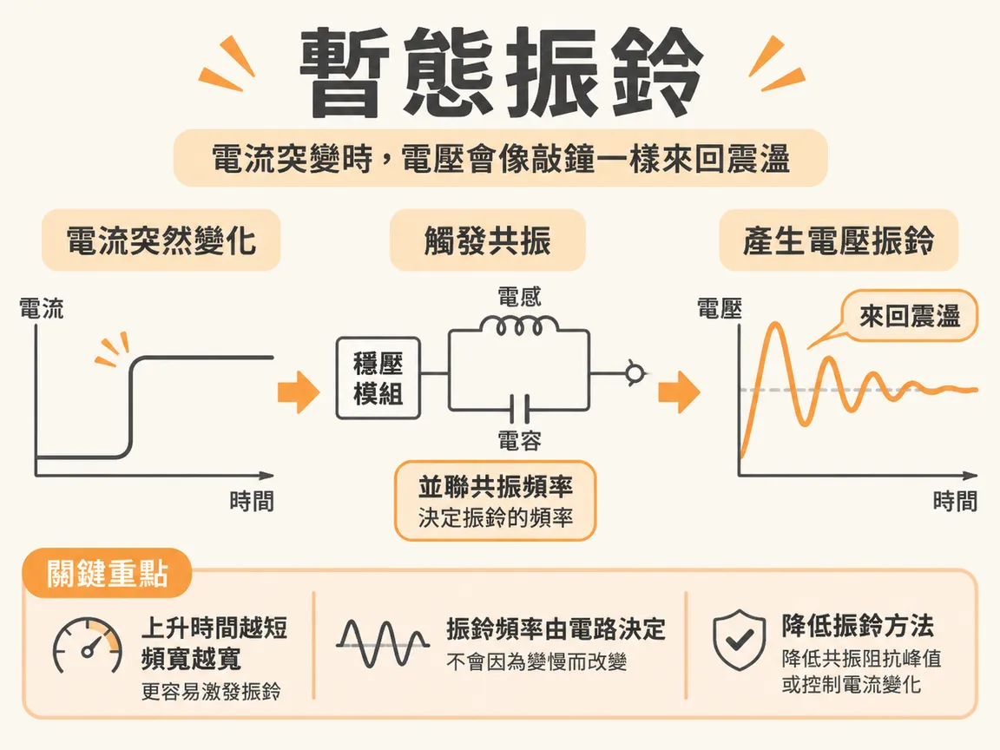

# 暫態振鈴

## 定義

暫態振鈴是指當電路裡的電流突然改變時，電壓沒有平穩地上升或下降，反而像敲鐘一樣，在某個特定頻率下來回上下震盪的雜訊現象。

這個現象通常發生在電源分配網路（PDN）中，就像水管突然關緊時水流在管壁撞擊震動一樣，電壓會在短時間內劇烈抖動。

## 為什麼重要

當晶片瞬間抽取大量電流時，暫態振鈴會讓供電電壓一下子掉得太低、一下子衝得太高，這會直接干擾晶片的正常運作。

平常使用的「頻域分析」只看電路達到穩定後的狀態，並假設所有訊號都已經持續了無窮久。這種方法會漏掉暫態電流中罕見的「異常波」（rogue waves）。如果只依賴頻域評估，就無法準確預測實際開關瞬間到底會晃得多嚴重。

## 如何運作

電路本身是由穩壓模組與去耦電容等零件組成，這些零件組合起來後，會在某個頻率形成特別大的電阻抗，這個點稱為「並聯共振頻率」。

當抽載電流突然發生變化時，電流波形裡其實混合了許多不同頻率的成分：

- 電流從 10% 爬升到 90% 所花的時間，稱為「上升時間」。
- 電流包含的最高頻率範圍稱為「頻寬」，頻寬（單位為 GHz）大約等於 0.35 除以上升時間（單位為 nsec）。
- 當上升時間越短，訊號頻寬就越寬，裡面包含的高頻能量也越多。

只要電流的頻寬涵蓋到電路的並聯共振頻率，該頻率的電流就會碰上巨大的阻抗，進而在電路兩端激發出電壓振鈴。振鈴震動的快慢（頻率）完全由電路本身的共振點決定，而振鈴震動的大小（振幅）則由電流在該頻率帶有多少能量決定。

## 例子

在一個並聯共振頻率為 25 MHz 的電路模型中：

- 當電流階躍的上升時間是 10 nsec 時，頻寬大約是 35 MHz。因為 35 MHz 超過了 25 MHz，電流帶有足夠的 25 MHz 能量，電壓就會震盪出週期為 40 nsec（對應 25 MHz）的巨大振鈴。
- 當把電流上升時間放慢到 30 nsec 時，頻寬縮減到大約 10 MHz。此時電流在 25 MHz 處的能量大幅減少，激發出的電壓振鈴振幅明顯縮小很多。
- 仔細比對這兩種狀況，雖然震盪大小差很多，但兩者的振鈴週期都同樣是 40 nsec，完全沒有因為抽電變慢而改變震動週期。

## 邊界與常見誤解

最常見的誤解是認為「電流抽得越慢，振鈴晃動的頻率就會跟著變慢」。

事實上，振鈴頻率是電路本身的內在特性，只要電路的電容與電感結構沒有改變，振鈴頻率就永遠固定在並聯共振點上。放慢電流上升時間，改變的只是分佈在該共振點上的能量比例，因此只會讓振幅變小，完全不會改變振鈴的頻率。

## 進階

在 SPICE 暫態模擬中，電路常以穩壓模組（VRM）的電阻與電感串聯，並聯兩組代表真實去耦電容的 RLC 串聯電路。

即使輸入的電流變化邊緣是非常平滑的高斯波形（Gaussian edge），只要電流的頻譜成分碰到了電路的並聯共振峰值，電壓依然會產生劇烈的共振振鈴。因此抑制暫態雜訊的核心原則，在於壓低並聯共振點的阻抗峰值，或是設法控制電流變化的頻譜成分。
