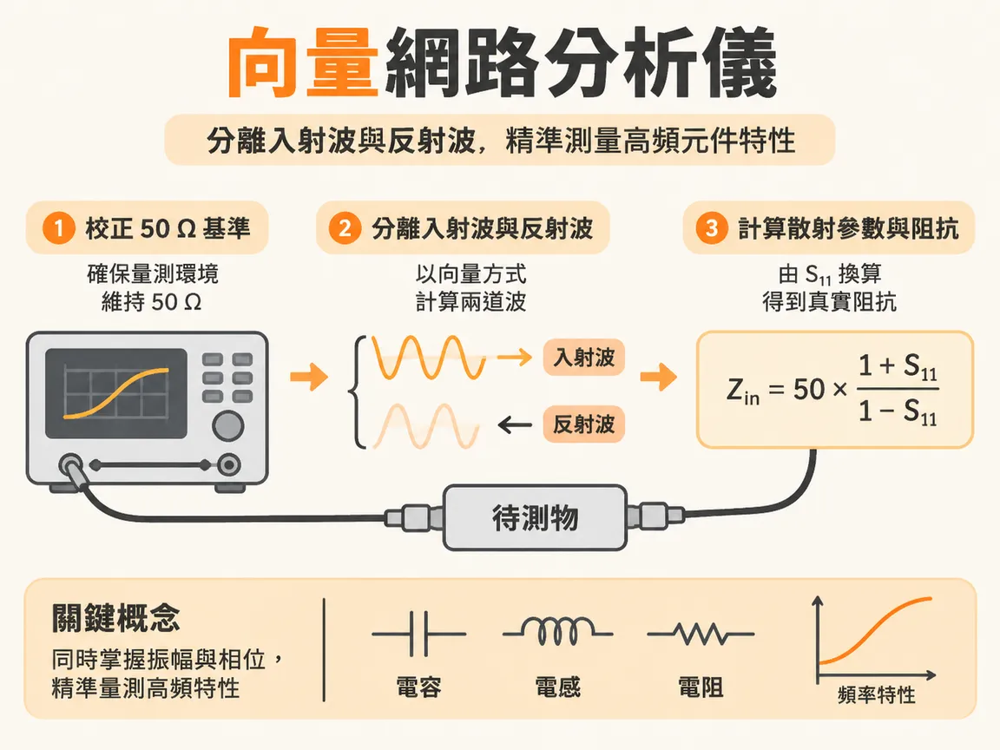

# 向量網路分析儀

## 定義

向量網路分析儀（Vector Network Analyzer，簡稱 VNA）是一種專門在高頻下量測元件特性的精密儀器。

它在連接埠（儀器與待測物相接的接口）維持精確的 50 Ω 阻抗，向待測物發射特定頻率的正弦波，並且能同時分開量測朝著待測物前進的「入射波」，以及被彈回來的「反射波」。因為它能精確測出這兩道波的「振幅大小」與「相位差」（也就是波形的時間落後或超前關係），完整掌握這兩個向量資訊，所以被稱為「向量」網路分析儀。

## 為什麼重要

在低頻電路中，我們通常用示波器探棒點在電路板上，測量單一點的電壓除以電流來求得阻抗。

但在極高頻環境下，信號是以電磁波的形式高速傳播。當你把探棒接在導線中段時，示波器螢幕看到的瞬時電壓，其實是向右跑的波和向左跑的波重疊在一起的總和，無法分辨訊號到底往哪裡傳。

VNA 的出現解決了這個難題。它透過單一連接埠就能把前進與後退的電磁波徹底分開，精確測得散射參數（S 參數）。透過這些參數，工程師不需要建立簡化的電路模型，就能直接換算出待測物在極寬頻率範圍（甚至超過 50 GHz）內的真實複數阻抗。

## 如何運作

VNA 在單一埠測量阻抗的過程，主要包含校正、分波與阻抗轉換三個環節：

1. **50 Ω 基準校正**：量測前，VNA 會將校正基準面延伸到測試電纜末端。校正完成後，從待測物端看進儀器，其信號源阻抗會是極為精準的 50 Ω。
2. **分離入射波與反射波**：
   - 儀器內部的正弦波訊號源先串聯一個精密 50 Ω 電阻，再接上 50 Ω 特性阻抗的電纜。電壓在此對半平分，儀器在純電阻分壓點量測基準電壓 $V_{\text{ref}}$，這就是打入待測物的入射波電壓 $V_{\text{incident}}$。
   - 當訊號抵達待測物，只要阻抗不等於 50 Ω 就會產生反射波。這道反射波沿著同一條電纜傳回，儀器內部的電壓表量得總電壓 $V_{\text{total}}$。
   - 由於 $V_{\text{total}} = V_{\text{incident}} + V_{\text{reflected}}$，儀器利用向量減法，以總電壓減去已知入射電壓，即可獨立算出反射波電壓 $V_{\text{reflected}} = V_{\text{total}} - V_{\text{incident}}$。傳回的反射波最後會被內部的 50 Ω 電阻完全吸收，不會再次彈回待測物。
3. **計算反射係數與阻抗轉換**：
   - 反射電壓除以入射電壓的比值，稱為單埠反射係數，也就是散射參數中的 $S_{11}$（代表從 port 1 輸入、從 port 1 反射流出的訊號比值）。
   - 利用邊界條件導出的公式，透過純複數代數移項，就能直接算出待測物的輸入阻抗 $Z_{\text{in}}$：
     $$Z_{\text{in}} = 50 \times \frac{1 + S_{11}}{1 - S_{11}}$$

## 例子

在實際工程中，工程師常將陶瓷雙列直插封裝（DIP）的兩隻相鄰接腳焊接在 SMA 治具上，作為訊號路徑與返回路徑，接腳末端保持開路。

將這組治具接上單埠 VNA，在 10 MHz 到 1 GHz 範圍內進行掃描：
- 因為接腳末端開路，能量幾乎沒有被吸收，反射回來的 $S_{11}$ 振幅全程接近 0 dB（幾乎全反射）。
- 關鍵的阻抗變化全都記錄在 $S_{11}$ 的相位隨頻率變化的數據中。
- 將測得的 $S_{11}$ 代入轉換公式換算為複數阻抗，畫在雙對數圖上觀察：在低頻時，阻抗呈現斜率為 -1 的直線，代表接腳主要呈現約 4.8 pF 的電容特性；直到約 800 MHz 附近曲線轉折向上，才轉變為電感特性。

另一個例子是測量直徑約 1 吋的圓形微型銅線迴路。在 400 MHz 以下，VNA 測得的阻抗符合電阻串聯電感（$Z = R + j\omega L$）的物理預期。阻抗實部即為串聯電阻 $R$，阻抗虛部除以角頻率（$\text{Im}(Z)/\omega$）即可精準反推出等效電感 $L$。

## 邊界與常見誤解

- **誤解：$S_{11}$ 的相位就是阻抗的相位**：
  這是非常常見的錯誤觀念。雖然 $S_{11}$ 和阻抗都是由大小與相位組成的複數，但阻抗相位是由 $S_{11}$ 的大小與相位經由複數公式綜合運算得出的結果，兩者的數值和曲線走勢完全不能混為一談。
- **量測極限與假象**：
  單埠 VNA 在量測極低阻抗（例如小於 0.1 Ω）時，受限於儀器本身的動態範圍與治具接觸阻抗，換算出的數據很容易出現明顯雜訊與劇烈跳動等量測假象。
- **集中參數模型的適用邊界**：
  當待測物實體結構的尺寸達到訊號波長的十分之一（1/10 波長）時，單純的理想電阻或電感等集中參數模型就會失效。例如直徑 1 吋的銅迴路，頻率超過 400 MHz 之後就會出現分佈參數效應，此時反推得出的電感值會隨頻率迅速飆升。

## 進階

遵循「Bogatin 第九法則」（絕不在沒有預期結果前就動手做量測或模擬），工程師能把 VNA 實測資料與模擬軟體結合，進行「以量測為基礎的建模」（measurement-based modeling），又稱為「拆解互連線」。

當訊號進入延伸結構或複雜治具時，波會在沿途每一個阻抗不連續點產生多次來回彈跳。由於線性系統中相同頻率的正弦波疊加後仍為同頻率正弦波，VNA 測得的單一淨反射訊號，已完整打包了整個結構的總整合輸入阻抗。工程師藉此擬合出精確的等效電路拓撲，就能在模擬環境中進一步探索各種設計變更與假設情境。
