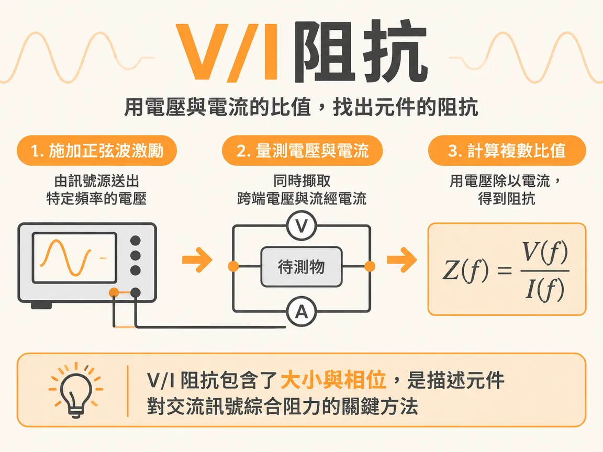

# V/I 阻抗定義

## 定義

V/I 阻抗定義是計算阻抗最基本的方法：在特定頻率下，對待測物施加正弦波訊號，再把待測物兩端的跨壓除以流經內部的電流。

阻抗（Impedance）就像元件對交流電訊號的綜合阻力。因為訊號具有波動特性，電壓與電流不僅有大小差異，還會出現時間差（相位差），所以 V/I 定義下的阻抗是包含振幅與相位的複數比值。

## 為什麼重要

電源分配網路（PDN）的設計目標，是在極寬的頻率範圍內把阻抗壓在目標阻抗以下，有時甚至需要低至 1 mΩ。

量測阻抗具有三個不可或缺的目的：
1. 驗證實體零件的效能是否符合規格。
2. 驗證電路模擬工具與建模流程是否準確。
3. 作為整體系統的最終檢驗與除錯依據。

V/I 定義是電路模擬軟體分析阻抗、以及各類低頻阻抗量測儀器運作的根本邏輯。

## 如何運作

V/I 量測阻抗的步驟相當直覺：

1. **施加正弦波激勵**：由訊號源在待測物兩端送入特定頻率的正弦波電壓。
2. **量測複數電壓與電流**：同時擷取待測物兩端的跨端複數電壓 $V(f)$，以及實際流經待測物的複數電流 $I(f)$。
3. **計算複數比值**：依據公式 $Z(f) = \frac{V(f)}{I(f)}$，電壓振幅除以電流振幅得出阻抗大小，電壓與電流的相位差則換算出阻抗的相位。

## 例子

許多入門級的阻抗分析儀便完全採用這套運作機制。儀器內部產生固定頻率的正弦波電壓驅動待測元件，內部感測電路同時擷取流經該元件的電流大小與相位，隨即透過除法算出該頻率下的阻抗值。

## 邊界與常見誤解

這套方法的物理極限，取決於實務上直接量測「流經待測物電流」的最高可用頻率。

常見的誤解是以為任何頻率都能直接用電壓除以電流來取得阻抗。實際上，當頻率超過約 100 MHz 時，直接在電路上準確擷取電流變得極端困難，量測電路本身的寄生效應（額外伴隨的非預期電容或電感效應）也會嚴重干擾結果。

如果硬要在 100 MHz 以上採用 V/I 直接量測電流，儀器的設計複雜度與校正成本都會暴增，在工程實務上非常不划算。

## 進階

在超過 100 MHz 甚至高達數十 GHz 的高頻環境下，工程界會改用反射訊號與散射參數（S 參數）來間接取得阻抗。

例如向量網路分析儀（VNA）透過精密的 50 Ω 參考環境量測單埠反射係數（$S_{11}$），再透過代數公式換算阻抗：

$$Z_{in} = 50 \times \frac{1 + S_{11}}{1 - S_{11}}$$

這種透過反射波換算出來的輸入阻抗，在數學本質上與傳統的 V/I 完全等價，卻完全避開了在高頻下直接量測電流的技術瓶頸。
