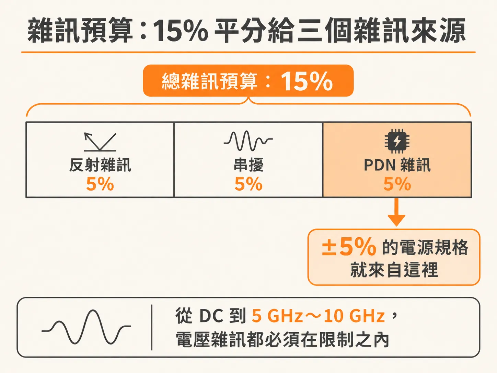
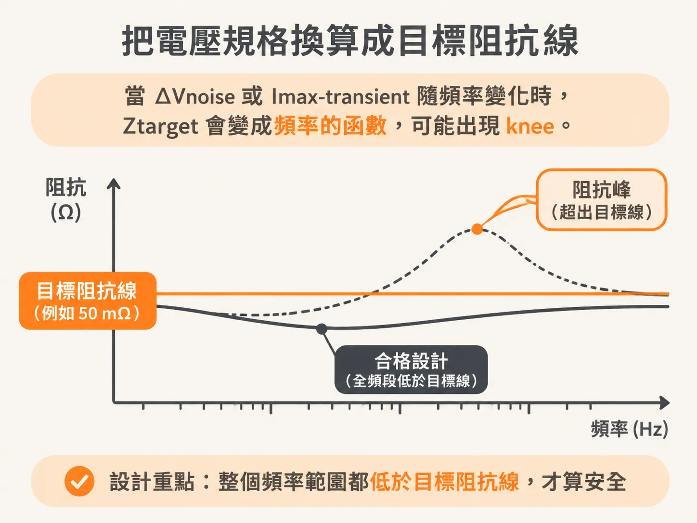
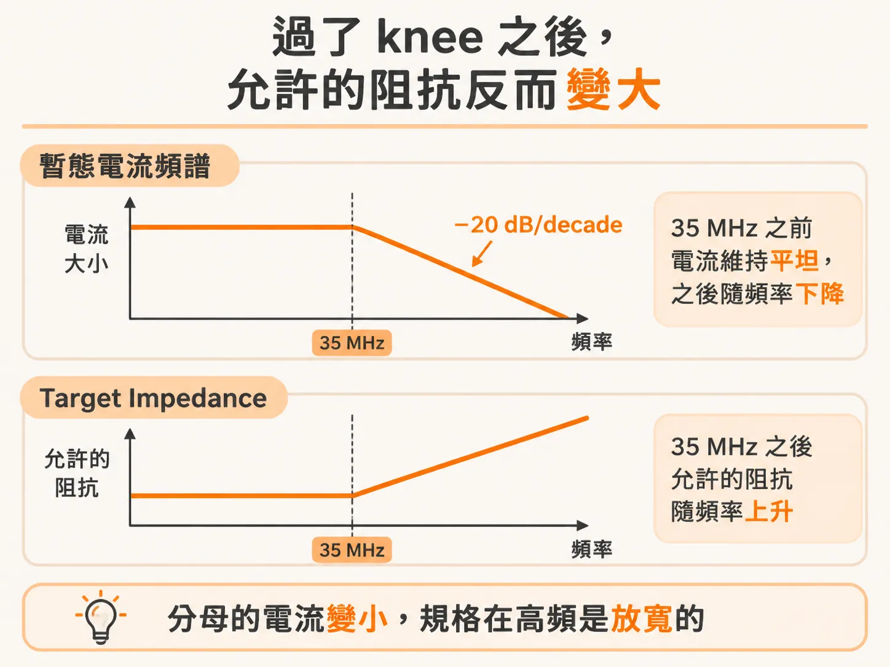

# Target impedance：保證性能的最大允許阻抗

Rail 上的雜訊來源很單純：die 裡的閘開關時拉出 transient current（暫態電流），電流穿過 PDN 的阻抗，就變成電壓雜訊。換一段程式、換一個頻率，雜訊就跟著變。

那麼，阻抗要壓到多低，雜訊才保證不超標？答案是一條可以畫在 Z(f) 圖上的線，叫做 target impedance。5% 這個數字有明確的由來，target impedance 可以用 ΔV 和 Imax 算出來，而且這條線在高頻反而放寬。

## 15% 的雜訊預算，平分三份

接收端能容忍的雜訊有上限。在典型的 CMOS 數位系統、單端訊號的場合，這個上限是接收器的總 noise margin，大約是訊號擺幅的 15%。

這 15% 要分給三個主要的雜訊來源：反射雜訊（reflection noise）、串擾（crosstalk）、還有 PDN 雜訊。沒有特別理由的話，就平均分，一份 5%。常聽到的「PDN 雜訊規格是供應電壓的 ±5%」，出處就是這個分配。

有些應用沒有這麼多餘裕。ADC 和 PLL 這類電路對電壓雜訊非常敏感，PDN 雜訊得壓到 1% 以下。

這條規格管的不只是低頻。從 DC 一直到訊號本身的頻寬——可能高到 5 GHz 到 10 GHz——電壓雜訊都必須在限制之內。

## VRM 再穩，die 的 pad 上還是有雜訊

低頻的雜訊通常直接來自 VRM（板上的電源轉換電路），所以 PDN 設計的第一步，是選一台在適當負載電流下、雜訊夠低的 VRM。

但就算 VRM 穩到極限，die 的 pad 上照樣有雜訊。來源是 transient current 流過「從 VRM 的 pad 到 die 的 pad」這一整段互連的阻抗，壓降就落在 die 的 pad 上。這整串互連有一個名字：PDN ecology。

所以你要管理的對象，從來不是 VRM 的輸出端有多乾淨，而是這整條路徑的阻抗曲線。transient current 打上去，雜訊就出來，跟 VRM 穩不穩無關。

## 把規格換算成一條阻抗線

target impedance 的定義只有一行：

Ztarget = ΔVnoise / Imax-transient

- Ztarget：任何頻率下，允許的最大 PDN 阻抗
- ΔVnoise：為了滿足性能要求，rail 上允許的最大電壓雜訊
- Imax-transient：任何可能的操作下，最壞情況的 transient current

用具體數字算一次：雜訊規格設 ±50 mV，最壞 transient current 是 1 A，target impedance 就是 50 mΩ。

這條線的用法很直接：把整個 PDN ecology 往 die pad 看過去的阻抗曲線畫出來，如果它在所有頻率都低於 target impedance，最壞的 rail collapse（電源軌塌陷）雜訊就不會超過規格——除非撞上非常罕見的 rogue wave 情況。

有兩個限制必須記住。第一，target impedance 是近似值。理論上，最壞的峰值雜訊要把 transient current 波形和整條阻抗曲線放進 transient simulation 才算得準；target impedance 的角色是 figure of merit（衡量設計的指標），幫你把設計聚焦在一個好的起點。最終的 robust 驗證，仍然要靠整個 PDN 加上實際電流波形的暫態模擬。

第二，它是評估 PDN 性能最重要的指標：阻抗曲線超出 target impedance 越多，失敗的風險越大。

還有一個重點：如果 ΔVnoise 或 Imax-transient 本身隨頻率變化，Ztarget 就不是一條水平線，而是頻率的函數。knee 就是這樣出現的。

## 高頻的 knee：允許的阻抗反而變大

把 Imax-transient 當成固定值，target impedance 就是一條水平線。實際上，die 拉得出來的最壞 transient current，在高頻端會掉下來。

原因是物理：要把最大數量的閘全部打開，需要時間。有效 rise time 短則一個 clock edge 的 rise time，長可到 100 個 clock cycles。確切數字取決於晶片架構、pipeline 的位元數、還有 microcode 的性質。

拿具體數字算一次。clock 是 2 GHz，週期 0.5 ns；假設最大組合的閘需要 20 個 cycle 才能全部打開，最壞 transient current 的最短 rise time 就是 0.5 ns × 20 = 10 ns。頻譜上，最大 transient current 的成分大約從 0.35 / 10 ns = 35 MHz 開始衰減，斜率是 −20 dB/decade——頻率每升高十倍，電流幅度掉十倍。

把 Ztarget = ΔVnoise / Imax-transient 拿來看高頻：頻率超過 35 MHz 之後，分母的電流越來越小，允許的阻抗就越來越大。target impedance 的曲線在 35 MHz 這個 knee 之前是水平線，之後隨頻率上升。規格在高頻是放寬的。

麻煩在於：knee 從哪裡開始，很難估。你必須知道 transient current 和最壞 microcode 的細節，而這些細節通常不在你手上。

## 精確算不出來，所以要工程判斷

把整條因果鏈走完，結論很務實：實務上，精確算出 transient current、以及 PDN 該有的 target impedance，是極為困難的。電流頻譜取決於晶片架構和 microcode 的性質，手上拿得到的多半是估計值。

所以永遠要靠工程判斷：把手上有的資訊，轉換成符合成本效益的設計要求。target impedance 不追求精確；它的價值是讓整個設計有一條共用的驗收線——先畫出這條線，之後每個設計決定才有共同的依據。
