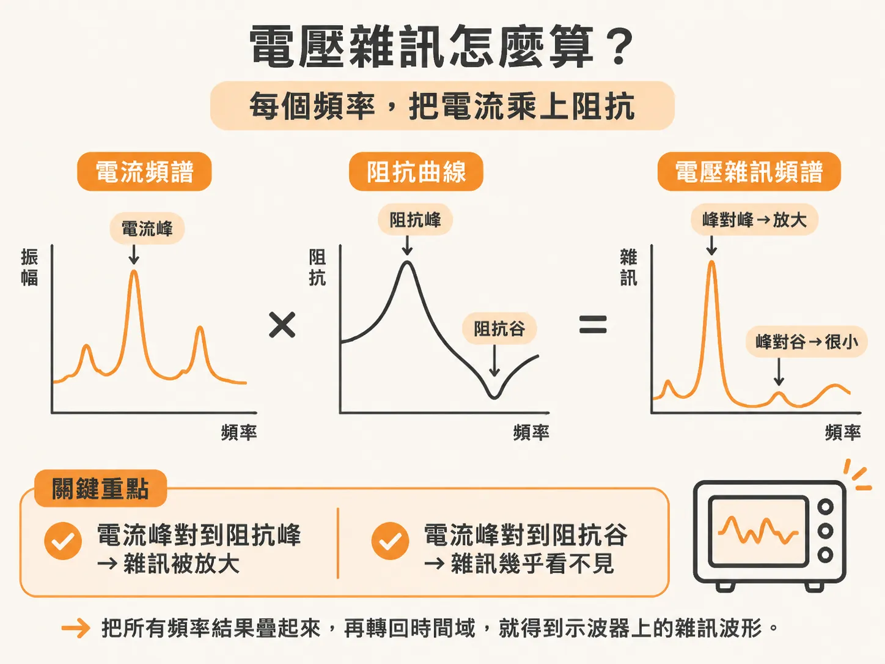
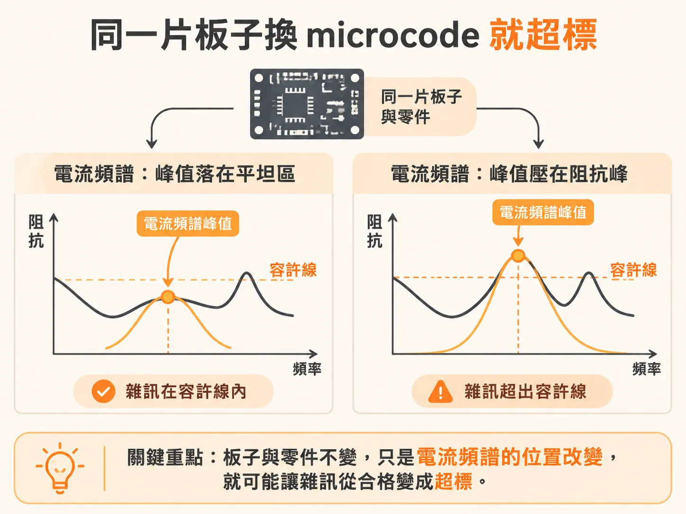
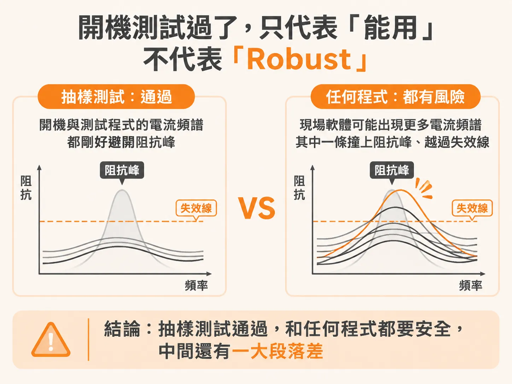

# 「能用」還是「Robust」的 PDN 設計

板子通電、開機、跑完一整輪測試程式，全部正常。出貨後，客戶裝上自己的軟體，電源軌雜訊突然超過上限，產品當機。板子寄回來，你卻怎麼樣都重現不了那個錯。

這不是運氣差。PDN 失效本來就長這樣：難診斷、難重現，而且常常只在特定 microcode 跑特定工作時才發作。這裡的 microcode 指的是處理器上執行的軟體內容——什麼程式在跑、哪些邏輯閘在切換、多少個同時切換、用什麼頻率切換。

要看懂這種失效，得先把「雜訊是怎麼產生的」拆開來算。

## 雜訊怎麼算：每個頻率做一次乘法

PDN（電源傳輸網路）是電從穩壓器 VRM 到晶片 die 之間的整條互連。從 die 的焊墊往回看這整條路徑，會看到一條阻抗曲線：每個頻率對應一個阻抗值，這就是 impedance profile。

die 工作時，內部邏輯閘的開關會抽出隨時間變化的電流，就是暫態電流（transient current）。把這個電流攤開成頻譜，它不是一條平線，而是在某些頻率特別高，帶著幾個峰。

電壓雜訊的算法很直接：在每個頻率上，把電流頻譜在該頻率的振幅，乘上阻抗曲線在該頻率的值，得到該頻率的電壓雜訊。把所有頻率的結果疊起來、轉回時間域，就是示波器上那條 rail 雜訊波形。

這個乘法有一個常被忽略的性質：它和 VRM 穩不穩無關。就算 VRM 輸出乾淨得像理想電池，暫態電流打在互連的阻抗上，die 焊墊上的電壓照樣會晃。

另一個關鍵：雜訊大小取決於電流頻譜的峰和阻抗曲線的峰有沒有對上。電流的峰落在阻抗的谷，相安無事；壓在阻抗的峰上，雜訊就被放大。而電流頻譜長什麼樣，由正在跑的 microcode 決定，包括閘使用率——同一顆晶片，不同程式驅動的閘數量和切換節奏都不一樣。

## 同一片板子，換一段程式就超標

把這個乘法放進真實情境，「同一片板子換 microcode 就超標」就是一道算術題。

同一條阻抗曲線。原本的程式跑得好好的：它的電流頻譜峰值落在阻抗曲線比較平的地方，乘出來的雜訊在容許範圍內。換一版 microcode——演算法改一點，驅動的還是同一批閘，但主導的切換頻率稍微移動——電流頻譜的峰就跟著移動，這次剛好疊上一個比較大的阻抗峰。電流振幅差不多，阻抗更高，乘出來的電壓雜訊就越過上限。

板子沒變，零件沒變，變的只有軟體用什麼頻率抽電流。PDN 雜訊從來不是阻抗曲線單方面的問題：它由 impedance profile 和暫態電流頻譜共同決定，而 microcode 的細節對後者影響很大。

## 開機測試過了，只代表「能開機」

回到開場那片板子。開機成功、測試程式全過，其實只證明一件事：這一份 microcode 的電流頻譜，剛好和阻抗峰錯開。這樣的產品會被蓋章標成「working」。

但客戶手上的軟體是另一份 microcode。它可能驅動更多閘，主導頻率又不一樣。一旦那個頻率撞上阻抗曲線的某個峰，瞬間電壓降就會變大，同一片「working」的板子就在現場失效。

「working」和「robust」的差別一句話就能切開：working 是「在測過的情境裡沒有出錯」；robust 是「任何軟體都跑得起來」——不管程式抽多大的暫態電流、集中在哪個頻率、時間域波形長什麼樣，最壞情況的電壓雜訊都低於會造成失效的量。

開機和測試程式，只是從「所有可能的電流頻譜」裡抽了幾個樣本。樣本沒踩到峰，不代表峰不存在。PDN 失效之所以難用測試抓出來，根本原因就在這裡：發作條件是特定程式內容和特定頻率的組合，測試環境很難剛好湊齊。Robust 沒辦法事後「測進去」，只能一開始就「設計進去」。

每片板子也得當自己的案子看待：有的 PDN 只靠低阻抗的 VRM 就很穩，有的要特定容值的電容放在特定位置，甚至只能跑受限的程式才不出事。照抄別人的設計原則，等於假設自己的電流峰和別人落在同樣的地方——那不成立。

## 把「任何程式」收斂成一條規格

Robust 的定義聽起來要對無限多種軟體驗證，其實可以收斂成一個工程問題：估出最壞情況的暫態電流，配合電壓雜訊的上限，就得到一條「每個頻率都不得超過」的最大允許阻抗。只要阻抗曲線整條壓在這條線下面，任何程式的電流通過，雜訊都不會超過規格。

這條上限就是 target impedance，PDN 設計方法裡最重要的指標。它怎麼從雜訊規格和最壞電流算出來，是下一篇的主題。
