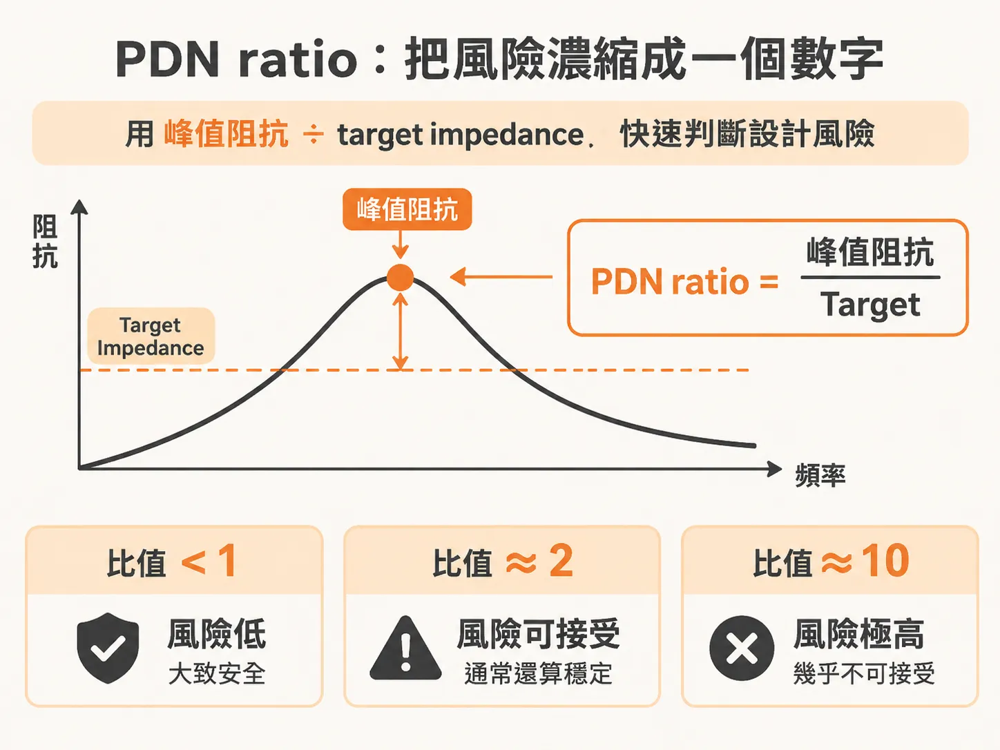
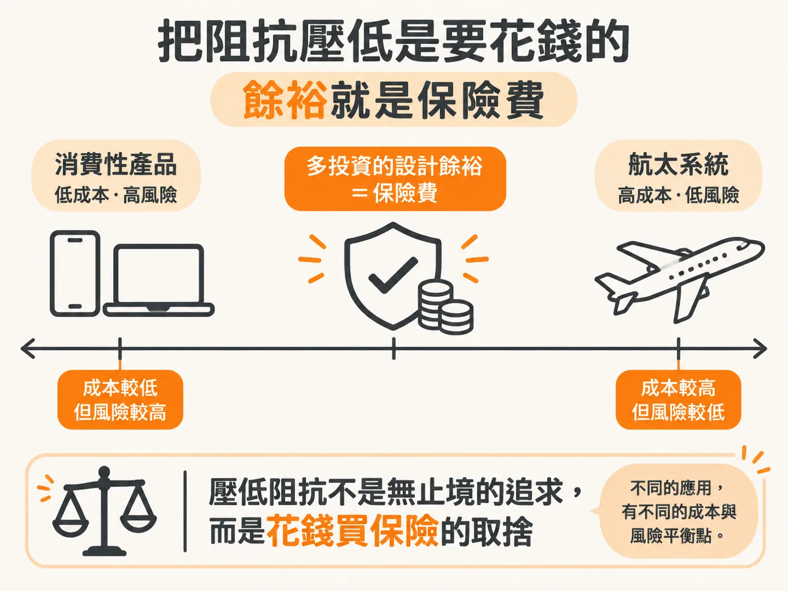
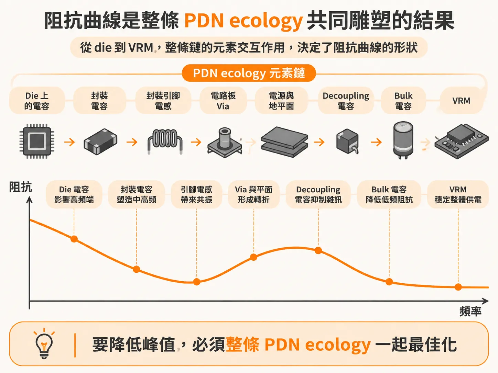

# 雕塑 PDN 阻抗曲線

開發做到一半，你手上會有兩樣東西：一條 target impedance 線，和一條 PDN 的阻抗曲線。target impedance 是驗收標準——最壞情況下，讓電源軌雜訊不超標的最大允許阻抗。而阻抗曲線不會乖乖躺在這條線下面，總有幾個峰凸出來。

這時你面對兩個問題：峰超出 target 多少，產品會在現場失效？把峰壓下去，又要花多少錢？PDN 的工程判斷，就繞著這兩個問題轉。先給你兩個工具：一個把風險換算成數字的比值，一個把曲線特徵對回電路元素的視角。

## PDN 設計只有三個步驟

實際動手是三步。先依照對晶片功能和應用的了解，給 target impedance 一個最佳猜測。接著做工程決策，讓阻抗曲線盡量貼著這條規格。最後求平衡：做這條曲線的成本，對上現場失效的風險。

注意第一步是「猜」。依據是對晶片功能與應用的了解，不是精確計算。target impedance 從一開始就是估計值，後面每一步都靠工程判斷收尾。

## PDN ratio：把風險變成一個數字

峰有多危險，不要憑感覺。把實際的峰值阻抗除以 target impedance，得到的比值就是 PDN ratio。它是「電路要跑在規格性能時，發生 PDN 相關失效」風險的粗略指標。

判讀標準來自實務經驗：

- ratio 低於 1：整條曲線都在 target 之下，PDN 相關失效的風險低。
- ratio 到 2 左右：風險通常還能接受。
- ratio 到 10：幾乎必然是不可接受的風險。就算多數 microcode 都跑得動，總會有一些剛好激發 PDN 共振，讓產品出現穩定性問題。

為什麼用比值、不用絕對值？因為決定風險的是阻抗超出驗收線的程度，不是阻抗數字本身。target impedance 本來就是替這顆晶片量身算出來的，峰值除以 target，直接量出超出驗收線幾倍，不同設計才放得上同一把尺。

## 壓低阻抗，是要花錢的

想把 ratio 降下來，先要知道代價。低阻抗的 PDN 幾乎總是更貴：要放更多零件；組裝設計規則收得更緊，良率跟著受影響；板子或封裝得多幾層；die capacitance 要佔掉更多晶片面積；或者直接改用更貴的材料。

die capacitance 是藏在晶片裡的電容。多要一些，代價就是晶片面積。

成本和風險怎麼取捨？說穿了，是問自己能接受多少風險。多花錢換設計餘裕，就是買保險：保費付在設計上，換到更低的現場失效機率。這是 PDN 設計最根本的取捨。

取捨點沒有標準答案，看產品。消費性產品被成本追著跑，刻意選一個風險比偏高、但便宜得多的設計，可能是更好的平衡。航太系統剛好相反：多花錢把 ratio 壓到 1 以下，才是符合成本效益的選擇。不同的應用，有不同的成本與風險平衡點。

## 雕塑阻抗曲線：整條 ecology 一起做

有了量風險的比值，接下來是手段。PDN 設計的目標，是從 DC 到電源軌電流的最高頻成分，整段範圍都工程出一條可接受的阻抗曲線。這條曲線不是任何單一零件給的，是整個 PDN ecology 一起雕塑出來的結果。

PDN ecology 是把整個電源傳輸網路看成一個整體：從 die 的 pad 到 VRM 之間的所有互連與零件，彼此互動，共同決定 die 實際看到的阻抗曲線。沿著鏈列一遍主要元素：die 上的電容、封裝上可能放的電容、封裝引腳電感、電路板 via、板上的電源與地平面、decoupling 電容、bulk 電容，最後是 VRM——負責產生這條電源軌的穩壓模組。

所有元素互相影響，但曲線上的每個特徵，仍然指認得回特定的設計特徵。這是整件事做得下去的關鍵：把各元素的功能切開來看，就能各自獨立最佳化，不必每次重畫整條鏈。

前提是盯著介面。介面是一個元素的阻抗碰到另一個元素的阻抗的地方。PDN 設計很大一部分的功夫，不在零件本身，而在零件之間的介面。

這也是雕塑的完整意義：要把峰壓低，只調單一元素不夠，元素之間的交互作用也得一起調——整條 ecology 一起最佳化，峰才下得來。

## 拿到曲線，你會怎麼判斷？

PI 工程師最終負責的，是在成本、風險、性能、時程之間找到可接受的平衡。對每個 PDN 元素的細節知道得越多，收斂到可接受的解越快。

下次拿到一條阻抗曲線和一條 target 線，練習兩個動作。先找最高的峰，除以 target impedance，算出 PDN ratio，判斷風險等級，決定值不值得花錢壓它。再把曲線上的每個特徵指認回 ecology 鏈上的元素，決定該動哪裡，並記得檢查元素之間的介面。

一個量化風險，一個定位手段。兩個問題都答得出來，你就能替這片板子開出 PDN 的設計條件。
