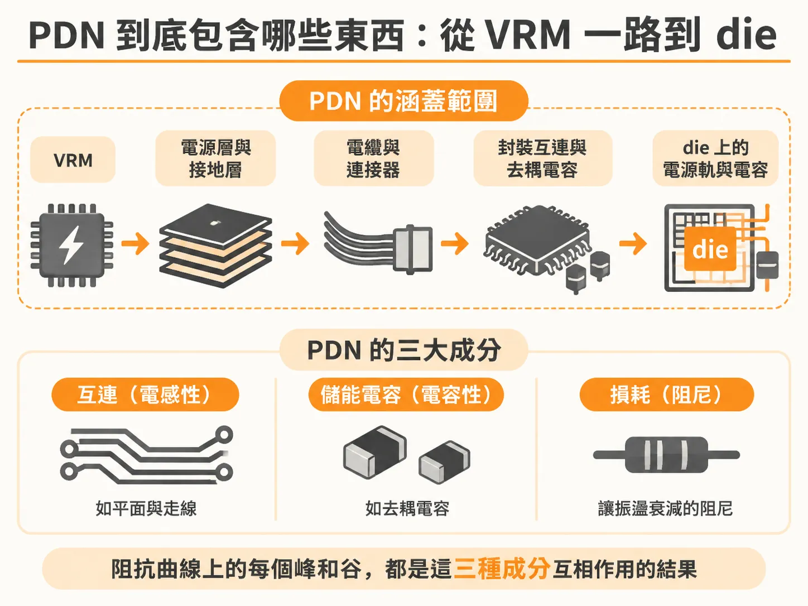
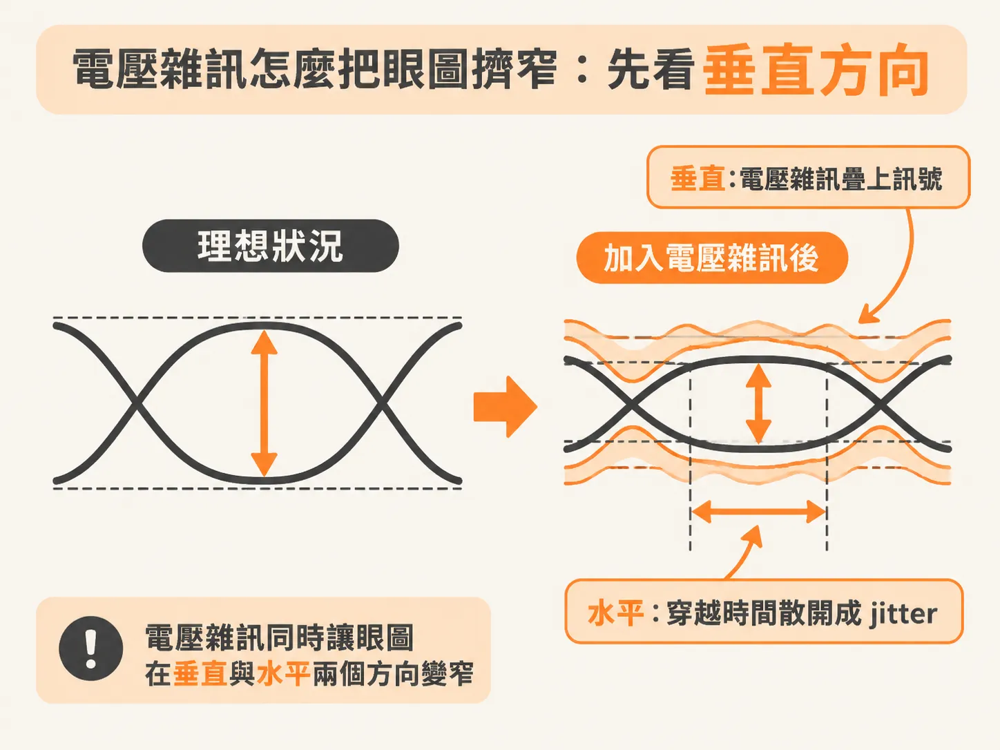
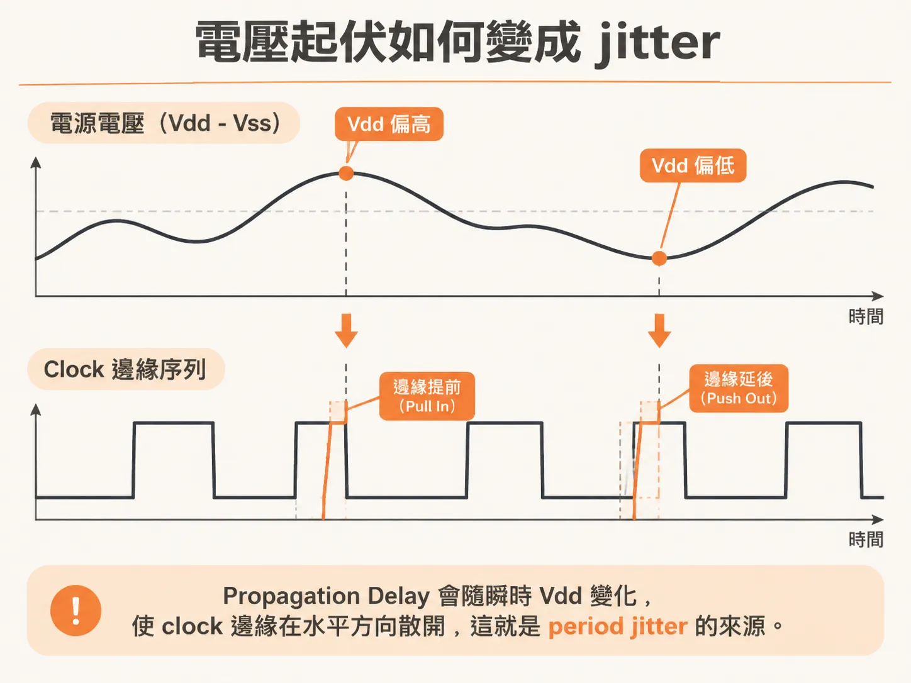

# 什麼是電源傳輸網路（PDN），我為什麼該在乎？

一片跑 300 MHz clock 的微處理器，在 die（封裝裡那顆矽晶片本體）上量 Vdd 到 Vss 之間的電壓。三個不同的 die 位置，都量到超過 125 mV 的雜訊。這個雜訊有很大一部分會疊到接收端看到的訊號上，眼圖（eye diagram）的開口就跟著縮小。要處理它，得先知道它走的是哪條路。這條路叫電源傳輸網路（power delivery network，PDN）：從電壓調節模組（voltage regulator module，VRM）到 die 之間，所有跟供電有關的東西。

## PDN 的範圍：從 VRM 到 die

VRM 負責把電源轉成晶片需要的直流電壓。電從 VRM 的焊墊出發，一路走到 die 上的電路。中間的每一樣東西都算 PDN：板上的電源層與接地層、電纜、連接器，還有沿途所有跟供電有關的電容。範圍的終點畫在 die 上的 Vdd-Vss 電源軌，die 自己的電容也算在內。

這條路裡有三種成分。第一種是互連（interconnect），例如平面與走線，通常是電感性的。第二種是刻意放的儲能元件，主要是電容，通常是電容性的。第三種是損耗，也就是讓振盪衰減下去的阻尼（damping）。阻抗曲線上的每一個峰和谷，都是這三種成分互相作用的結果。

## PDN 的三種角色

PDN 的任務有三個。第一，把低雜訊的直流電壓和功率，送到所有在做事的主動元件。第二，替所有的訊號提供一條低雜訊的迴路徑。第三，處理電磁干擾（EMI）問題，而且自己不能變成輻射源。

第一個角色是重點：把直流電壓送到位，並把雜訊壓在可接受的範圍內。雜訊沒壓住，眼圖就會縮小。

## 切換雜訊、接地彈跳，還有自雜訊

有些雜訊很難說歸誰管。I/O 的切換電流流經共用的封裝引腳電感（這條電感最終接到 VRM），在電源軌上產生的雜訊，有人叫它切換雜訊（switching noise），也有人叫接地彈跳（ground bounce）。die 上核心電路自己切換、在 Vdd 軌上造成的暫態雜訊，則叫自雜訊（self-aggression）。

分清楚是哪一種，才能選對解法。板上加去耦電容（decoupling capacitor）常常能降低 Vdd 核心雜訊，但對高頻寬訊號在平面空腔（cavity）裡激起的雜訊幾乎沒有幫助。板級電容對回流平面彈跳（return-plane bounce）也沒什麼改善，它們產生的並聯共振甚至可能讓 cavity 到訊號的 cross talk 變大。解決問題的第一步，是把問題和根因認清楚。

## 電壓雜訊怎麼關掉眼圖：先看垂直

PDN 雜訊會直接疊加到發送端（TX）送出的訊號上，也可能出現在接收端（RX）的電壓參考（voltage reference）上。兩種情況都會吃掉其他雜訊源原本留下的雜訊裕度（noise margin）。很多電路裡，電源雜訊有相當大的比例會直接出現在 RX 看到的訊號上。

眼圖的垂直開口，就是被這種電壓雜訊壓縮的。訊號振幅的上下兩端各多了一層雜訊，開口從兩頭往中間縮。那 125 mV 即使還不足以單獨造成位元錯誤，也會持續貢獻 eye closure（眼圖閉合）。跟其他雜訊源加總起來，就可能真的造成失效。

## 水平方向：從電壓到 jitter

同一個電壓雜訊也吃掉水平方向。propagation delay（輸入的電壓轉換傳過一連串閘、到輸出轉換出現所需的時間）取決於瞬間的 Vdd 電壓。CMOS 技術裡，drain-to-source 電壓越高，通道裡的電場越強，propagation delay 就越短。Vdd 到 Vss 的電壓越低，delay 就越長。

所以電源軌上的雜訊會直接變成輸出訊號的時間抖動（jitter）。Vdd 偏高時，clock 邊緣被「拉近」（pull in）；偏低時，clock 邊緣被「推遲」（push out）。訊號穿越參考電位的時間在水平方向散開，眼圖的左右開口就跟著縮小。核心電路裡過量的水平雜訊，可能造成 setup 和 hold time 違反，直接變成功能失效。

## 1 ps/mV：100 mV 就能吃光 timing budget

有個實測可以感受這件事的規模。一片高端 FPGA 測試晶片上，clock 分布網路和其他幾組閘共用 Vdd 軌。那些閘用偽隨機位元序列（PRBS）切換，從 PDN 抽大電流，產生大的暫態電壓雜訊。這些雜訊作用在 clock 分布網路上，讓每個 clock 週期出現變化。period jitter 量的就是相鄰兩個 clock 邊緣之間的時間。

結果是：每 1 mV 的電壓雜訊，大約貢獻 1 ps 的 jitter。100 mV 峰對峰的 PDN 雜訊，就是 100 ps 峰對峰的 jitter。在 2 GHz 的系統裡，clock 週期只有 500 ps。光是 PDN 雜訊這一項，就把整個 timing budget（時序預算）吃光了。

這個 1 ps/mV 是粗略估計，很多元件都在這個量級附近。它也是一條好用的換算：把電源雜訊的峰對峰 mV 直接當成 ps 來讀，量級就對了。
