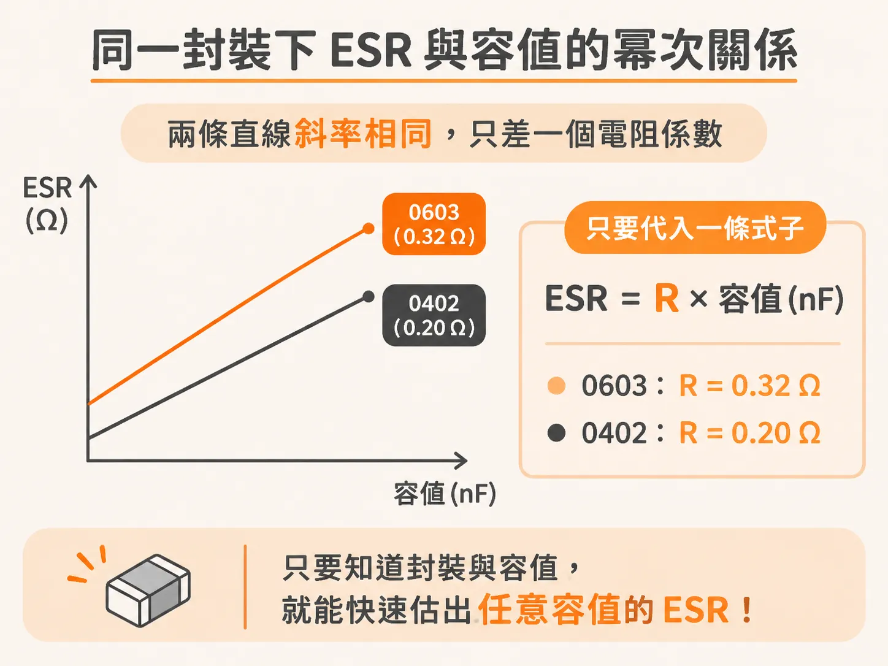
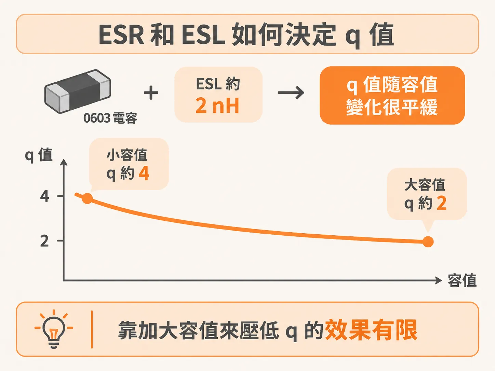
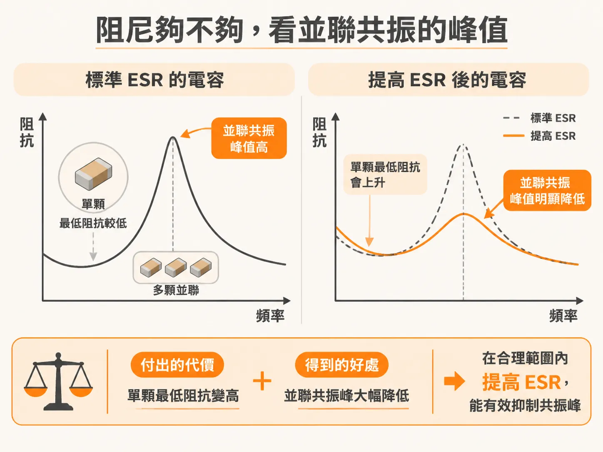

# 從規格表估算電容的 ESR

上一節的結論是：谷底的高度就是 ESR。真正排 BOM 時，問題卡在另一邊——規格表上沒有這個數字。

你排完 BOM，手上一堆 0402 和 0603 的 MLCC。你想跑 SPICE 看 PDN 的阻抗曲線。打開規格表，裡面有標稱容值、額定電壓、溫度特性，就是沒有你要的 ESR。

沒有 ESR，你算不出並聯共振的峰有多高，也不知道阻尼夠不夠。一顆一顆量測最準，但樣品都還沒到。

ESR 不必憑空猜。它跟容值綁在一起，而容值就在規格表上。

## ESR 不是獨立參數

電容的實體空間有限。極板對數越多，容值越大。並聯的導體截面越多，串聯電阻越小。所以同一種 body size、同一種介電材料，容值越大，ESR 通常越低。

ESR 有兩個來源：極板那層薄導體的串聯電阻，以及極板之間陶瓷材料的介電損耗。低頻時介電損耗主導。頻率往上走，電流不容易鑽進極板深處，導體損耗的占比就變大。兩者疊起來，就是規格表上那條阻抗曲線的谷底。

## 用兩個係數把 ESR 估出來

把 AVX 規格表上 0402 與 0603 的容值與 ESR 抽出來，畫在雙對數座標上，會得到兩條直線。直線代表冪次關係：容值上升，ESR 以固定的次方下降。

兩條直線的斜率相同，只差一個電阻係數。0603 的 X5R 材料是 0.32 Ω，0402 的 X5R 材料是 0.20 Ω。容值用 nF，估出來的 ESR 就是 Ω。

這組數字是從 AVX 的 SpiCAP 資料庫反推出來的。擬合貼得太好，反而透露一個線索：廠商很可能就是用一條解析式在產生這些 ESR 值。這等於把他們的內部公式還原回來。

換成別家廠商、別的量測條件，函數形式大概還是這樣，但兩個係數要重估。這不影響它的用處。有這條式子，任何 SPICE 電路裡都能直接算出某個容值對應的 ESR，不必為每一顆電容去查表。

## 由 ESR 和 ESL 算 q

q 描述的是自振的阻尼。q 越高，自振頻率附近那個谷越尖，能量在裡面來回振盪得越久。在串聯 RLC 模型裡，q 由三個元素決定：q 大致等於 √(ESL/C) 再除以 ESR。

先假設 ESR 對所有容值都一樣。容值變成四倍，q 就掉一半，因為 q 跟容值的平方根成反比。這個結論聽起來很有力：大容值的電容阻尼好得多。

實際情況打了折扣。ESR 只隨容值慢慢下降，沒有容值漲得那麼快，所以 q 只微微下滑。以 0603、ESL 約 2 nH 估算，小容值的 q 大約 4，大容值的 q 大約 2。

只要 ESL 相近，不同容值的電容在自振點上的 q 差不多。想靠加大容值來壓低 q，效果有限。

## 阻尼夠不夠，看並聯共振的峰

單顆電容的 q 只是起點。真正決定 PDN 好壞的，是兩顆不同容值的電容並聯之後，在並聯共振頻率上的那個峰。這個峰必須壓在目標阻抗以下。

有三個旋鈕可以壓低它：拉近兩顆的容值、降低 ESL、提高 ESR。

前兩個旋鈕的空間有限。容值要拉近，能挑的檔位就變少。ESR 才是關鍵的那一個。方向很清楚：在合理範圍內，ESR 越高，峰越低。問題是標準 MLCC 的 ESR 實在太低，低到把 ESR 調高幾乎只有好處。

## Controlled-ESR 零件

這幾年廠商推出了「controlled ESR」這類電容。做法是把極板金屬圖案局部做窄，或在極板之間串一個小的印刷電阻，故意把串聯電阻做大。

各家做出來的阻值不太一樣，大致落在 100 mΩ 到 1.2 Ω 之間，而且跟容值無關。Murata 有一個 0816 反轉長寬比的系列，容值 1 µF，ESR 可以選 0.1 Ω、0.22 Ω、0.47 Ω 或 1 Ω；同尺寸標準品的典型值只有 0.016 Ω。

TDK 的量測也吻合：一批標稱 10 µF 的 controlled ESR 電容，ESR 從 20 mΩ 一路到 1 Ω，測試治具裡的 ESL 約 0.6 nH。

要看清楚它換到什麼，得把兩件事分開。加 ESR 之後，單顆電容在自振點上的最低阻抗會變高，這是代價。真正的好處在多顆並聯的時候：並聯共振的峰變低了。

## 選用時的三個限制

第一，容值與 ESR 脫鉤之後，ESR 是固定的。容值越大，q 越低，阻尼越好。這是它最大的價值，也是它特別適合大容值位置的原因。

第二，目前只有大容值有這種零件，通常要 1 µF 以上。

第三，同一個 body size 下，controlled ESR 能給的容值比標準品小。你要拿一部分容值去換阻尼。

值得換的場合很具體：低頻時跟 VRM 之間的並聯共振，以及封裝上 on-die 電容與封裝電感之間的並聯共振。這兩個地方的 q 都很高，標準電容壓不住。

## 估算之前，先知道誤差有多大

實際零件的離散度會吃掉不少精度。拿 15 顆標稱完全相同的 100 µF、1210 MLCC，來自不同廠商，量出來的 ESR 從 0.01 Ω 到 0.003 Ω，差了三倍。三倍的 ESR 差距，會直接反映在並聯共振峰的預測上。

所以，如果峰高對你的設計很關鍵，就量。如果還不到那個階段，用一個常數 R 近似就好：取自振點上最低阻抗對應的那個 R。在 10 MHz 到 100 MHz 之間，常數 R 跟完整的頻變模型非常接近，而這個近似本身的誤差，比零件與零件之間的差異還小。

先用手上的容值把 ESR 估出來，算出 q，看峰壓不壓得住目標阻抗。壓不住，就換 controlled ESR 的零件。
