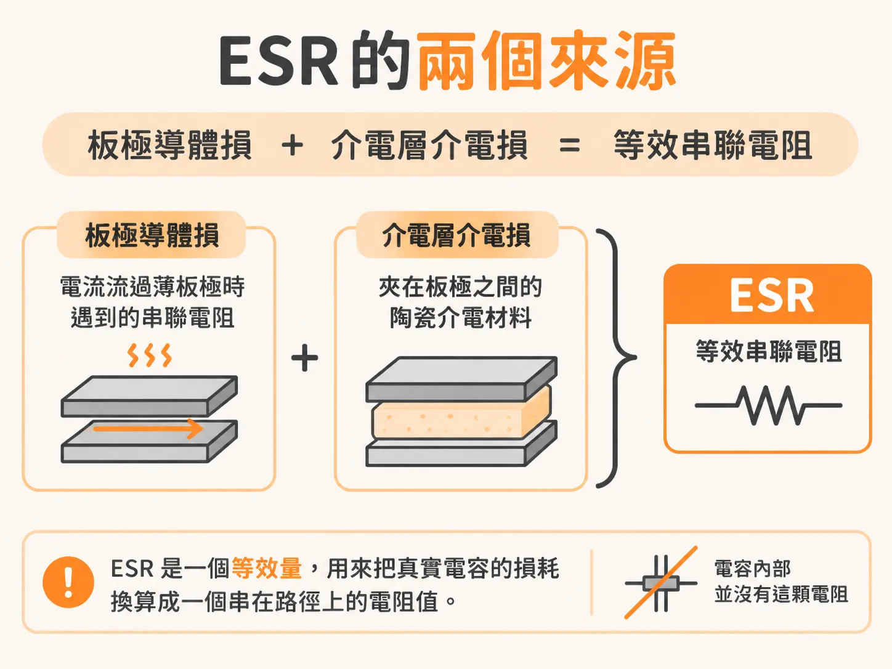
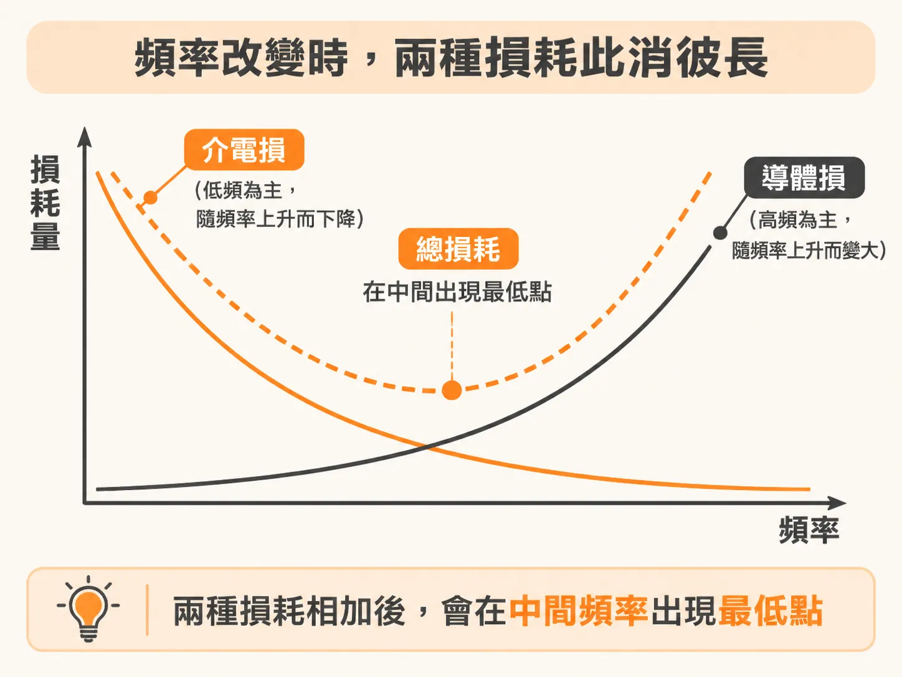
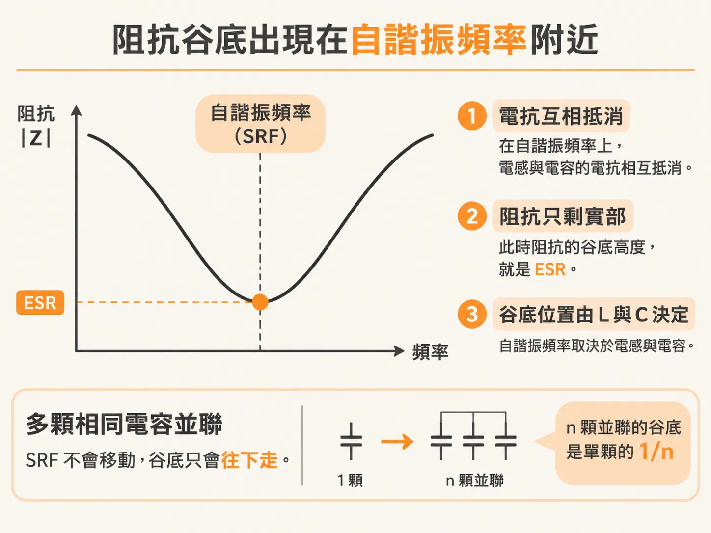

# 電容的 ESR 由兩個損耗機制組成

你打開電容廠商的規格書，會看到一條阻抗對頻率的曲線。頻率從低往高走，阻抗先隨頻率下降。到了某個頻率，阻抗落到最低點。之後，阻抗再隨頻率上升。這個最低點所在的頻率叫自諧振頻率（SRF，series self-resonant frequency）。谷底那個阻抗值，就是這顆電容的 ESR。

ESR 數值很小，但決定很多事情。它決定單顆電容在 SRF 上能把阻抗壓到多低。它也決定多顆電容並聯之後，並聯共振的峰值會被拉高到多少。要預測電源分配網路（PDN）的阻抗曲線，就得先知道 ESR 從哪裡來，以及它為什麼長成這個形狀。

## ESR 是等效出來的電阻，不是一顆真的電阻

真實電容在多數實務情況下，可以用一顆理想電容、一顆理想電感、一顆理想電阻串起來描述。這顆電容只在頻率遠低於 1 MHz 時，才真的像理想電容。頻率再往上，這個串聯 RLC 模型和量測結果還是對得很好。

其中的 R 就是 ESR，等效串聯電阻。它的作用，是把真實電容裡發生的損耗，換算成一個串在路徑上的電阻值。所以板極上並沒有焊著這樣一顆電阻。ESR 是一個等效量。

## 損耗有兩份：板極的導體損與介電層的介電損

第一份是導體損。電容內部是一疊很薄的平行導體板，也就是板極。電流必須穿過它們。板極本身有電阻，電流一過就產生損耗。這就是這些薄板的串聯電阻。

第二份是介電損。兩片導體之間夾著陶瓷介電材料。它不是完美絕緣體，在交變電場下會損耗能量。這份損耗用材料的耗損因數 Df 描述。只需要這一個參數，就能把介電損放進電路模型裡。

兩份損耗同時存在，所以 ESR 是兩者的疊加。真正的差別在於：不同頻段裡，哪一份佔的比例大。

## 頻率往上，兩份損耗此消彼長

介電損可以用一個並聯的 RC 表示。這個 R 對應介電層的導納 G。G 裡有一個直接跟頻率成正比的項。所以頻率越高，這個並聯電阻越小。結果是介電損把阻抗的實部往低頻推高。低頻那一段的電阻，主要就是它貢獻的。

導體損的方向剛好相反。頻率升高時，電流越來越不願意離開基板上的回流路徑。它也就不願意深入到電容本體裡。電流集中在靠近銲墊的底層板極，實際導電的截面變小，電阻於是上升。這個現象和導體的集膚效應同源。所以電阻隨頻率的變化也是開根號的形式，大約在 F0 以上開始明顯。F0 是電流深度效應開始主導的頻率。

一份隨頻率下降，一份隨頻率上升。

## 最低點落在自諧振頻率附近

把兩份損耗疊起來，低頻端由介電損主導。高頻端由電流深入深度變淺的導體損主導。中間就出現一個最低點。

對串聯電感大約 1 nH 的陶瓷電容，這個最低點一般落在 10 MHz 到 100 MHz 之間。而這個頻段，大約就是這類電容的 SRF 所在的位置。

會剛好對上，並不意外。在 SRF 上，電感的電抗和電容的電抗互相抵消。阻抗只剩下實部，也就是 ESR。谷底的位置由 L 和 C 決定。谷底的高度由 R 決定。介電損在低頻把 R 抬高。導體損在高頻把 R 抬高。兩邊都抬不到的地方，就是 SRF。

這也是為什麼量測時可以直接讀阻抗曲線的谷底：那裡讀到的就是 ESR。多顆相同電容並聯時，SRF 不會移動。谷底只會隨顆數往下走。n 顆並聯的谷底是單顆的 1/n。

## 實務上：三個參數，一個常數近似

要完整描述一顆真實電容的 ESR 隨頻率的行為，需要三個參數。這些參數每顆都不太一樣，取得也不容易。很多廠商直接提供阻抗曲線，曲線裡已經包含這兩種損耗。把三個參數調到和曲線對上，就得到一個可以放進 SPICE 的模型。以 AVX 的 0402、10 nF、ESL 0.4 nH 為例，三參數模型和原廠曲線對得很好。

不想一顆一顆量的話，還有一個更省事的做法：用一個常數 R 近似，值取在 SRF 上的最低阻抗。在 10 MHz 到 100 MHz 這個區間，常數 R 和隨頻率變化的 R 差別不大。整體阻抗曲線幾乎看不出差異。

這個近似也站得住腳。把 15 顆標稱同為 100 µF、1210 尺寸、來自不同廠商的 MLCC 擺在一起量，從谷底讀出來的 ESR 從 0.01 Ω 到 0.003 Ω，差了三倍。用常數模型帶來的誤差，比元件之間的變異還小。

高頻端那段往上爬的 ESR，對壓低並聯共振有幫助。但那是次要的效果。真正要抓住的，是谷底在哪裡，以及谷底有多低。
