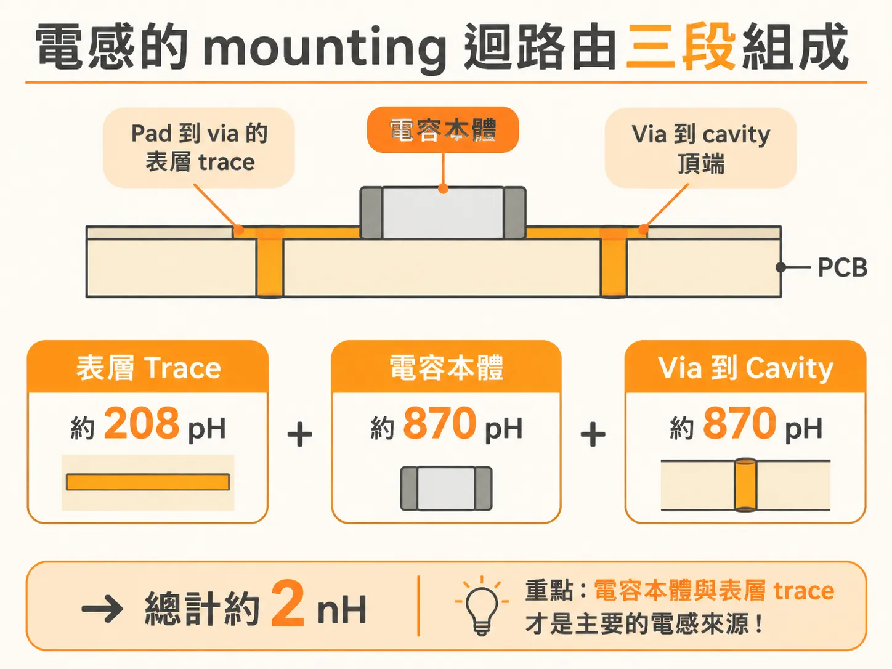
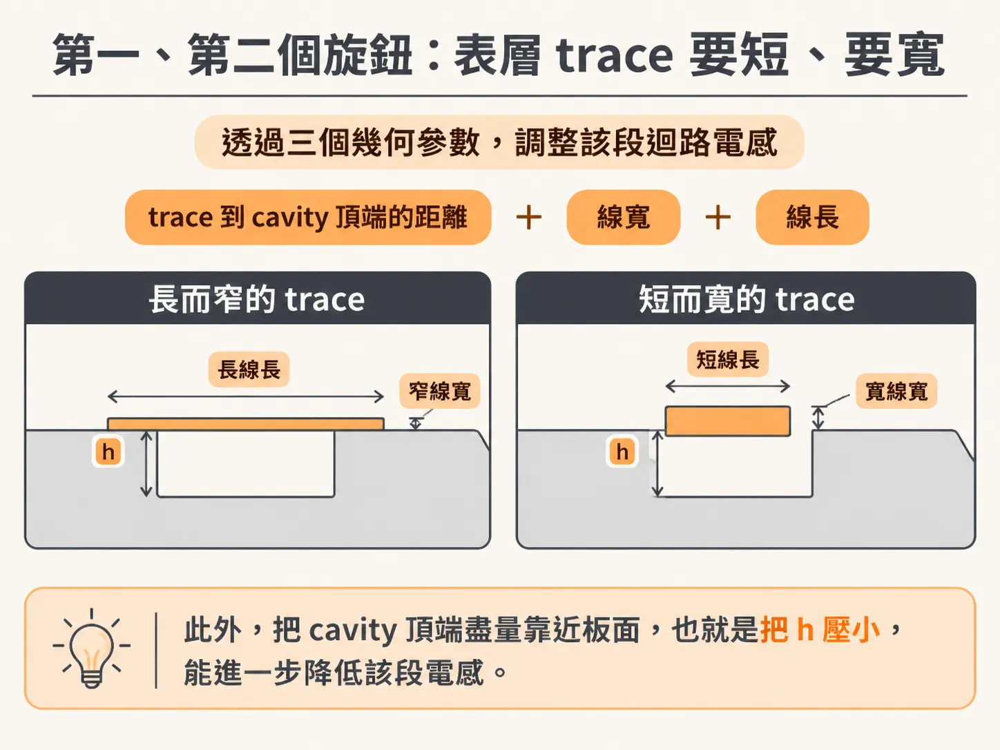
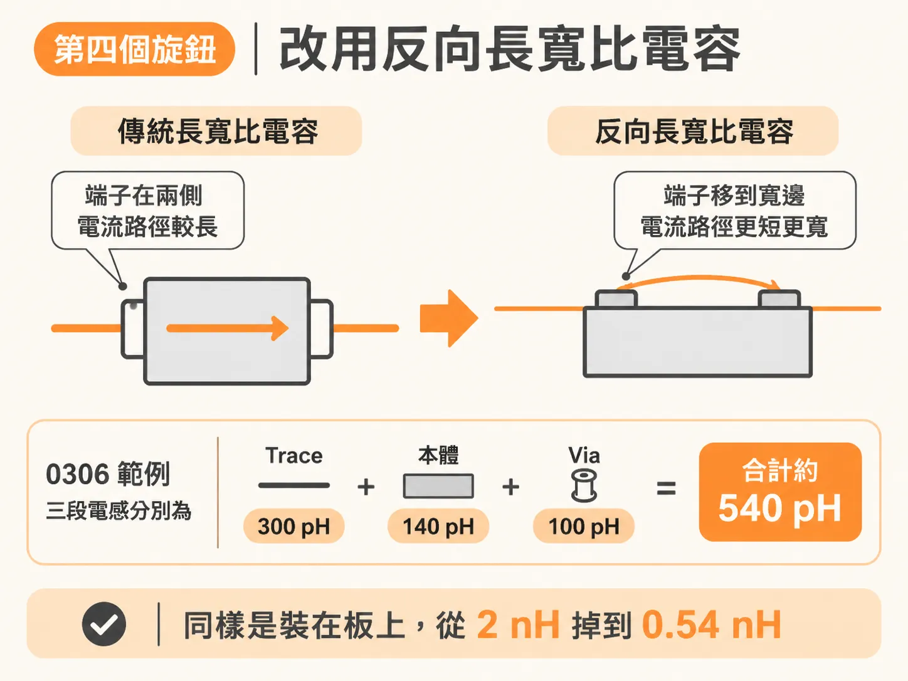
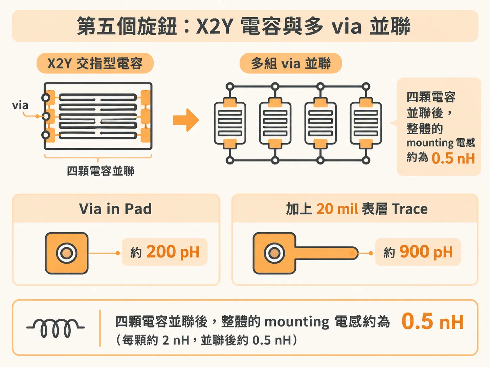

# 降低電容 mounting 電感的五個設計旋鈕

一顆 0603 電容放上板子，量到的不是單純的電容。它是一顆電容串了一個大約 2 nH 的電感。

真實的電容只在低頻像理想電容。大約 10 MHz 以上，阻抗行為就變了。主因是串在迴路裡的 mounting 電感。它把自振頻率往下拉。於是在你需要它工作的頻段，它已經不太像電容。

2 nH 不是天生註定，是幾何造成的。用常見設計參數、沒有特別為最低 mounting 電感下功夫的 0603 電容，裝起來大約就是 2 nH 這個量級。好消息是它可以拆成幾段，一段一段往下壓。

## 從三段預算到五個旋鈕

上一節把 0603 的 1948 pH 拆成三段：via pair 208 pH、兩條表層 trace 870 pH、電容本體 870 pH，合計約 2 nH。這一節把同一份預算換個角度用：三段各自當成一個可以轉動的旋鈕。

力氣該往哪裡使，從比例就看得出來。via 只佔一成，真正的大頭是那兩條 30 mil 的表層 trace 和電容本體。底下的數字都是粗估，用來比較不同幾何的相對大小；整體迴路真正的電感，只有把完整幾何都放進去的 3D 場求解器才算得準。

## 第一與第二個旋鈕：trace 要短，要寬

表層 trace 的迴路電感可以用 FR4 上 microstrip 的近似估。它跟 trace 到 cavity 頂端的距離 h、線寬 w、線長 Len 有關。

代入 h = 10 mil、w = 10 mil、Len = 30 mil，單邊 trace 得到約 435 pH。電容兩側等長的話，兩隻腳合計 870 pH。

所以兩個方向很直接：長度縮短，寬度加大。長度是線性的，短一半就少一半。寬度也一樣直接。0306 的反向長寬比電容把線寬做到 60 mil，同樣兩條 trace 的貢獻就只剩約 300 pH。

同一組數字裡還藏著第三個旋鈕：把 cavity 頂端盡量靠近板面，也就是把 h 壓小。

## via：靠攏有用，但幅度有限

一對 via 的迴路電感可以用兩根圓柱的近似來估。它和中心距 s、半徑 r、長度 Len 有關，前提是 s 遠大於 r。

把 via 從 80 mil 間距拉到 40 mil，迴路電感只是稍微下降。這說明讓去回電流靠得近一點是對的方向。但光是靠攏，改不了大局。

via 真正能出力的地方是「多」。多組 via 並聯、利用 via 之間的互感互相抵消，這些才是把 via 那一段壓下去的來源。

反過來看一個常見的壞主意：把電容掛在 BGA 下方的板子背面，直接接到 BGA pad stack 的 power 與 ground via。這樣一來，主導項變成 via 穿過整塊板子的迴路電感。ball pitch 50 mil、via 半徑 5 mil 時，每 mil 大約 23 pH。64 mil 厚的板子，光 via 就是 1.5 nH。板子越厚越吃虧。壓在 BGA 下面不一定比較好，要算過才知道。

## 第四個旋鈕：反向長寬比電容

反向長寬比電容把端子放在寬邊上。電流從寬的那一側進出，走的距離短、截面大。

一顆 0306 的反向長寬比電容，參數可以是這樣：trace 高度 5 mil、寬 60 mil、長 10 mil（via 直接在 pad 上），電容本體高度 5 + 10 = 15 mil、寬 60 mil、長 30 mil，via 間距 40 mil、直徑 10 mil。

拆下來的結果：trace 約 300 pH、本體約 140 pH、via 約 100 pH，合計約 540 pH。同樣是裝在板上，從 2 nH 掉到 0.54 nH。

這個旋鈕有一個副作用要一起看。端子之間的方塊數同時決定 ESL 和 ESR。方塊數從 2 降到 0.5，ESR 可能只剩標準方向的 25%。阻尼變差、Q 變高。如果總迴路電感沒有同步大幅下降，並聯共振的峰值阻抗反而可能更高。所以每一種設計都要各自分析，比較取捨。

## 第五個旋鈕：X2Y 與多 via

X2Y 是三端子電容。它也算 interdigitated capacitor（IDC，交指型電容）的一種：端子在兩端與中間，結構上像好幾顆電容並聯。但 via 的排列方式讓它可以做貫穿孔，不會擋到走線通道。

當四顆電容並聯，整體的 mounting 電感就是四顆迴路電感的並聯。每顆大約 2 nH 的話，並聯後大約 0.5 nH。

並聯帶來四個好處：多顆電容並聯、多組 via 對並聯、可以利用 via 之間的互感再壓 via 電感、以及更大的 via 到 cavity 的 footprint，連 spreading 電感都跟著降。大部分的好處其實來自 via 的排列，不是電容本身。

X2Y 的 mounting 電感不好直接算，因為並聯路徑太多。實務上的估法是先算四分之一顆的 mounting 電感，再依並聯顆數縮放。

長度在這裡依然關鍵，而且關鍵得嚇人。兩顆同樣的 X2Y 裝在板上，一顆用 20 mil 表層 trace，一顆把 via 直接做在 pad 上：via in pad 的迴路電感可以低到 200 pH。只是加上 20 mil 的 trace，就變成 900 pH。還是低，但已經是四倍多。

## 越低，越要顧細節

mounting 電感低的時候，很小的東西就能把它拉高。這就是為什麼低電感電容要真的做進板子時，細節值得一個一個盯。

尺寸更小的場合還有更多空間。封裝基板有 build-up 層和 micro via，via 可能只有幾 mil 長。多顆 via 可以放在電容端子正下方、用最小間距排列。這種情況下，mounting 電感低到 100 pH 是可能的。

放到整個產品來看，把 MLCC 的 mounted ESL 壓到 4 nH 以下，實務上應該都做得到。做得好可以低於 2 nH。好的設計可以低於 0.5 nH。

差別就在那幾個旋鈕：trace 短、trace 寬、cavity 貼近板面、端子放在寬邊、via 多用幾顆。
