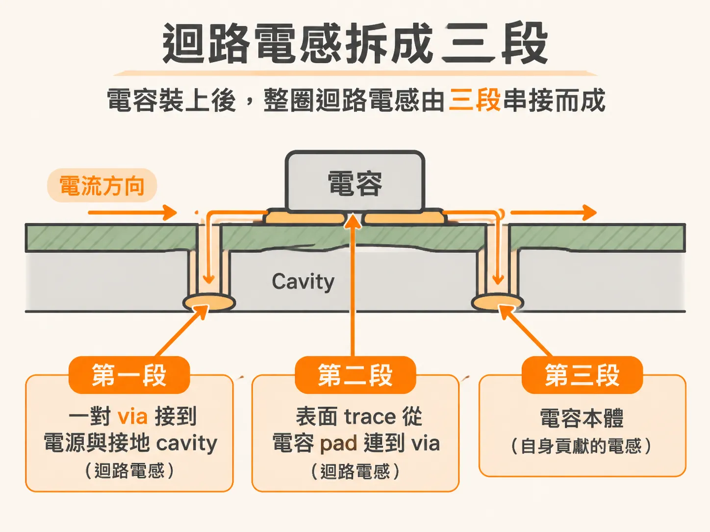
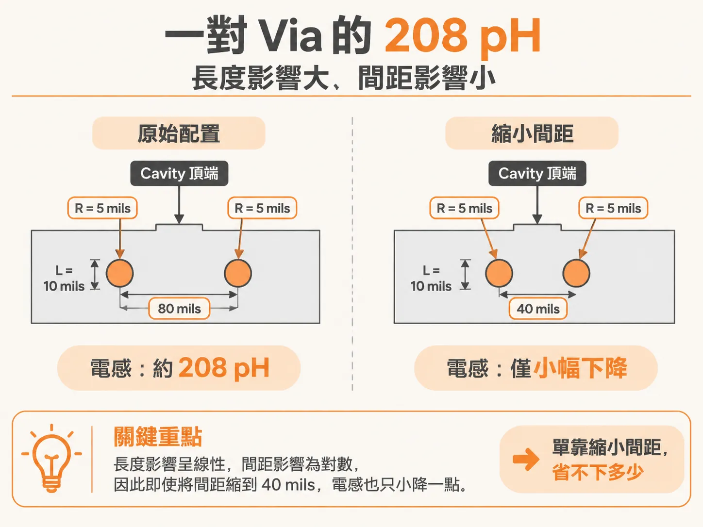
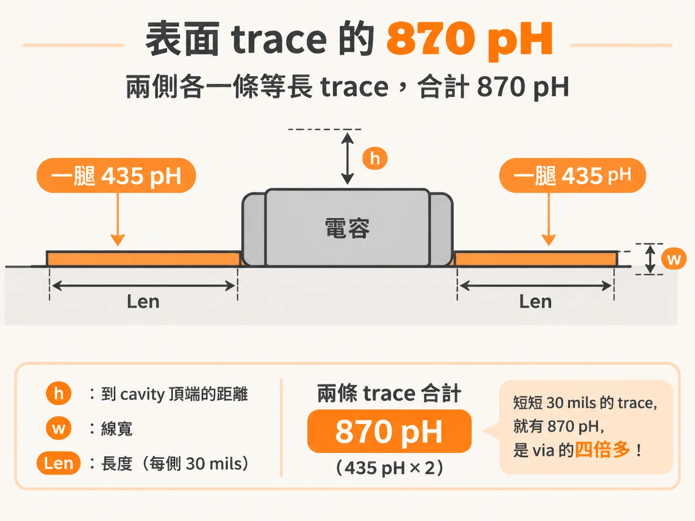
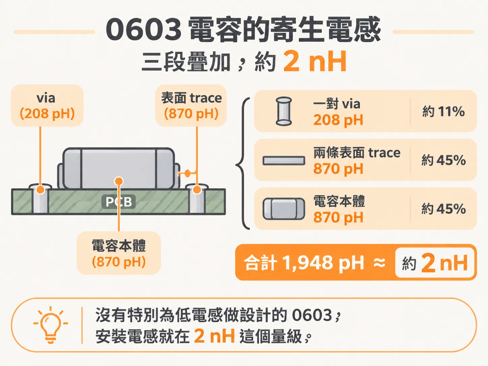

# 電容的安裝電感

ESR 決定峰有多高，接下來換另一邊：高頻段還剩下多少電容，由迴路電感決定。

選 0603 的 MLCC 時，看的是電容值。不過頻率到 10 MHz 以上，它還剩多少效果，主要不是電容值決定，而是焊上板子後多出來的那一段迴路電感。

這段迴路常比電容本身還大。可以拆成三塊來看：一對 via、表面 trace、電容本體。每一塊都用板上的尺寸粗估，加起來之後，0603 的典型值約 2 nH。知道 2 nH 是哪三個數字來的，才知道該動哪一個尺寸。

## 只有整圈的電感算數

電容焊上板子後，真正影響阻抗的是整個迴路的電感，不是其中一小段。迴路電感由兩部分的 partial inductance 相加：電容自己那一段，通常叫 intrinsic inductance；再加上 mounting structure 那一段。兩者之間還有 mutual inductance，要從相加結果減掉兩倍的 mutual。

把供應商的 RLC 模型直接和 mounting structure 疊加很常見，但容易誤導。模型幾乎不說明它的 ESL 是在什麼幾何上定義。就算有說明，給的 ESL 通常也偏保守：電容的 partial inductance 和 mounting structure 的 partial inductance 之間的 mutual 被忽略了。

忽略 mutual 的誤差要看情況。板上有從 pad 連到 via 的表面 trace、板子厚、via 長時，誤差很小。換成 0201 這種小電容、pad 裡直接做 micro via 的裝法，誤差就變大。

## 拆成三段

安裝電感是整圈迴路裡可以自己控制的那一段。它包含兩塊：一對 via 接到 cavity 的迴路電感，以及表面 trace 接到 cavity 頂端的迴路電感。再加上電容本體自己貢獻的一段，總共三段。

三段用同一種近似：一段長度為 Len 的導體，加上它下方的回流路徑。via 那段用兩根圓柱近似；表面 trace 和本體那段用 FR4 上 microstrip 近似。這些都是粗估，用來比較不同幾何的相對大小。要算準，得靠 3D field solver 把整個幾何吃進去。

## 第一段：via pair，208 pH

via 從板面走到電源與接地 cavity 的頂端，假設長 10 mils、半徑 5 mils，兩根 via 的中心距 80 mils。這樣一對 via 的迴路電感大約 208 pH。

這個數字對長度是線性的，對間距只走對數，所以縮小間距的收益很有限。把 via 從電容兩端移到電容邊緣、中心距縮到 40 mils，電感只小降一點。方向對，但光靠這一招省不下多少。

## 第二段：表面 trace，870 pH

表面 trace 的迴路包括 trace 本身和 cavity 的頂面。取 trace 到 cavity 頂端的距離 h = 10 mils、線寬 w = 10 mils、長度 Len = 30 mils，一條腿的迴路電感是 435 pH。

電容兩側各有一條等長的 trace，兩條加起來 870 pH。這只是一條 30 mils 長的短 trace，卻已經是 via 那 208 pH 的四倍多。表面 trace 的長度對安裝電感影響這麼直接，原因就在這裡。

## 第三段：電容本體，870 pH

電容本體也能套同一個 microstrip 近似，困難的是高度。焊錫 fillet 會把電容底部撐離板面 5 到 10 mils。電容內部最外層還有一層介電層，上下兩層厚度通常不相同，外觀也沒標示哪一面朝上。

粗略假設板面到極板底部是 15 mils。電流主要走極板中央，實際離板面的有效距離可以到 20 mils。cavity 頂端在板面下 10 mils，所以 h = 10 + 20 = 30 mils。寬度取 30 mils，長度取 60 mils，本體貢獻的迴路電感大約 870 pH。

## 三段加起來：1948 pH，約 2 nH

三個數字是：

- via pair：208 pH
- 兩條表面 trace：870 pH
- 電容本體：870 pH
- 合計：1948 pH

1948 pH 就是大約 2 nH。前提是 cavity 頂端在板面下 10 mils、表面 trace 長 30 mils 寬 10 mils，裝的是一顆 0603。

這就是常被引用的數字：沒有特別為低電感做設計的 0603，安裝電感就在 2 nH 這個量級。

## 換個幾何，預算就變

把電容放到板子背面、BGA 正下方，直接接上 BGA pad stack 的電源與接地 via，這時主導的是穿過整塊板的 via 迴路。ball pitch 50 mils、via 半徑 5 mils 時，每 mil 的迴路電感是 23 pH。64 mils 厚的板子就是 64 × 23，約 1.5 nH。這個數字要跟「電容放板面、經 cavity spreading 與 BGA via 接到晶片」那條路徑的總和比。厚板對背面裝法不利。

反向長寬比（reverse aspect ratio）的 0306 是好例子。trace 高 5 mils、寬 60 mils、長 10 mils（via in pad）；本體 h = 15 mils、w = 60 mils、Len = 30 mils；via 間距 40 mils、直徑 10 mils。trace 約 300 pH，本體約 140 pH，via 約 100 pH，合計約 540 pH。

代價是 ESR 也跟著降。端子之間的方塊數（squares）從 2 降到 0.5，ESR 可能只剩標準方向的 25%。阻尼變差、q-factor 變高。如果總迴路電感沒有明顯下降，並聯共振的峰值反而可能更高。這種裝法該不該用，得看這兩股力量誰贏。

X2Y 這一類 interdigitated 電容把四顆電容做在同一個本體裡。如果每一顆的迴路電感約 2 nH，四顆並聯後大約 0.5 nH，好處主要來自 via 的排法。表面 trace 在這種低電感裝法上更刺眼：via in pad 時整圈的安裝電感只有 200 pH，加上 20 mils 的表面 trace 就變成 900 pH，多出四倍多。

## 五個旋鈕，和可以到的下限

要把安裝電感壓低，能動的是這幾件事：

- 表面 trace 從電容 pad 到 via 越短越好
- trace 越寬越好
- cavity 頂端離板面越近越好
- 情況允許就改用反向長寬比電容
- 用多顆 via 接電容 pad

實際可以到多少？MLCC 的 mounted ESL 壓到 4 nH 以下，實務上永遠做得到。做得不錯可以低於 2 nH，好的設計可以低於 0.5 nH。package substrate 上有 build-up 層和 micro via，via 只有幾 mils 長，多顆 via 直接打在電容端子下方，100 pH 是可能的值。

## 這套粗估什麼時候不夠用

三段相加只是粗略分解，用來看出哪一段最值得動。真正的總量是整圈迴路，只有 3D field solver 才算得準。

還有一條界線：安裝電感低到遠小於 1 nH 時，電容本身的 distributed 行為就會浮出來。頻率升高時，電流會往電容底部、靠近回流路徑的地方集中，迴路電感隨頻率下降，ESR 隨頻率上升。這種時候簡單的 RLC 模型反而偏保守，會把並聯共振的峰值估得偏高。
