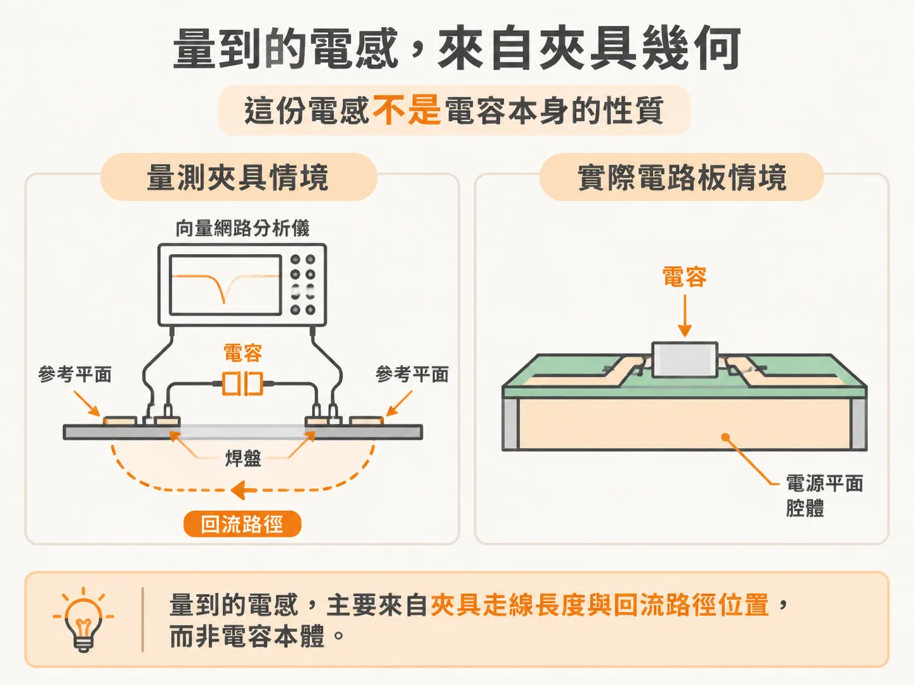
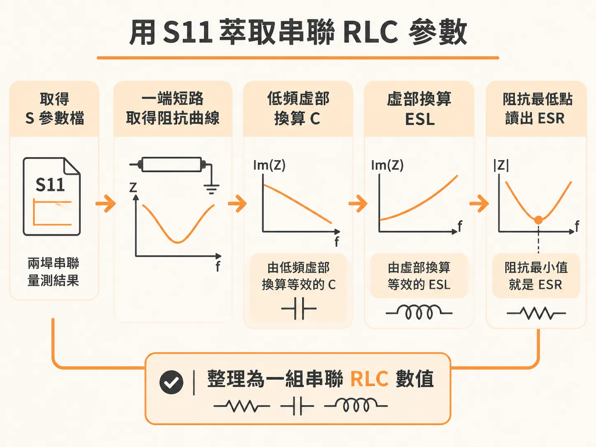
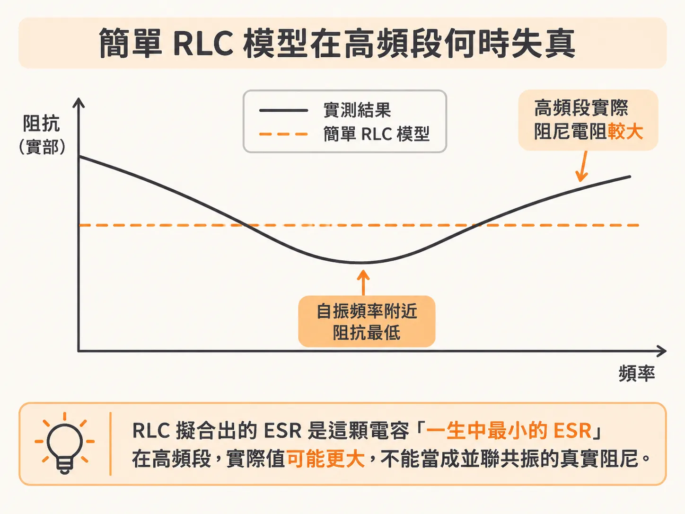

# 如何分析廠商提供的 S 參數模型

mounting 電感壓到自己板子可以接受的程度之後，剩下的不確定性來自電容本體：它的 C 和 ESR 該用哪一組數字？廠商的 S 參數檔看起來是最省事的答案，問題是它裡面裝了多少自己的東西。

你挑了 47 nF 的 0402 電容，準備放進 PDN 模擬。廠商網站上有一個現成的 S 參數檔，頻率還一路到 3 GHz。直接接上去，看起來最省事，也最不容易出錯。

問題是，這個檔案裡有多少是電容，有多少是量測用的夾具？不先分清楚，模擬結果會很漂亮，但不會是你的板子。

## 先分清楚：這個檔案描述電容，還是夾具

電容廠商普遍提供 S 參數模型。這些檔案幾乎都來自同一個做法：把電容裝在一個「串聯」夾具上，做兩埠量測。

電容串在向量網路分析儀（VNA）兩個埠之間。兩個埠的參考平面，各有一段走線連到電容的焊盤。電容正下方則有一條回流路徑。

這個配置量到的電感，會受夾具走線長度和回流路徑位置影響。這份電感不是電容本身的性質。

常見的誤用方式是這樣：把模型的一個埠接到自己板上的電容焊盤，另一個埠短路到地。

這樣接，等於直接把夾具的 mounting inductance 當成自己板上的 mounting inductance。你的板子可能比夾具多很多 mounting inductance，也可能少很多。系統模擬的結果會偏掉。

## 模型本身還有三個風險

就算撇開夾具不談，這些檔案還有三個地方要小心。

第一個是校正。廠商通常會對量測結果做 passivity 與 reciprocity 校正，但不公布演算法。做法大概是把振幅大於 1 的項減掉一個偏移量，再把成對的項換成兩者的平均值。證據很具體：很多檔案裡 S11 與 S22 的振幅與相位，到小數第八位都完全相同。只有模擬出來的、或校正過的資料，才會出現這種事。

校正幅度小的話，問題不大。但我們不知道校正前的資料有多糟，就沒辦法判斷現在這份資料有多好，也無從評估量測品質。

第二個是壞資料照樣上架。有些量測明顯有問題，轉成阻抗一看就是嚴重失真，跟另一組行為正常的量測擺在一起差很多。這種檔案不該發布。

第三個是容量跟標籤不符。有一個標成 10 nF 的模型，實際萃出來的電容只有 5.8 nF。原因之一是廠商習慣用 100 Hz 或 120 Hz 的阻抗電橋量電容值。那個頻率的數字，對要在數 MHz 做去耦的電源完整性工程師幫助不大。

還有一件事要記在心裡：這些模型大多是「量產」出來的，沒有資深工程師逐一檢查過。

## 從 S11 把阻抗曲線拉出來

這些模型還是能給出有價值的資訊，前提是用得負責任。

第一步，把兩埠的串聯量測轉成單埠。做法是模擬從一端看進去的 return loss，把另一端短路到地。這樣得到的輸入阻抗，就是「這顆電容裝在它的夾具裡」的阻抗。

有了每個頻率的複數阻抗，就能抓出三個數值：

- 低頻時假設阻抗全部來自一個理想電容，用虛部換算等效的 C。
- 同樣用虛部換算等效的 ESL。
- 阻抗振幅的最小值，就是 ESR。

實際做一次：一顆標成 47 nF 的 0402 MLCC，從 S 參數萃出 C = 42.6 nF、ESL = 0.71 nH、ESR = 0.0298 Ω。用這三個值跑簡單的串聯 RLC 模擬，和量測曲線的吻合度相當好。

要記得，這裡的 ESL 不是電容的本體。它包含夾具從 VNA 接頭接到焊盤的引線，也包含當時的回流路徑。

## 正確的用法：C 和 ESR 留著，ESL 換掉

萃取完之後，正確的組裝方式是這樣：留下 C 與 ESR，把 ESL 丟掉，換成你自己算出來的 mounting inductance。

理由很簡單。mounting inductance 是由「這顆電容怎麼接到電源平面腔體」決定的，包括過孔幾何、腔體在疊構裡的位置。這件事只有你的板子知道，廠商的檔案不會知道。

## 簡單 RLC 會在哪裡失真

這個模型好用，但有兩個限制，而且都在 mounting inductance 被壓低之後才明顯。

第一個限制是 ESR 被當成常數。真實電容的 ESR 隨頻率變化。低頻的損耗來自介電材料，隨頻率升高而下降。到某個頻率之後，電流在電容本體裡重新分配，skin depth 效應開始作用，ESR 反而往上走。

第二個限制出在阻尼。如果把最小阻抗處那個平坦的電阻值放進電路模擬，高頻段的阻尼電阻會被低估。在自振頻率（SRF）以上，有效的阻尼電阻可以是 SRF 處的兩倍以上。SRF 則由電容量和夾具裡的 mounting inductance 決定。

實部阻抗的最小值，多數電容落在 1 到 10 MHz 之間。這個頻率大約就是 skin depth 開始讓電流重新分配的地方，也大約是大多數電容在測試夾具裡的 SRF。

所以，RLC 擬合出來的 ESR，是這顆電容「一生中最小的 ESR」。它仍然是一個可以比較的指標，但偏悲觀，不能當成並聯共振裡真實的阻尼。

同一套電流重新分配的機制，也會讓電感在高頻下降。所以萃取出來的阻抗曲線，高頻段的電感會比 RLC 模型稍微小一點。

## 什麼時候該換成寬頻模型

當 mounting inductance 明顯小於 1 nH，電容的分散特性就會浮出來，RLC 不再夠用。電感隨頻率下降、ESR 隨頻率上升，這兩個效應會同時出現在阻抗曲線上，而且對並聯共振的 Q 值有幫助。

在那之前，先把夾具和本體分開，用萃取出來的 C 和 ESR，配上自己的 mounting inductance，就已經比直接相信廠商檔案準得多。
