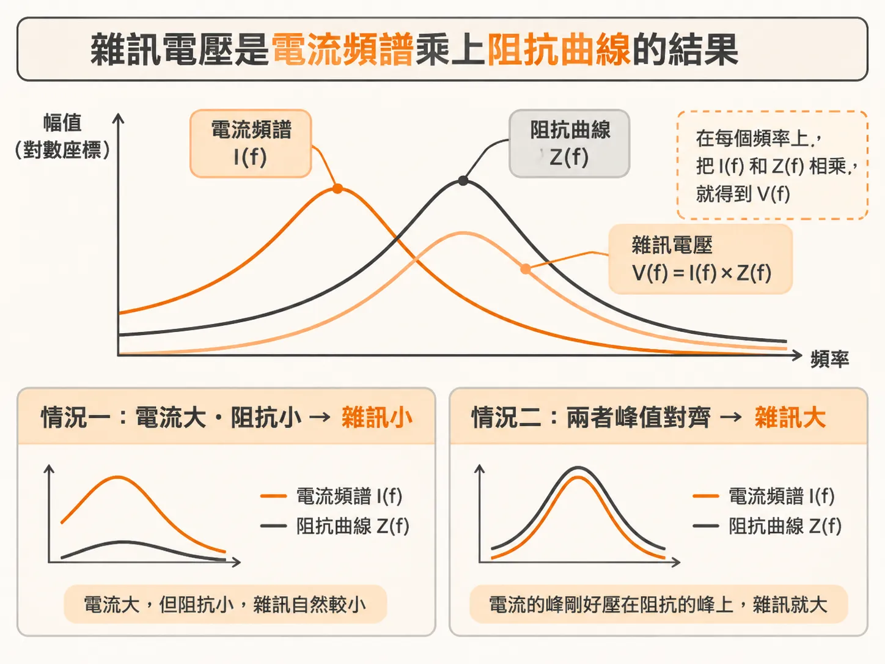
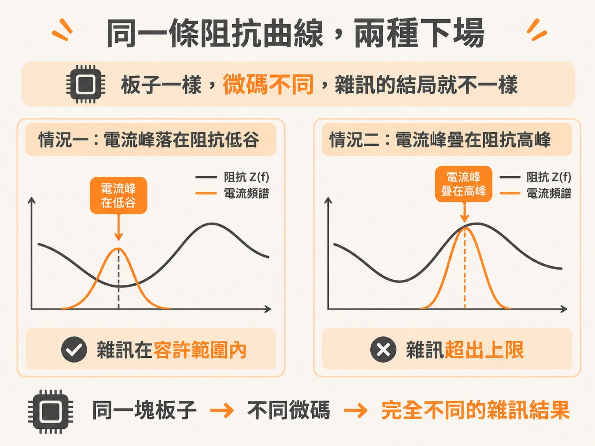
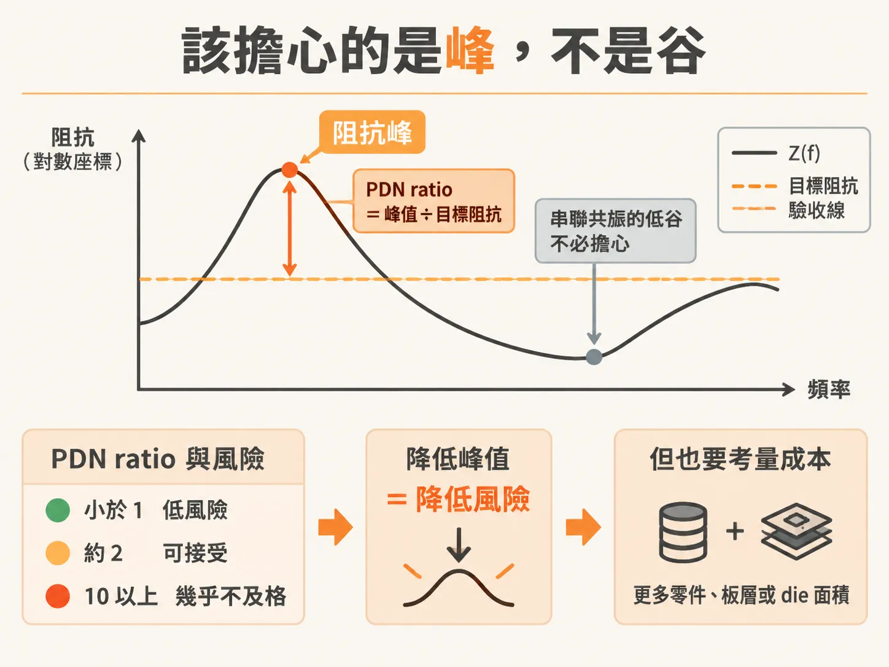

# 為什麼我們在乎阻抗？

你手上有一塊板子。開機正常，測試程式全數通過，你把它標成「可用」。幾個月後，客戶回報當機，重現條件很挑：得跑某一段特定的程式碼才會發生。

這不是運氣差。這是電源分配網路（PDN，power delivery network）最典型的失敗模式：你的驗收只涵蓋一種電流行為，但晶片在現場會跑哪些微碼、電流頻譜長什麼樣，事先沒有人知道。

要解釋這件事，得回到一個簡單的乘法。

## 電壓雜訊是怎麼來的

到第一階近似，PDN 上的電壓雜訊，就是晶片抽的電流頻譜流過 PDN 阻抗的結果。在頻域裡，每個頻率各算各的：頻率 f 上的雜訊電壓，等於那個頻率的電流振幅，乘上 PDN 在那個頻率的阻抗，也就是 V(f) = I(f) × Z(f)。把所有頻率疊起來、轉回時域，就是示波器上看到的電源軌雜訊。

所以雜訊由兩件事共同決定：晶片的電流頻譜，和 PDN 的阻抗曲線 Z(f)。阻抗曲線是從晶片墊看進整個電源路徑的阻抗，從 DC 一路畫到最高頻，通常畫在 log-log 圖上。圖上會有平的地方，也會有凸起的峰。

雜訊大不大，看電流頻譜的峰和阻抗曲線的峰有沒有對上。電流大而阻抗小，雜訊就小；電流的峰剛好壓在阻抗的峰上，雜訊就大。

## 同一條阻抗曲線，兩種命運

把這個乘法畫出來，就是同一塊板子兩種下場的差別。第一種情況：某個微碼跑出來的電流頻譜，峰落在阻抗曲線的低處，算出來的雜訊在容許範圍內，一切正常。第二種情況：同一條阻抗曲線，只換了微碼，讓運算換個頻率、多推一些閘，電流的峰剛好疊在一個更高的阻抗峰上——電源軌雜訊直接超出上限。

板子沒有變。變的是軟體。

「跑過測試程式」不等於「可用」，原因就在這裡。你的測試程式是一種特定的電流頻譜；現場的客戶軟體是另外幾千種。只要有一種頻譜的峰撞上阻抗的峰，產品就在那裡掛掉，而且難以重現。

## 只驗電壓，為什麼不夠

既然雜訊等於電流乘阻抗，直接量電壓不就好了？問題在於，量到的電壓只對「當下跑的程式」負責。在某個位置量到合格的電壓，只保證那段微碼之下合格；換一段微碼，電流頻譜變了，結論就作廢。而且晶片墊上的雜訊往往比板子上量到的更大，量測位置本身就會漏掉一部分真相。

更根本的困境是：你不可能在實驗室裡重跑客戶會跑的每一種電流波形。

## 把驗收線畫在阻抗圖上

繞過這個困境的方法，是把驗收從電壓搬到阻抗。阻抗可以量、可以用 SPICE 模擬、也可以從幾何估計；電流的最壞情況則可以從閘使用率或模擬估出來。兩個都有了，最壞情況下的雜訊就能算——不需要真的跑出每一種波形。

目標阻抗（target impedance）就是這樣來的：把容許的電壓雜訊上限，除以最壞的暫態電流，得到一條驗收線。例如雜訊規格 ±50 mV、最壞暫態電流 1 A，目標阻抗就是 50 mΩ。設計目標於是變成一句話：讓整條 Z(f)，從 DC 到最高頻，都壓在這條線下面。

做到了，任何軟體、任何頻率的電流進來，最壞雜訊都不會超標——除了極罕見的 rogue wave：多個共振峰被時序剛好的電流依序灌飽、雜訊疊加起來的病態情況。目標阻抗是一階的設計準則；最終把關，還是要把整個 PDN 和電流波形丟進暫態模擬。

## 高頻端可以放寬

實際上，晶片的最壞電流並不是在所有頻率都一樣大。電流要靠閘一顆一顆打開疊上來，需要時間。以 2 GHz 時脈、最壞電流要 20 個週期才疊滿來說，最短上升時間是 0.5 ns × 20 = 10 ns，電流頻譜大約在 0.35/10 ns ≈ 35 MHz 以上開始以 −20 dB/decade 滾降。高頻沒有大電流，目標阻抗在高頻就可以放寬、往上翹。

麻煩的是，這個轉折點在哪裡，取決於晶片架構、pipeline 的深度和微碼的性質，通常不容易估。目標阻抗是很好的起點，不是精確的答案。

## 峰，不是谷

拿一條 Z(f) 曲線做驗收判斷時，重點永遠在峰，不在谷。谷是電容和電感串聯共振造成的低點，越低越好，不必擔心。峰是並聯共振造成的，才是風險所在。通常最高、也最難壓的那座峰，來自 on-die 電容（晶片內部的去耦電容）和 package 引線電感的並聯共振，名字叫 Bandini Mountain。

風險大小有個現成的度量：PDN ratio，阻抗峰除以目標阻抗。小於 1 是低風險；2 上下大致還能接受；到 10 以上，幾乎肯定是不及格的設計。要在成本和風險之間取捨，這個比值就是籌碼：每把峰往下壓一點，都要多花零件、板層或 die 面積的錢。

## 你會怎麼判斷

下次拿到一條 Z(f) 曲線，問自己三個問題：最高的峰在哪個頻率、比目標阻抗高出多少（PDN ratio）；晶片電流頻譜的大宗落在哪裡，跟這個峰隔多遠；這個峰是誰造成的——換掉哪個零件，峰會消失。能回答這三題，阻抗對你就不只是一張圖，而是可以簽收的驗收指標。
