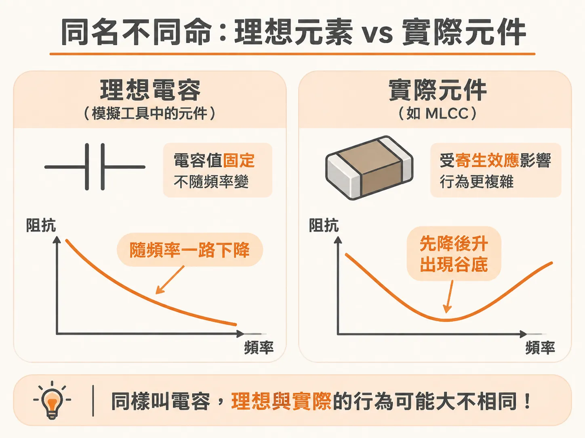
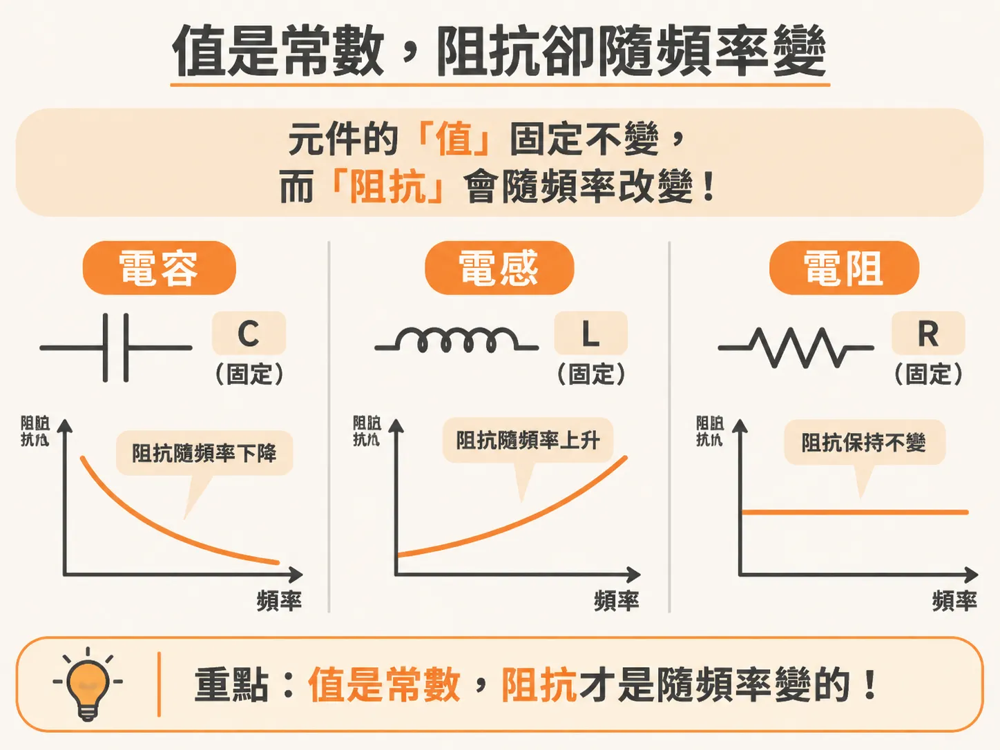
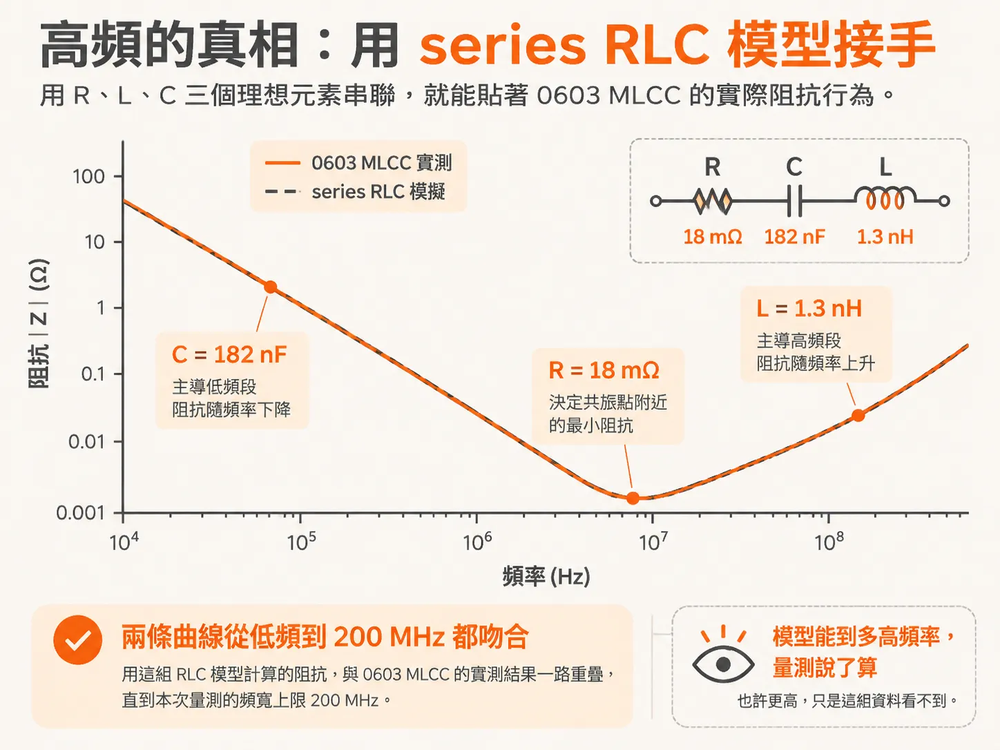
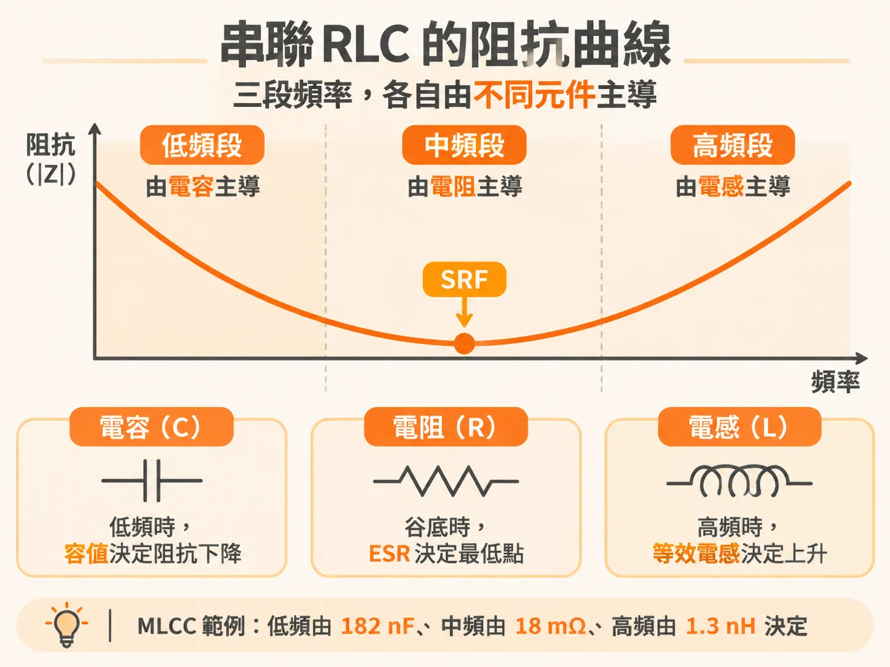

# 實際元件與理想電路元素

拿到一顆 MLCC，datasheet 上印著 100 nF。把它焊上板子，用 VNA 量阻抗，畫出來的曲線卻不是一條一路往下的斜線：低頻往下走，過了某個頻率開始往上翹，中間還有一個尖尖的谷。這不是量錯，是「電容」這個詞同時指兩種東西。

一種是**理想電路元素**（ideal circuit element）：模擬工具裡那個符號，性質由定義決定，電容值永遠不隨頻率變。另一種是**實際元件**（real circuit component）：真實世界裡量得到的物理結構，有接腳、有封裝、有寄生效應。兩者共用同一個名字，行為卻可能在某些頻段完全不同。



## 值是常數，阻抗隨頻率變

先釘死一個容易混淆的觀念。理想電容的**電容值**（capacitance）不隨頻率改變——這是定義。理想電感的**電感值**、理想電阻的**電阻值**也一樣。會隨頻率變的是它們的**阻抗**（impedance）：理想電容的阻抗隨頻率升高而下降，每十倍頻率降十倍（−20 dB/decade）；理想電阻的阻抗是常數。

「182 nF」是這顆電容的值，它不會動。這顆電容在任何頻率下呈現的阻抗，是另一回事。把兩件事分開，看阻抗曲線才不會糊掉。



## 實際電容的低頻段：看起來就是理想電容

把一顆 0603 MLCC 焊在四層測試板上，用雙埠 VNA 量阻抗。低頻段，這條實測曲線跟一個 182 nF 理想電容的模擬曲線幾乎完全重疊，一直到 3 MHz 左右都吻合得很好。

這個頻段直接把實際元件當成理想電容用，不會出事。容量值就是從這段曲線讀出來的。

## 高頻段才是真相：用 series RLC 接手

頻率再往上，實測曲線就偏離理想電容了。描述高頻行為，一個 series RLC 電路（R、L、C 三個理想元素串聯）就夠。對這顆 0603 MLCC，三個值取成：

<!-- source: sources/principle-pi/20261031/Principles of power integrity for PDN design -- simplified robust and cost effective design for high speed digital products.3.part.txt#L381-L384 -->
```
R = 18 mΩ
C = 182 nF
L = 1.3 nH
```

用這三個理想元素模擬出來的阻抗，跟實測曲線一路吻合到 200 MHz——正好是這次量測的頻寬上限。模型能到多高頻率，量測說了算；說不定更高，只是這組資料看不到。



一個真實、有時相當複雜的物理結構，光靠三個理想元素組成的簡單模型，就能貼到這麼高的頻寬。R、L、C 這三個值本身不隨頻率變，變的是整個電路的阻抗曲線。

## 三個元素各管一段頻率

series RLC 好用，因為它的阻抗曲線分成三段，每段由一個元素主導：

- **低頻**：電容主導，阻抗隨頻率下降，相位接近 −90 度。這一段只取決於 C 值。
- **共振點**：電容的阻抗與電感的阻抗大小相等、相位相反，互相抵消，剩下純 R。阻抗最低點就在這裡，稱為自共振頻率（SRF）。這顆電容的 ESR 18 mΩ，就是谷底的深度。
- **高頻**：電感主導，阻抗隨頻率上升，相位接近 +90 度。這一段只取決於 L 值。

對應回 MLCC：低頻段由晶片本身的容值 182 nF 決定；高頻段由等效串聯電感（ESL）1.3 nH 決定；谷底由等效串聯電阻（ESR）18 mΩ 決定。datasheet 印的 100 nF 只是故事的三分之一。



實務上，從一條實測 MLCC 曲線讀模型參數，用的就是這三段：低頻斜線讀 C，谷底讀 ESR，高頻斜線讀 ESL。反過來，改 C 只動低頻段，改 L 只動高頻段，改 R 只動谷底。三個旋鈕互不干擾，「調模型貼實測」因此變成很直接的動作。

## 從一顆電容到整個 PDN

能用 RLC 描述的不只有電容。PDN 裡大部分結構，都能用兩種電路和它們的組合來逼近：series RLC 和 parallel RLC。series RLC 的阻抗有谷，parallel RLC 的阻抗有峰。PDN 阻抗曲線上最要命的峰，幾乎都來自 parallel 共振。

series 和 parallel 指的是 L 跟 C 從量測端看進去的接法；R 可以串在裡面，也可以並在外面。同一組實體結構，從 die 端和 board 端分別看進去，可能一邊是谷、一邊是峰——看的人決定谷或峰。
