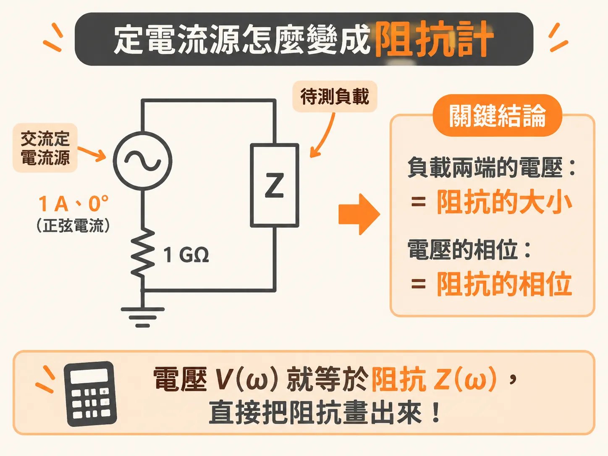
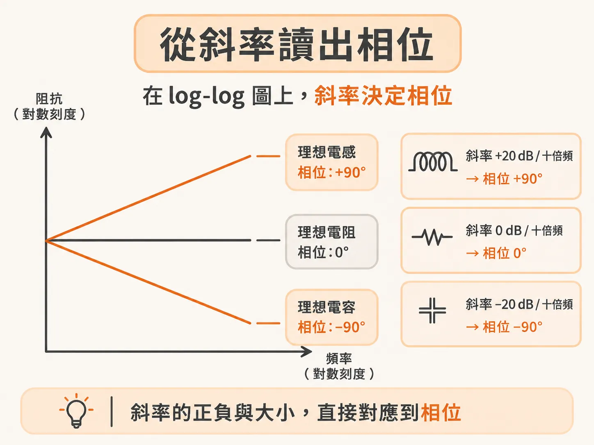
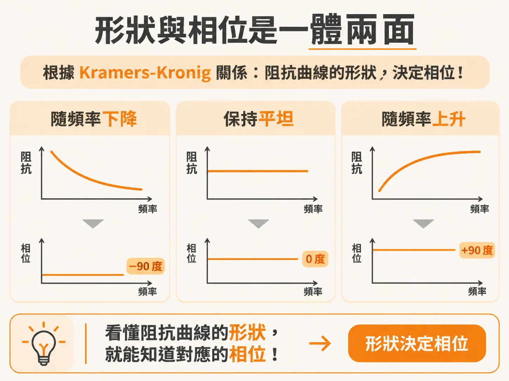

# 用 SPICE 做阻抗分析器的秘密：一個 1 A 定電流源

只算一個元件的阻抗，紙筆還應付得來；電路裡多一個元件，計算量就以指數速度暴增。該換工具了。任何由理想、線性、非時變元件組成的電路，都能交給 SPICE 這類電路模擬器算阻抗。這類模擬器好用、免費、各平台都跑得動，還有圖形介面。

QUCS（Quite Universal Circuit Simulator）是其中一個選擇：免費、開源、功能夠強也好上手，可以當阻抗計算器或阻抗分析器用。另一頭的極致是 Keysight 的 ADS（Advanced Design System），屬於最高階的電路模擬工具之一。兩者的模擬結果一樣。

## 電流源怎麼變成阻抗計

在 SPICE 裡替任何電路做阻抗分析，只需要一個東西：交流定電流源。SPICE 的定電流源是理想源，不管接什麼負載，都輸出固定的電流；它靠調整輸出電壓來維持電流不變。

AC 模式下，這個定電流源輸出振幅固定的正弦波電流，振幅不隨負載改變。

整個方法的核心是一條關係式。源要維持固定的正弦波電流，輸出的正弦波電壓就必須是某個特定值，而這個電壓永遠由通過它的電流決定：

V(ω) = I(ω) × Z(ω)

V(ω) 是每個頻率下正弦波電壓的振幅與相位，I(ω) 是電流的振幅與相位，Z(ω) 是負載在每個頻率下的阻抗大小與相位。三個量都是複數。模擬得到的複數電壓，數值上就是負載的複數阻抗：電壓的振幅就是阻抗的大小，電壓的相位就是阻抗的相位。

有個好用的特例：把電流源設成 1 A 振幅、0 度相位的正弦波，模擬出來的電壓振幅（單位是伏特）數值上就等於阻抗（單位是歐姆）；電壓的相位數值上也就是阻抗的相位。掃頻率、讀電流源兩端的電壓振幅與相位，就得到負載在任一頻率下的複數阻抗。

實作有個小細節：在定電流源左側放一顆 1 GΩ 電阻。很多模擬器要求每個節點都要有到地的直流路徑；電流源輸出端開路、或接的是純電容負載時，這顆電阻就是那條直流路徑，模擬器才不會炸掉。代價是可模擬的阻抗上限變成 1 GΩ——對所有 PDN 應用來說綽綽有餘。

## 從斜率讀出相位

看阻抗曲線，log-log 座標永遠最有用，因為一眼就分得出電路什麼時候「像電容」、什麼時候「像電感」。

三種理想元件在 log-log 圖上各有固定的樣子。理想電容的阻抗隨頻率上升而下降，相位固定在 −90 度；理想電感的阻抗隨頻率上升而增加，相位固定在 +90 度；理想電阻的阻抗大小是常數，相位固定在 0 度。電容與電感的阻抗大小，變化率都是每十倍頻率 20 dB。

阻抗的相位和曲線的形狀綁在一起。背後的根據是 Kramers-Kronig 關係：任何描述真實時域效應的頻域複數函數，為了不違反因果性——反應永遠發生在刺激之後——實部與虛部之間必須存在特定連結。知道實部就等於知道虛部。落到阻抗上，這條關係的意思是：曲線的形狀決定相位。看懂形狀，就看懂相位。

這條規則可以變成看曲線就會用的判斷法。阻抗大小以每十倍 −20 dB 下降（像電容那樣），相位就接近 −90 度；以每十倍 +20 dB 上升（像電感那樣），相位就接近 +90 度；曲線平坦不隨頻率變，相位就接近 0 度。所以在 log-log 圖上盯著形狀看，相位在做什麼就推得出來。這也是很多阻抗圖只畫大小、不畫相位的原因——形狀已經把相位說完了。

還有一個容易混淆的點：別把理想電容、電感的「電容值、電感值」跟它們的「阻抗」混為一談。依定義，理想電容的電容值不隨頻率變，理想電感的電感值也一樣；隨頻率變的是阻抗，不是 L 和 C 的值。

這整套讀數與判斷，任何簡單的電路模擬器都能自動算出來。所有版本的 SPICE 都能用這個方法，模擬任何電路的阻抗。
