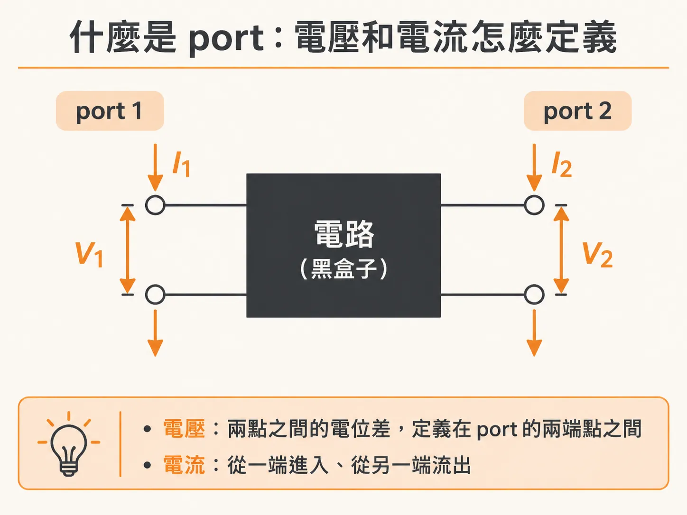
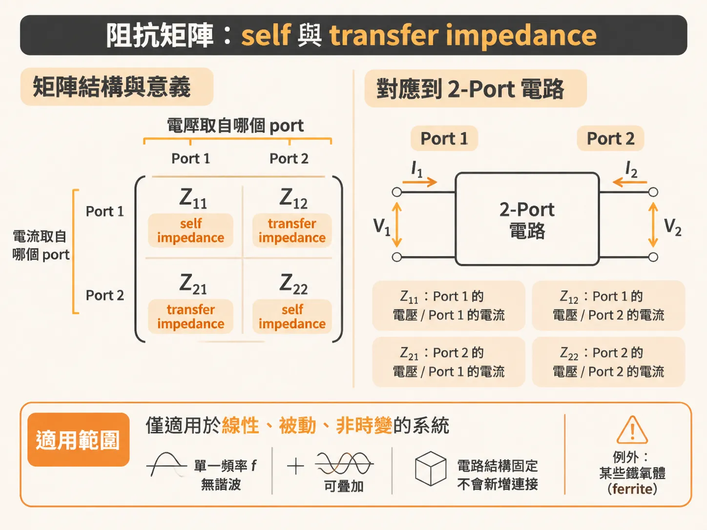
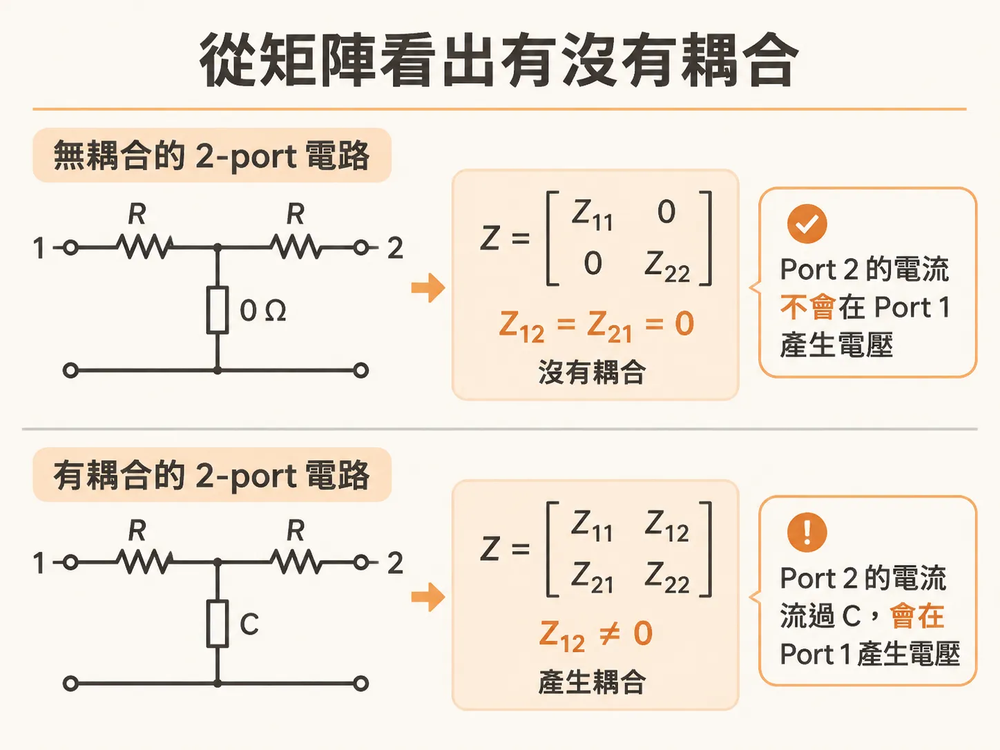
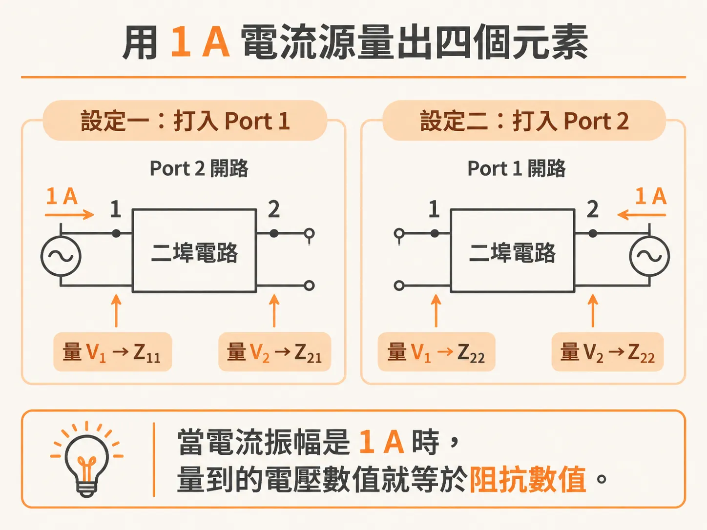
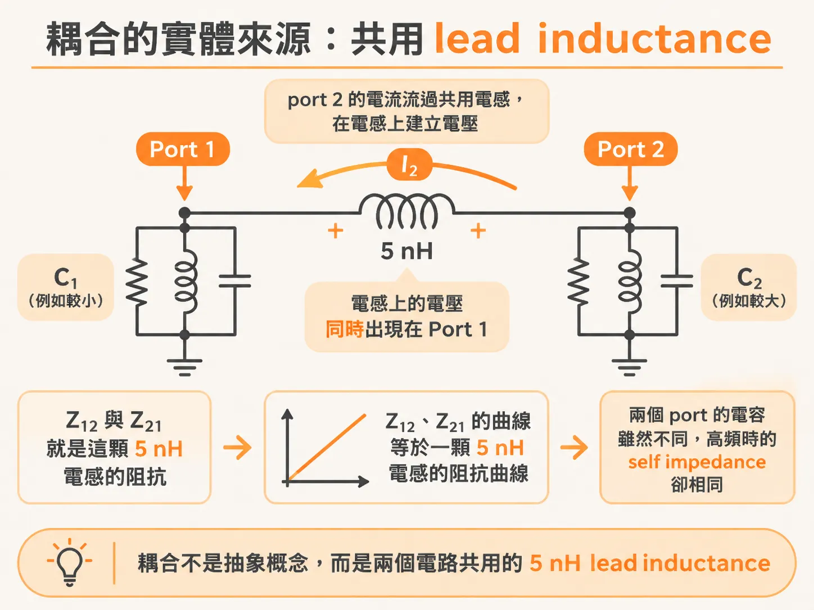

# 阻抗矩陣

阻抗的算法你早就會了：兩個端點之間的電壓，除以流進來的電流。兩個端點、一個比值，就這麼簡單。但一塊真實的板子上，端點不會只有一對。電源軌上量阻抗的地方是一對，每顆 die 抽電流的輸入是一對，每一顆去耦電容的接腳也各是一對。問題跟著來了：port 2 上流的電流，會不會在 port 1 製造出電壓？兩端點的定義答不了這一題。把阻抗擴充到多埠網路就有答案：用一個矩陣整理所有「電壓對電流」的組合，並且講清楚其中最容易誤會的元素——transfer impedance。它描述的是兩個 port 之間的耦合，不是接在兩個 port 中間的那顆電阻。

## 先把 port 說清楚

把任何電路想成一個黑盒子。盒子裡可以是一顆 R、L 或 C，也可以是 25 個元素接成的複雜網路。只要對外的連接只有兩個端點，盒子的阻抗就完全由端點上的性質決定：跨在端點上的電壓 V1，除以從一端流進、另一端流出的電流 I1。

這一對端點就是一個 port。電壓永遠是兩點之間的電位差，所以定義在 port 的兩個端點之間；電流則是從其中一個端點進去、從另一個端點回來。



## port 一多，就需要矩陣

一個 n-port 電路有 n 個電壓和 n 個電流。阻抗是電壓對電流的比值，任何一個電壓配任何一個電流，都算得出一個阻抗值。n 個 port 就是 n × n 種組合；port 越多，組合數漲得越快，光用文字描述很快就亂掉了。矩陣就是把這些比值收整齊的方法：每一個元素對應一個比值。列（row）指定電壓取自哪個 port，行（column）指定電流取自哪個 port。

拿最簡單的 2-port 來看：兩個電壓、兩個電流，可以組出四個阻抗，排成 2 × 2 的矩陣。矩陣把每個 port 上的電壓和流進每個 port 的電流連在一起，寫成方程式就是：

<!-- derived -->

```
V1 = Z11·I1 + Z12·I2
V2 = Z21·I1 + Z22·I2
```

每一個矩陣元素只講一件事：某個 port 上產生的電壓，對上流進某個 port 的電流，兩者的比值。

在頻率域裡，電壓和電流都是複數，所以每個矩陣元素都是複數，而且一般會隨頻率變化。每個 Z 其實都是 Z(f)。

適用範圍也要記住。這套形式只適用於線性、被動、非時變的系統：盒子裡的電路固定不變，不會長出新的連接；送進頻率 f 的正弦波，響應只出現在同一個頻率，不產生諧波，而且可以疊加。所有的互連結構都符合這個條件，唯一的例外是某些 ferrite（鐵氧體）。



## 對角線是 self，其他都是 transfer

矩陣裡的元素分成兩種。對角線上的 Z11、Z22 稱為 self impedance（自阻抗）：一個 port 自己看自己的阻抗。非對角線上的 Z12、Z21 稱為 mutual impedance 或 transfer impedance（互阻抗、轉移阻抗），也常聽到 transimpedance 這個說法。

想單獨求出某一個元素，就把其他 port 的電流全部設為零：

<!-- derived -->

```
Z11 = V1 / I1   （條件：I2 = 0）
Z22 = V2 / I2   （條件：I1 = 0）
Z21 = V1 / I2   （條件：I1 = 0）
Z12 = V2 / I1   （條件：I2 = 0）
```

讓一個 port 的電流為零，實作上就是讓它開路，什麼都不接。

self impedance 的意思很直接：其他 port 全部開路時，你在這個 port 上量到的電壓除以打進來的電流，就是它的 self impedance。這正是你原本熟悉的兩端點阻抗——把其他 port 開路，多埠問題就退化回兩端點問題。

transfer impedance 是另一回事。以 Z21 為例：把 port 1 開路，從 port 2 打入電流 I2，再量 port 1 上出現的電壓 V1。Z21 就是 V1 對 I2 的比值。一個 port 上的電流，在另一個 port 上製造出電壓——這就是耦合。

## transfer impedance 不是電阻

「transfer impedance」和「transimpedance」這兩個詞在別的領域也會出現，先把它們分清楚。談線材屏蔽（cable shield）與機殼的屏蔽效果時，transfer impedance 指的是：導體的一側有電流時，另一側產生的電壓與該電流的比值，衡量能量從外表面轉移到內表面的程度。談把電流轉成電壓的裝置時，transimpedance 指的是這個轉換的比值：一顆電阻就是最簡單的例子，它的 transimpedance 就等於電阻值；用運算放大器加回授電阻做成的 transimpedance amplifier，transimpedance 可以非常高，超過放大器的增益頻寬之後隨頻率下降。

在阻抗矩陣裡，這些名字指向同一個核心：一個區域的電流，在另一個區域製造電壓。

最容易誤會的在這裡。transfer impedance 並沒有「接」在兩個 port 之間。它不是你拿歐姆計跨在兩個 port 之間會量到的那個電阻。它是「流進一個 port 的電流」和「出現在另一個 port 的電壓」之間的關係，是耦合程度的度量。

兩個極端可以幫你定位這個數值。完全沒有耦合時，電流打進 port 1，port 2 上的電壓是 0 V，transfer impedance 就是 0 Ω。反過來，兩個 port 緊緊相連、根本是同一個節點時，電流打進 port 1，兩個 port 上出現相同的電壓，transfer impedance 會等於這兩個 port 的 self impedance。0 Ω 代表零耦合；等於 self impedance 代表 100% 耦合。

## 兩個電阻電路，看出差別

兩個只含電阻的 2-port 電路，可以把這件事看得非常清楚。



第一個電路：每個 port 各經過一顆電阻，兩顆電阻的中心端各自用 0 Ω 接到返回路徑。用 self impedance 的定義看，每個 port 的 self impedance 就是各自的電阻值。transfer impedance 呢？把 port 1 開路（I1 = 0），沒有電流流過 port 1 的電阻，電阻上自然沒有壓降。這時不管 port 2 打入多大的電流，port 1 上的電壓都是 V1 = 0。所以 Z21 = 0，同理 Z12 = 0。這個電路的阻抗矩陣描述的正是「兩個 port 之間毫無耦合」。

第二個電路只改一處：接到返回路徑的 0 Ω 換成一顆兩側共用的電阻 C。這一改，兩個 port 之間就有耦合了。把 port 1 開路，port 2 打入電流 I2，這個電流會在電阻 C 上產生電壓，而這個電壓直接出現在 port 1 上。Z21 = V1/I2 不再是零。

耦合的大小由 C 決定。RC 越大（另外兩顆電阻 RA、RB 維持不變），transfer impedance 越大，一路逼近它的上限：等於 self impedance。transfer impedance 越大，代表耦合越強。

## 用 1 A 電流源把四個元素都量出來

真實電路裡的元素是複數又隨頻率變化，盒子裡的電路一複雜，矩陣元素往往只能靠模擬求出來。方法就藏在定義裡：把一個 port 開路，用交流電流源把電流打進另一個 port，再量各個 port 上的電壓。



<!-- derived -->

```
把 1 A 打進 port 1（port 2 開路）：量到的 V1 數值 = Z11，V2 數值 = Z21
把 1 A 打進 port 2（port 1 開路）：量到的 V2 數值 = Z22，V1 數值 = Z12
```

為什麼可以直接讀數？因為電流振幅是 1 A，V = Z × 1，電壓的數值就等於阻抗的數值。任何一套 SPICE 都做得到這件事。

## 共用 lead inductance：耦合的實體來源

看一個更貼近真實互連的例子：兩個 RLC 電路各接一個 port，兩個電路共用一段 lead inductance（接腳電感）。兩邊的 L 和 R 值相同：5 nH 和 0.005 Ω。port 1 接的電容是 1000 nF，port 2 接的是 100 nF。共用的 lead inductance 是 5 nH。

四個矩陣元素都模擬得出來。兩個 self impedance 各自來自所屬的 RLC 電路，再串上共用電感。雖然兩邊的電容值不同，兩個電路的等效電感相同，所以在高頻極限，兩個 port 的 self impedance 一樣。

transfer impedance 的來源更值得看：port 2 的電流流過共用的 5 nH 電感，在電感上建立電壓，這個電壓同時出現在 port 1。所以從任一側看，Z12 和 Z21 都等於那顆 5 nH 電感的阻抗。模擬結果正是如此：Z12 和 Z21 的曲線就是一顆 5 nH 電感的阻抗曲線。耦合不是抽象概念，它有實體：那一段兩個電路共用、繞不開的 lead inductance。



## 這套語言的下一步

阻抗矩陣不只適用於集中元件，同一套形式也會推廣到分散式元素，以及由電源平面與接地平面構成的波導空腔。先把「self 是自己、transfer 是耦合」想透，之後遇到平面空腔的阻抗描述時，用的還是同一套語言。
