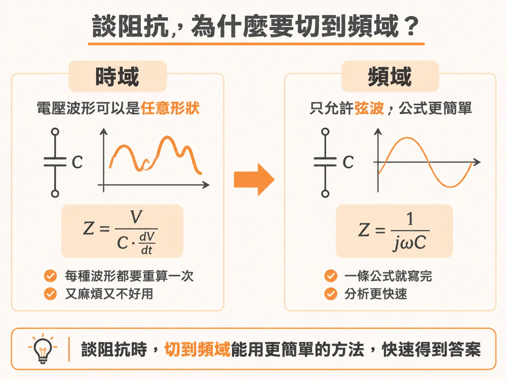
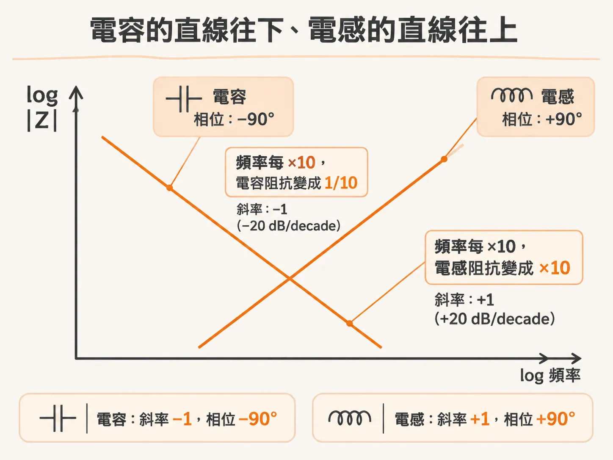
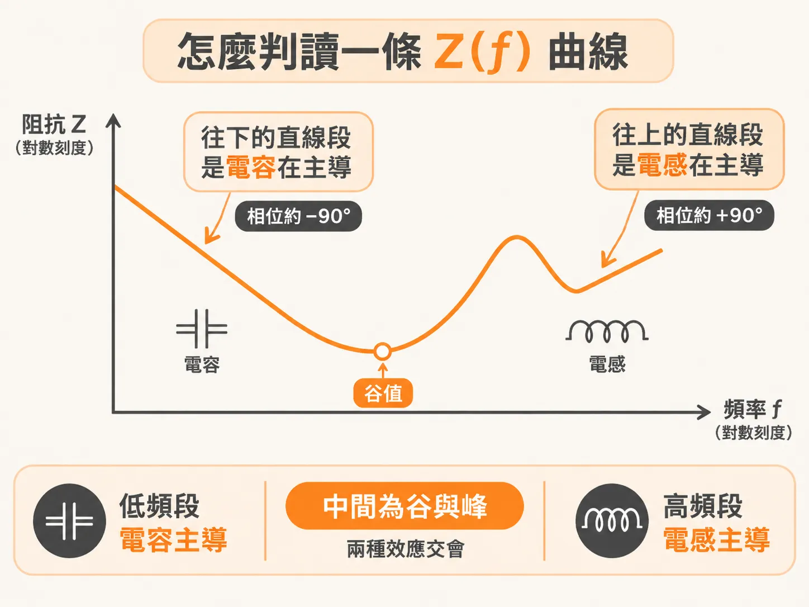

# 每十倍頻 20 dB

你手上有條 PDN 的 Z(f) 曲線——模擬跑出來的，或量測畫出來的。低頻段筆直往下，高頻段筆直往上，中間夾著谷和峰。那些筆直的段落不是畫圖的巧合，是理想電容和電感留在曲線上的簽名。兩條公式就能說明一切：1/(jωC) 和 jωL 各給出什麼斜率、什麼相位。順便回答一個更基本的問題：為什麼阻抗圖永遠畫成 log-log。

## 時域的阻抗，跟著波形長相走

阻抗的定義到處都一樣：Z = V/I，裝置兩端的電壓除以流進再流出的電流。這個定義在時域、頻域都成立，也能延伸到多端點的 transfer impedance。麻煩不在定義，在代進去之後的長相。

拿理想電容在時域算一次。電容電流是 I = C·dV/dt，代回阻抗定義，得到 Z = V/(C·dV/dt)。式子沒有錯，方向也符合直覺：dV/dt 越大，電流越大，阻抗越低。問題是這個阻抗跟著電壓波形的斜率走——波形長什麼樣，阻抗就是什麼值。實際要用，等於對每一種波形各算一次，彆扭到難以派上用場。

## 頻域只剩弦波，阻抗是一條公式

頻域把這件事簡化到極致：那個世界裡允許的波形只有弦波。弦波過了線性元件還是弦波，變的只有振幅和相位。於是理想電容的阻抗有了封閉形式：

Z_C = 1/(jωC)

理想電感同樣乾淨：

Z_L = jωL

其中 ω = 2πf 是角頻率，j 是 −1 的平方根。效能最終還是要回到時域驗收，但很多問題改走頻域這條捷徑會快得多——這是 PDN 的阻抗分析幾乎都在頻域進行的最大理由。

## j 把阻抗變成兩個數字

那個 j 讓阻抗成為複數：在任何一個頻率，阻抗都有兩個值。最常用的表示法是大小和相位；也可以拆成實部與虛部，虛部有個專屬名字——電抗（reactance），記作 X。

在 R、L、C 組成的電路裡，電抗由 L 和 C 主導。例如電阻串聯電容，阻抗寫成 Z = R + jX：實部是電阻，虛部是電抗。談斜率時，盯著電抗就夠了。

## 電容：頻率每十倍，阻抗掉十倍

單一理想電容的阻抗是純電抗，X_C = −1/(ωC)，大小是 1/(ωC)，和頻率成反比：頻率乘 10，大小就除以 10。工程上用 dB 記這種倍數——大小變成 1/10，就是 −20 dB。所以電容的電抗隨頻率以 −20 dB/decade 下降；decade（十倍頻）就是頻率乘 10 算一格。畫在 log-log 圖上，這對應斜率 −1 的直線。

相位也好算。1/j 就是 −j，所以電容阻抗整個落在負虛軸上：相位 −90°，而且每個頻率都是 −90°。

帶個數字感受一下：1 µF 的理想電容在 1 MHz 的阻抗大小是 1/(2π × 10⁶ × 10⁻⁶) ≈ 0.16 Ω；頻率升到 10 MHz，掉到 0.016 Ω。頻率 ×10、阻抗 ×1/10，−20 dB/decade 講的就是這件事。

## 電感：頻率每十倍，阻抗長十倍

電感把方向整個反過來。X_L = +ωL，和頻率成正比：頻率乘 10，電抗跟著乘 10，每 decade +20 dB，log-log 上是一條斜率 +1 的直線。jωL 是純正虛數，相位 +90°，同樣不隨頻率變。

## 為什麼阻抗圖永遠畫 log-log

把兩條公式並排放：電容 −20 dB/decade，電感 +20 dB/decade。這種「頻率每十倍、阻抗固定倍數」的變化，畫在線性座標上是彎的；橫軸縱軸都取 log 之後，固定的 dB/decade 變成固定的斜率——兩條筆直的線，電容 −1、電感 +1。這就是為什麼 PDN 阻抗圖的標準畫法是縱軸 log 阻抗、橫軸 log 頻率。

直線帶來的判讀能力是立刻的：曲線往下走的直線段，是電容在主導，相位接近 −90°；往上走的直線段，是電感在主導，相位接近 +90°。一段是直的，你就知道誰在說話；斜率一讀，還能反推元件值。

## 你會怎麼判斷

下次拿到一條 Z(f) 曲線，先找直線段。低頻那段往下斜、斜率 −1，這是電容的地盤，相位約 −90°；高頻那段往上翹、斜率 +1，這是電感的地盤，相位約 +90°。對理想元件，斜率和相位是同一條公式給的，看到一個就能推出另一個。
