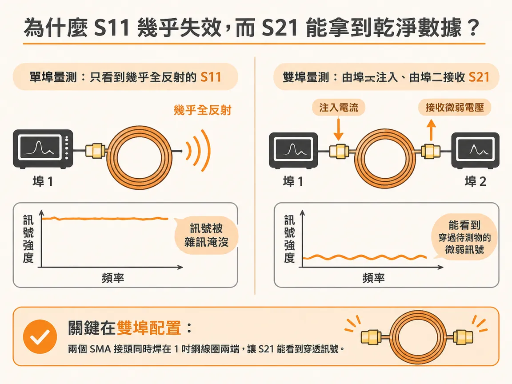
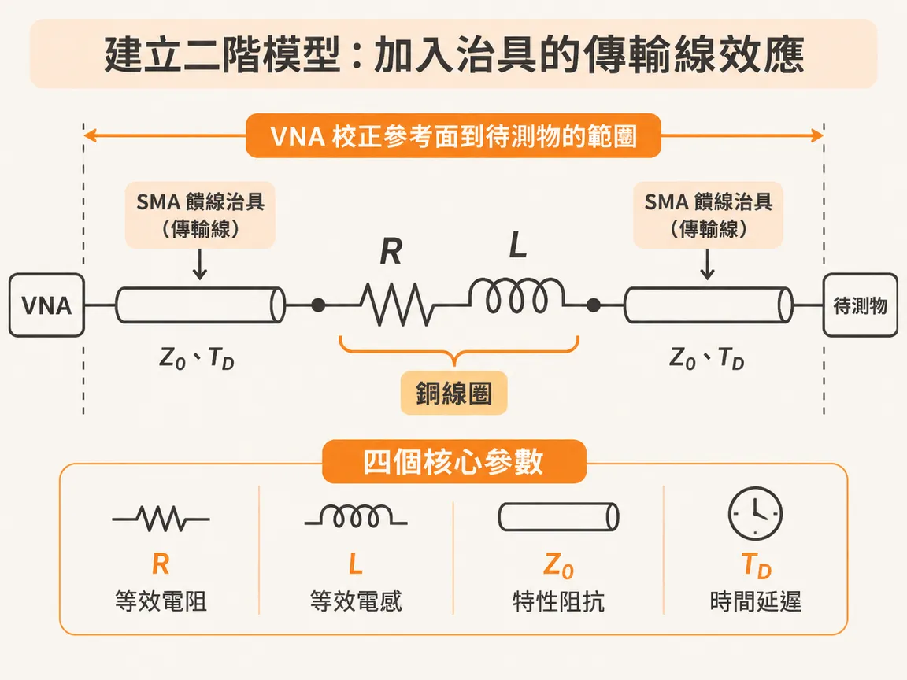
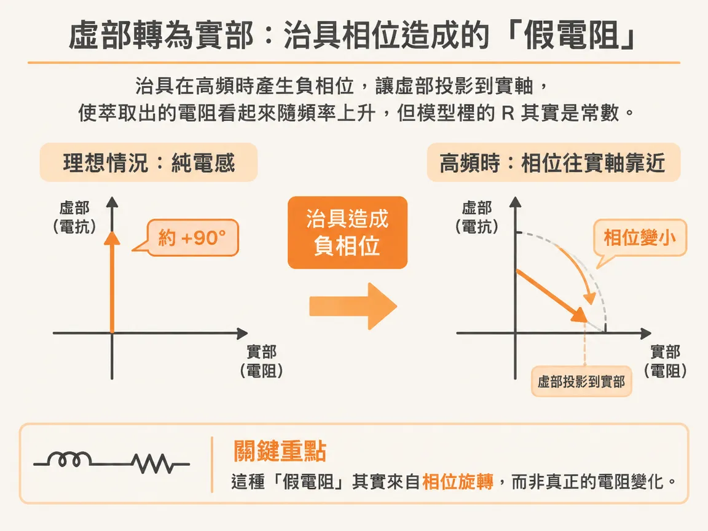

# 雙埠阻抗量測中的治具效應：拆解相位偏移帶來的假電阻

用向量網路分析儀（VNA）量測極低阻抗結構時，量測訊號往往極其微弱，治具本身的寄生效應甚至比待測物（DUT）還要明顯。以直徑 1 吋的短路銅線圈為例，直接用單埠反射量測（$S_{11}$），常常只會看到雜訊或嚴重誤差；改用雙埠分流傳輸量測（$S_{21}$），曲線立刻變得乾淨。

把量測到的 $S_{21}$ 換算成等效串聯電阻（$R$）與電感（$L$）時，電阻常會隨著頻率大幅上升。這通常不是導體高頻集膚效應造成的，而是治具傳輸線的相位延遲所帶來的「假電阻」。

## 為什麼 S11 幾乎失效，而 S21 能拿到乾淨數據？

在雙埠量測配置中，我們將兩個 SMA 接頭同時焊在直徑 1 吋的銅線圈兩端：兩個 SMA 接頭的中心針腳接到線圈同一端，接地外殼的迴流腳接到線圈另一端。

在極低阻抗待測物上，$S_{11}$ 接近全反射，反射係數非常接近 1。只要儀器稍微有校正誤差或雜訊，換算出的待測物阻抗就會嚴重偏差，無法提供精準的阻抗資訊。

$S_{21}$ 測量穿過待測物分流到第二埠的微弱傳輸訊號，能反映待測物的低阻抗特徵。在待測物阻抗低於 $1\ \Omega$ 的範圍內，阻抗與 $S_{21}$ 的振幅與相位呈現單純的比例關係：

$$Z_{\text{DUT}} \approx 25\ \Omega \times S_{21}$$

這項換算不需要預設電路模型或曲線擬合。當阻抗超過 $10\ \Omega$ 時，這個簡化關係才會失效。將計算出來的阻抗畫在雙對數圖（log-log scale）上，會看到隨頻率線性上升的直線，這是標準的串聯電感特徵。

## 單埠與雙埠的萃取差異：消除了 5 nH 的治具電感

如果假設待測物是串聯 $RL$ 電路，將阻抗實部視為電阻 $R$、虛部換算為電感 $L$，可以直接從量測數據萃取參數。

比對單埠與雙埠量測結果時，必須把第二個埠斷開，且不能接上 $50\ \Omega$ 終端負載。將兩者萃取結果疊加比對，會呈現兩個特徵：

1. **電感值落差**：雙埠量測萃取出的電感值明顯低於單埠量測，兩者相差約 $5\text{ nH}$。這段差值就是單埠量測中 SMA 轉接治具的串聯電感。在雙埠量測架構下，儀器直接感測待測物兩端的電壓降，因此消除了這段治具串聯電感的干擾。
2. **電阻值雜訊與上升**：在低頻、電阻極小的區間，單埠量測的雜訊非常嚴重；雙埠量測相對平穩，在 $10\text{ MHz}$ 時測得電阻約為 $8\text{ m}\Omega$。不過，無論單埠或雙埠，萃取出的串聯電阻都會隨著頻率持續升高。

這個隨頻率上升的電阻，容易被直接當成銅線的集膚效應。但在此之前，需要先檢查一階的串聯 $RL$ 模型是否過於簡化。

## 建立二階模型：加入治具的傳輸線效應

分析待測物量測數據時，建立包含預期物理效應的等效電路模型，並將模擬結果與實際量測比對，可以逐步校驗模型內部機制。

模擬與量測高度吻合，只能證明該模型與真實待測物的行為一致，並不能排除其他具備相同頻率特性的物理機制存在。但一致性檢查越多，對模型內部機制的信心就越高。

一階模型只包含待測銅線圈的串聯 $R$ 與 $L$。為了解釋高頻偏差，需要升級為二階模型：在串聯 $RL$ 電路的兩側，各加入一段對稱、均勻且無損耗的短傳輸線，代表從 VNA 校正參考面延伸到待測物的 SMA 饋線結構（即治具）。

這個二階模型共有四個核心參數：

- $R$：銅線圈的串聯電阻（假設為固定常數，不隨頻率改變）
- $L$：銅線圈的迴路電感（假設為固定常數，不隨頻率改變）
- $Z_0$：SMA 饋線治具的特性阻抗
- $TD$：SMA 饋線治具的時間延遲（time delay）

低頻時，這段極短傳輸線對訊號影響極小，可以直接從低頻響應定出銅線圈的 $R$ 與 $L$。將治具特性阻抗 $Z_0$ 初步設為 $50\ \Omega$，並微調時間延遲 $TD$，使模擬阻抗曲線貼合量測數據。經擬合後，參數值為：

- $R = 0.005\ \Omega$
- $L = 23\text{ nH}$
- $Z_0 = 50\ \Omega$
- $TD = 42\text{ ps}$

## 虛部轉為實部：治具相位造成的「假電阻」

將二階模型模擬結果與量測數據對照，兩者吻合。一階純 $RL$ 模型預測阻抗線性上升，而加入治具傳輸線模型的二階模型，解釋了阻抗曲線在約 $600\text{ MHz}$ 處出現的峰值與後續衰減。

在二階模型中，設定的電阻 $R$ 是不隨頻率改變的定值（$0.005\ \Omega$）。然而納入治具傳輸線後，計算出的阻抗實部卻呈現強烈的頻率相依性，一路隨頻率升高。

這個現象的物理機制非常單純：

1. 治具兩端的短傳輸線在量測路徑上引入了隨頻率增加的負相位偏移。
2. 低阻抗下的阻抗直接正比於 $S_{21}$，傳輸線帶來的負相位偏移直接加到了阻抗上。
3. 線圈本身主要是電感，阻抗相位原本接近 $+90^\circ$。治具引入隨頻率增大的負相位時，整體阻抗的相位被往 $0^\circ$ 的方向拉動。
4. 相位向 $0^\circ$ 靠攏，等於將虛部（感抗）的一小部分投影為實部。

直接把阻抗實部解讀為電阻時，會誤以為電阻隨頻率急遽增加。實際上，這個隨頻率上升的實部不是由電阻產生的，而是電感阻抗受到治具相位偏移旋轉後的投影，屬於治具帶來的偽影（artifact）。

這項電阻上升不需要用集膚效應解釋。從雙埠 $S$ 參數萃取出來的阻抗實部，反映的是包含治具在內的整個量測迴路。

在直徑 1 吋的短路銅線圈案例中，直到約 $300\text{ MHz}$ 分布效應浮現之前，串聯 $RL$ 電路加上治具模型就能解釋量測行為。頻率更高時，後續只需要再補上一顆微小的並聯電容，描述線圈兩半部之間的高頻耦合即可。

這套治具傳輸線模型能把治具相位分離出來；面對印刷電路板上的貫孔結構時，同樣能用這個方法釐清微小電阻與電感。
