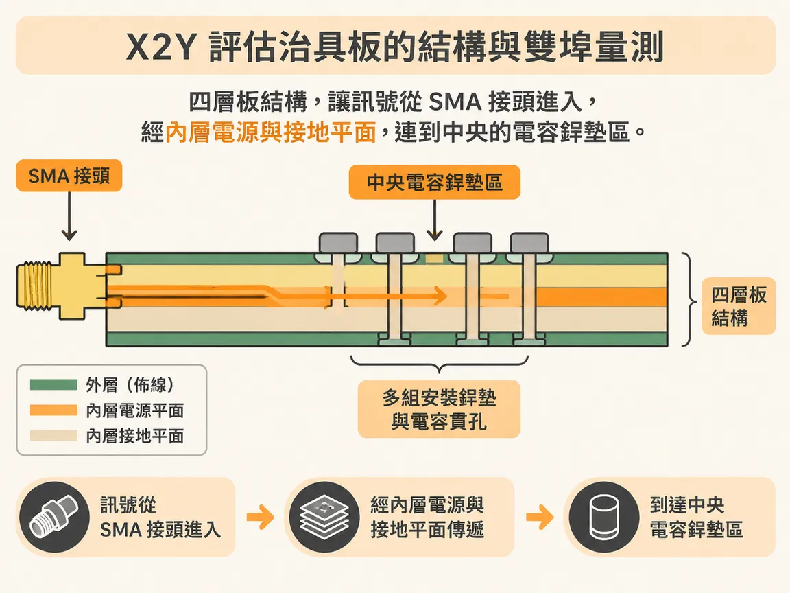
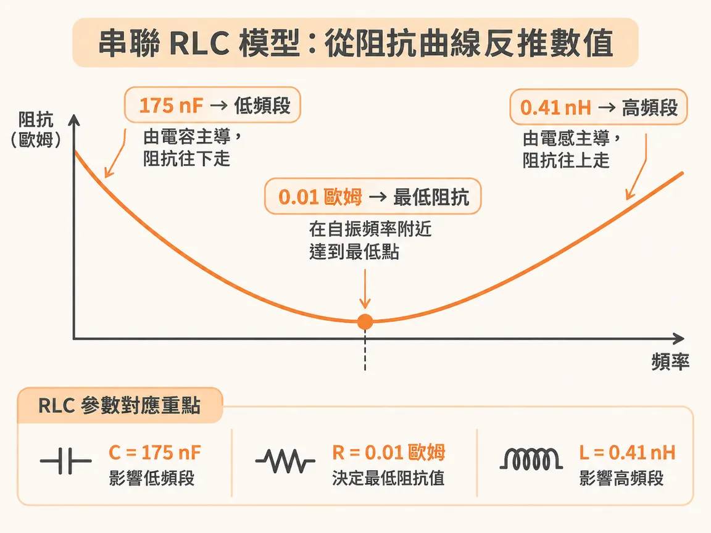
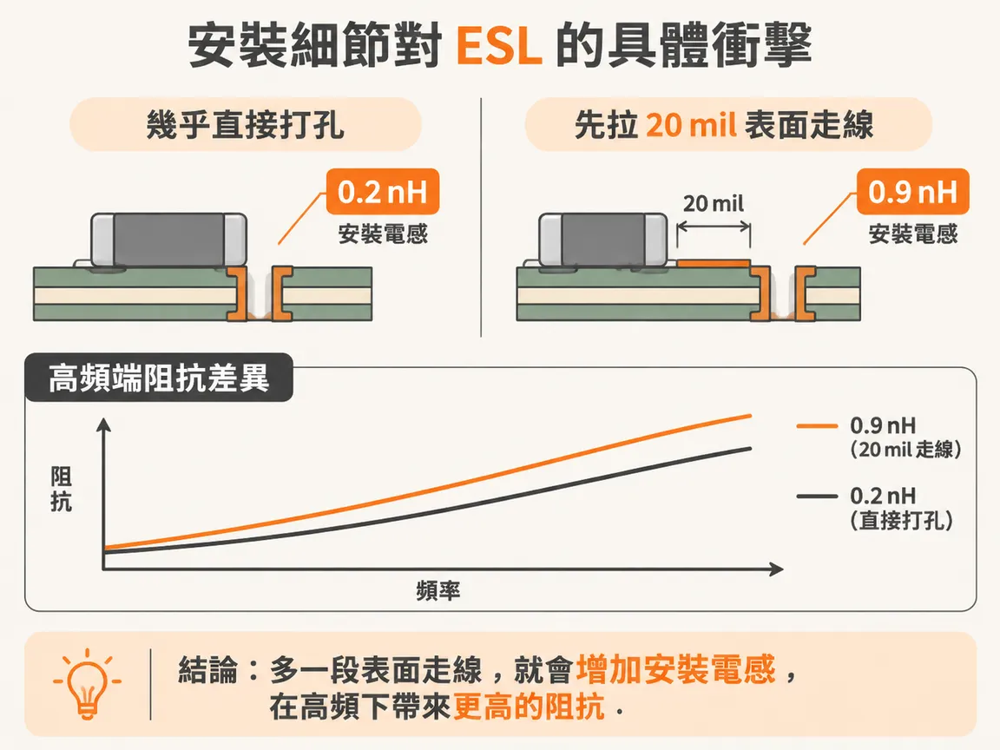

# 從 X2Y 測試治具的 S21 萃取實裝 MLCC 的 ESR 與 ESL：為何安裝方式主導電感

在電源完整性（PDN）設計中，去耦電容的阻抗特性是設計核心。想單獨量測一個被動元件本身的孤立特性非常困難，因為向量網路分析儀（VNA）的 SMA 接頭與待測物之間必然存在實體連線。對電容而言，脫離安裝結構量測固有特性並不切實際；同一顆電容銲在不同測試結構上，量出來的阻抗曲線也會不同。

量測的目標在於取得特定安裝方式下的實裝電容阻抗曲線與安裝電感。

## X2Y 評估治具板的結構與雙埠量測

業界常用的一種測試治具是四層板結構。訊號從電路板邊緣的 SMA 接頭進入，經由內層電源與接地平面延伸到電路板中央的電容銲墊區。

X2Y Attenuators 的測試治具板專為雙埠量測設計，中央區域配置了多組不同的安裝銲墊。將同一顆電容銲接在不同位置的銲墊上，或更換不同款式，就能比對銲墊佈局對阻抗的影響。其剖面結構主要由電容貫孔與相鄰的內部平面構成。

量測時，將一顆 X2Y 電容銲接到治具板銲墊上，透過 VNA 進行雙埠 S 參數量測取得傳輸係數 $S_{21}$，再換算成從治具端 SMA 接頭看進去的輸入阻抗。

## 從簡單串聯 RLC 模型反推數值

量測到的阻抗曲線形狀符合標準串聯 RLC 電路的特徵。常見的表面黏著電容大多表現出這種行為。

藉由在模擬軟體中調整電阻（R）、電感（L）與電容（C）三項數值，就能找到貼合量測阻抗曲線的模型：

- 電阻 $R = 0.01\ \Omega$
- 電容 $C = 175\ \text{nF}$
- 電感 $L = 0.41\ \text{nH}$

單純的串聯 RLC 模型通常吻合到大約 400 MHz。超過這個頻率後，治具的實體尺寸開始產生寄生效應，必須納入模型。

## 納入治具效應：傳輸線模型修正

在電容治具板上，從板邊 SMA 接頭到中央電容安裝位置，兩側各有一段約 0.7 英吋長的互連路徑。修正高頻誤差的方式，是在 RLC 模型前後兩端各串上一段均勻傳輸線。

建立傳輸線模型時，長度固定為 0.7 英吋，透過擬合調整特性阻抗。將特性阻抗設為 $3.5\ \Omega$ 時，模擬曲線與實測數據一致。由於 SMA 接頭到電容銲墊之間採用寬面銅箔平面，特性阻抗落在 $3.5\ \Omega$ 符合物理幾何配置。

串聯 RLC 電路代表實裝電容，加上兩段均勻傳輸線代表治具走線，構成了完整的高頻等效模型。在實務上，很難嚴格區分殘留的高頻細微誤差屬於電容本身的物理現象，還是簡化模型未涵蓋的治具效應。因此設計量測治具時，走線應盡可能縮短，並使走線阻抗盡量接近 $50\ \Omega$，減少治具長度對萃取電阻實部的干擾。

實測數據在 40 MHz 到 800 MHz 之間出現阻抗實部略微上升，可能來自陶瓷介電質的耗損正切（dissipation factor）、高頻下實際參與充放電的電容內電極層數變化，或是電容與安裝導體的串聯集膚阻抗。

## 萃取參數的物理意義：為何安裝方式主導 ESL

擬合過程中反推得到的各項參數代表明確的物理意義：

1. **等效電容（C）**：萃取值為 175 nF。樣品標稱電容量為 220 nF，實測值低了約 25%，屬於 MLCC 製程容許公差與直流偏壓衰減的正常範圍。
2. **等效串聯電阻（ESR）**：萃取值為 $0.01\ \Omega$。ESR 在抑制 PDN 並聯諧振峰時提供必要的阻尼。
3. **等效串聯電感（ESL）**：萃取值為 $0.41\ \text{nH}$。**這項數值由安裝在板子上的方式決定，不是電容元件獨有的固有屬性。**

在 PDN 設計中，ESL 決定了系統達到目標阻抗所需的去耦電容數量。0.41 nH 的低電感，主要來自 X2Y 電容的對稱低電感接腳設計，以及治具板上接近銲墊內貫孔（via-in-pad）的佈局。

同一顆電容若換到不同的疊層結構，或拉長引腳到電源平面的擴散距離，量出的 ESL 就會改變。

## 安裝細節對 ESL 的具體衝擊

利用雙埠量測，可以比對不同安裝幾何對總安裝電感的影響。

以兩顆規格相仿的電容為例，以不同的表面走線長度銲接在多層治具板上：

- **接近銲墊內貫孔**：電容銲墊直接或極近距離打孔進入內層平面，萃取出的 ESL 為 **0.2 nH**。
- **具備 20 mil 表面微帶走線**：在銲墊與貫孔之間多拉了 20 mil（約 0.5 毫米）走線，萃取出的 ESL 增加至 **0.9 nH**。

從高頻端的感性阻抗曲線可以看出，短短數十 mil 的佈線差異會使安裝電感增加數倍。板級去耦設計中，微小的貫孔配置與接線幾何是決定最終實裝 ESL 的核心因素。

當去耦結構從 PCB 上的分立電容進一步推進到矽晶圓層級時，量測環境將變得更加微型，必須直接在晶片凸塊上進行雙埠點測。
