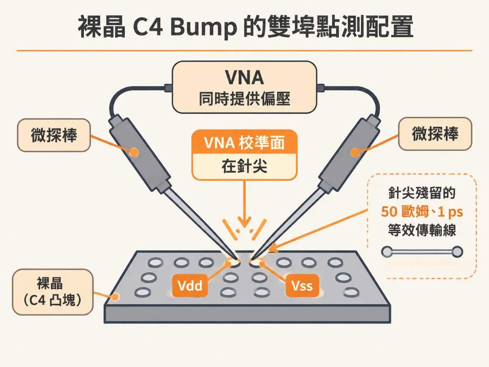
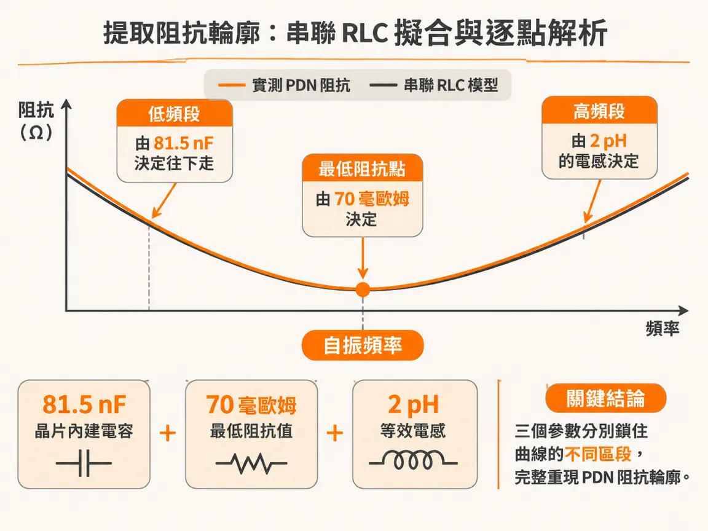
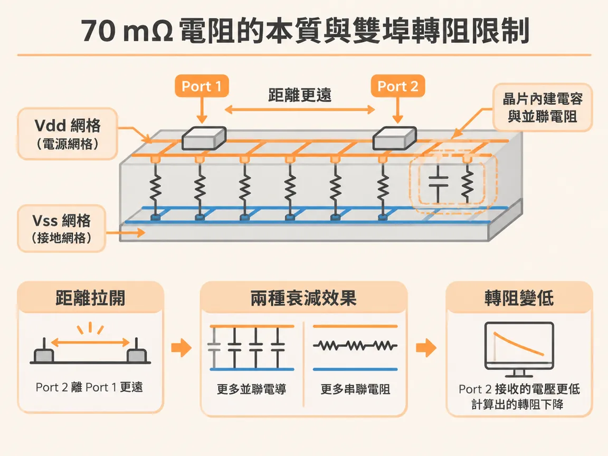

# 在 C4 Bump 上量測 On-Die 電容與串聯 RLC 擬合

在晶片層級，晶片內建電容（on-die capacitance）是電源完整性（PDN）設計的關鍵。雙埠量測法不僅適用於極低阻抗，也適合量測動態範圍大的晶片端電容阻抗。

量測晶片內建電容常見三種配置：直接在裸晶（bare die）凸塊（C4 bumps）上點測、在單一對封裝錫球（package balls）上點測，或是跨兩對封裝錫球點測。無論哪種配置，都必須考慮治具未校準的延伸效應。若將兩組測試埠接在不同的凸塊或球墊對上，探針可以避開一部分串聯阻抗；但跨兩對點位的量測會受到插入損耗或轉移阻抗（transimpedance）效應干擾。這裡先從裸晶凸塊的點測開始說明。

## 裸晶 C4 Bump 的雙埠點測配置

點測裸晶的電源軌（Vdd）與接地軌（Vss）時，VNA 同時提供偏壓，兩支微探棒的接觸點靠得很近。

VNA 的校準通常做到微探棒針尖前端。探棒尖端未校準或無法重複重現的效應，大約等效為特性阻抗 50 Ω、時差（TD）約 1 ps 的傳輸線。這個殘餘量通常對應探棒下針位置偏差或針尖形變約 10 mil 的影響。

量測頻率涵蓋 300 kHz 到 3 GHz。取得雙埠 S 參數後，主要由 $S_{21}$ 換算出待測物阻抗 $Z_{\text{DUT}}$。

## 提取阻抗輪廓：串聯 RLC 擬合與逐點解析

從晶片凸塊看進去的阻抗，有兩種提取方式：

第一種是建立簡單串聯 RLC 電路模型，透過最佳化參數擬合量測到的 $S_{21}$ 數據：
- 低頻區段決定電容值（C）。
- 阻抗最低點附近數值決定電阻值（R）。
- 高頻區段阻抗斜率調整電感值（L）。

這套極為單純的串聯 RLC 模型，與晶片內建 PDN 實際量測的阻抗輪廓高度吻合。經最佳化擬合，該電源軌提取出的晶片內建電容為 81.5 nF。等效電感 L 僅有 2 pH，代表從凸塊看進電源接地網格朝向晶片電容時的擴散電感（spreading inductance）極低。這是因為晶片內部 Vdd 與 Vss 網格之間的介電層非常薄，整體尺寸也小。

第二種方式同樣假設架構為串聯 RLC，但直接拿各頻率點的複數阻抗進行數學拆解：
- 將阻抗實部直接視為電阻 R。
- 將阻抗虛部在各頻率點分別換算為對應的 C 或 L。

這種方法能給出每個頻率點上的電抗與電阻估算值。低頻時，計算出的最佳電容值約為 81 nF，與電路模擬擬合結果一致；當頻率超過 40 MHz，計算出的 C 值開始變動，因為此時阻抗不再單純由電容主導，電感效應也開始浮現。

頻率超過 1 GHz 時，提取出的電感值約為 2 pH，接近量測系統的雜訊底限。電感值隨頻率變動，原因同樣是阻抗虛部夾雜了電感以外的效應。

阻抗實部（R）也呈現頻率相依性：
- 低頻起伏主要來自晶片內 $\text{SiO}_2$ 絕緣層的介電損耗或漏電流（leakage current）。
- 高頻電阻略微下降，則是量測治具效應開始顯現。

## 70 mΩ 電阻的本質與雙埠轉阻限制

兩種提取方法都得到約 70 mΩ 的電阻值。這個 R 值是晶片內 Vdd/Vss 網格的擴散電阻，與晶片內建電容本身的並聯電阻（shunt resistance）組合而成的結果。晶片內部分散式電容與電阻本質上是三維平面網路。

在 100 MHz 以上的高頻區段，該電源軌阻抗幾乎呈現純電阻性。高頻下分散式電容的阻抗遠低於其相關並聯電阻，使得凸塊之間的電路網路表現得接近純電阻網。

當量測點分別位於兩對不同的凸塊時，量得的轉移阻抗可以直接用插入損耗 $S_{21}$ 解讀。Port 2 測得的電壓，取決於 Port 1 的 50 Ω 訊號源阻抗、該網路的等效串聯與並聯電阻、以及 Port 2 的 50 Ω 負載阻抗所構成的分壓架構。此案例中，該分壓使 Port 1 到 Port 2 之間產生約 -50 dB 的訊號衰減。

如果把 Port 2 移到離 Port 1 更遠的凸塊，電源網格與接地網格之間會出現更多並聯電導，路徑上也增加更多串聯電阻。兩者都會使 Port 2 接收到的電壓更低、衰減更大，導致計算出的轉移阻抗下降，看起來像電阻變小。

將量測得到的轉移阻抗與提取出的等效電阻直接當成晶片電源網格的「串聯阻尼電阻」，是不正確的概念。它是由並聯與串聯電阻共同構成的綜合數值，屬於三維平面效應。

在高頻低阻抗環境下，單埠 $S_{11}$ 精準度不足，必須依賴雙埠插入損耗 $S_{21}$；但雙埠量測算出來的是轉移阻抗（$Z_{21}$）。在兩組探棒跨越的空間範圍內存在訊號衰減，也就是「空間衰減」（spatial attenuation），不能誤當成待測點具備極低阻抗。解讀分散式平面結構的雙埠 PDN 數據時，必須將轉移阻抗與空間衰減納入考量。在沒有搭配三維分散式模型比對的情況下，轉移阻抗數據只能做概念性推估。

理解了晶片凸塊的阻抗特性與空間衰減後，若將量測點移至封裝錫球，還會面臨封裝金屬層與晶片網格並聯所帶來的更多量測陷阱。
