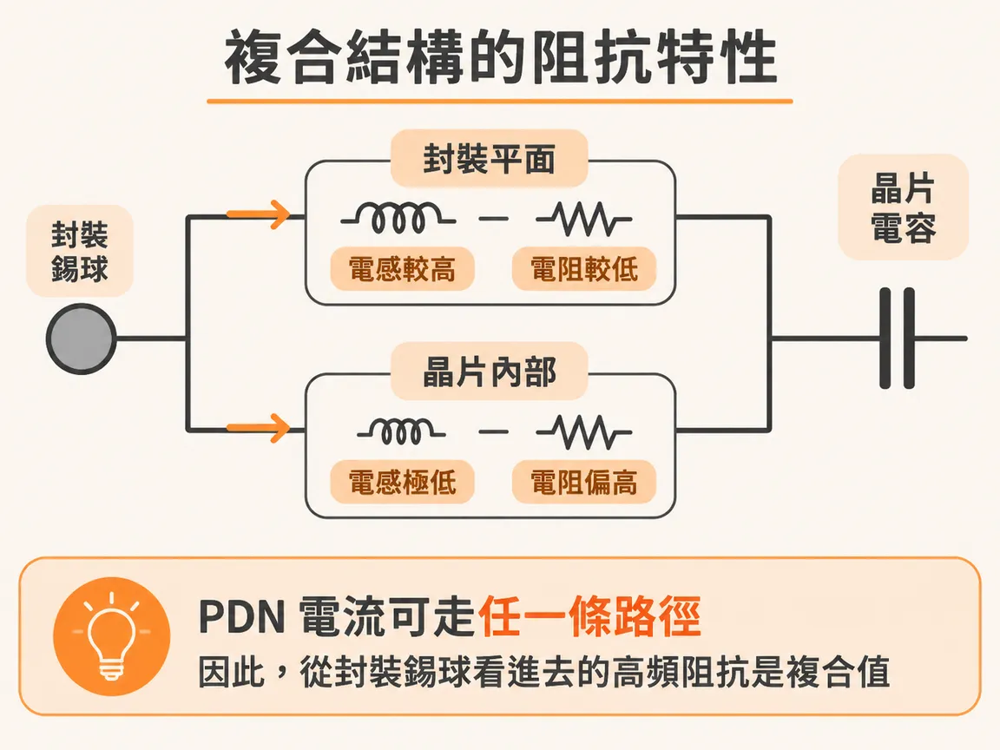
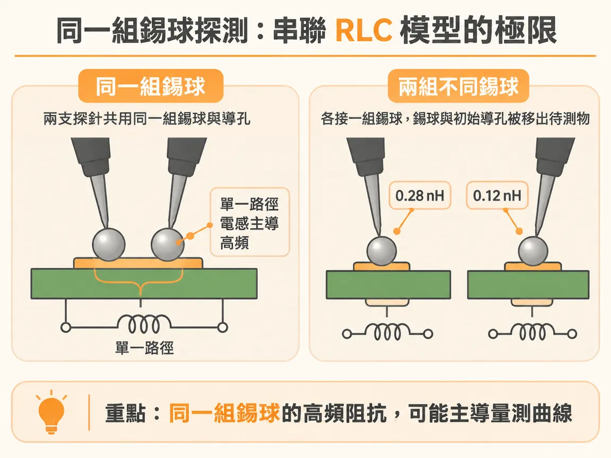
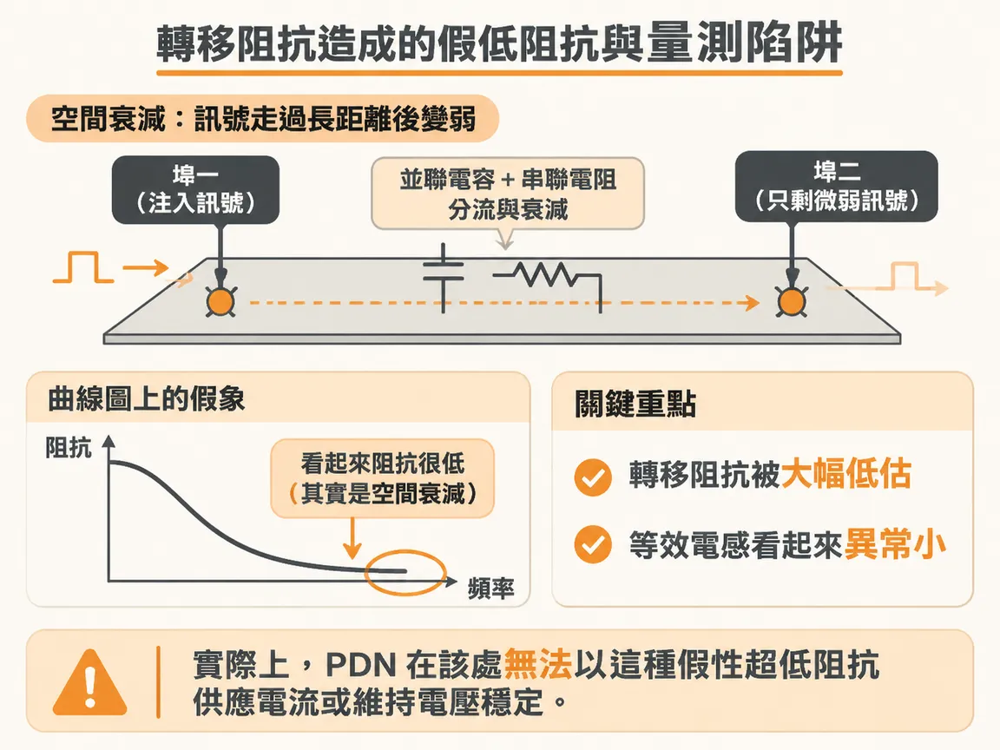

# 封裝 PDN 的雙埠量測：探測邊界、轉移阻抗與治具效應解讀

在晶片 PDN 的並聯諧振中，晶片內部的分散式等效電阻有助於阻尼並聯諧振的阻抗峰值。但在實際封裝中，這層電阻會被封裝金屬層的低電阻短路。封裝金屬層透過表面分佈的大量 C4 凸塊與晶片連接，形成另一層互連結構，把分散的晶片電容併在一起。

量測點從晶片凸塊移到封裝錫球時，從封裝端看進晶片的阻抗必須依據整個複合結構解讀。透過封裝探測晶片主要有兩種方式：

1. **探測同一組錫球（Single Ball Pair）**：Port 1 與 Port 2 的探針同時接觸封裝上的同一組錫球對。此時封裝錫球本身的電感以及進入封裝的第一段導孔電感，都會算進待測物的串聯阻抗路徑中。
2. **探測兩組不同錫球（Two Ball Pairs）**：兩支 VNA 探針分別接觸兩組不同的封裝錫球對。此時通往晶片的部分封裝 PDN 成為未校準的治具延伸，真正的待測物從 Port 1 與 Port 2 訊號首度匯合的封裝電源平面起算。這種接法移除了單一錫球對的電感與電阻，讓量測點在物理上更接近晶片電容，但數據解讀更需謹慎。

## 複合結構的阻抗特性

低頻時，阻抗完全由晶片電容主導。無論從晶片凸塊量或從封裝錫球量，測得的電容值都相同。但隨著頻率升高，電感與電阻行為變得複雜。

從封裝錫球看進去，高頻阻抗反映的是封裝與晶片的複合結構：
- **封裝平面**：電感較高，但電阻較低。
- **晶片內部**：晶片電源網格的電感極低，但電阻偏高。

這兩組互連是並聯的，PDN 電流可以透過任一條路徑流向電路負載與晶片電容。加上探針放置位置的影響，這個結構屬於多層三維平面網格，適合透過 3D 場解算器（field solver）分析。

## 同一組錫球探測：串聯 RLC 模型的極限

當兩支探針放在同一組錫球對時，量測結果對該錫球對與導孔的電感、電阻最敏感。待測物包含通往封裝平面的單一路徑，這組錫球的高頻阻抗可能主導整個量測曲線。

以串聯 RLC 電路模型比對同一組錫球的量測結果，低頻吻合度很高。該電源軌量出的晶片電容為 79.5 nF，與在晶片凸塊上測得的 80.5 nF 接近。在自諧振頻率（SRF）附近，以 24 mΩ 電阻與 0.28 nH 電感模擬，能與實測對齊。

超過 100 MHz 後，實測萃取的電感開始隨頻率下降。這代表簡單的 RLC 模型無法描述低電阻封裝平面短路高電阻、低電感晶片網格的行為：
- 部分電流改走晶片端低電感、高電阻的路徑。
- 高頻下電流不需走遠尋找低阻抗電容。電流通過較短的晶片內部互連時，經過的分流電阻變少，使等效串聯電阻（ESR）隨頻率上升。

在低頻端，實測阻抗實部具有頻率相關性，符合晶片內部絕緣層的介電損耗特徵。

未校準的探針殘留效應也會影響結果。若將治具等效為電長度 1 ps 的微小傳輸線，它會把虛部阻抗的相位轉移到實部。模擬顯示，探針治具對 10 MHz 起算上升的電阻以及 L、C 的萃取影響極小，但接近 1 GHz 的高頻極限時，萃取出的電阻陡降多半是探針造成的假影。例如探針微調刮擦（tip scrub）若讓實際長度比校準時縮短 2 ps，就會在 1 GHz 造成負向相位偏轉，使電阻看起來往下跌。

## 不同錫球對探測：治具延遲與阻抗萃取

將探針改接到兩組不同錫球對時，量測排除了單一錫球對與初始導孔的串聯電感，以及部分封裝擴散電感與電阻。這項量測對封裝腔體並聯晶片低電感、高電阻網格的行為更敏感。

比對兩者的諧振特性：
- **同一組錫球量測**：SRF 的有效電感為 0.28 nH。
- **不同組錫球量測**：SRF 的有效電感降至 0.12 nH。

兩者相差的 0.16 nH（160 pH），來自錫球、進入封裝平面的導孔，以及封裝平面內的部分擴散電感。從不同錫球對萃取的電感，隨頻率變化的幅度比單一錫球對小；萃取出的電阻較低，但依然隨頻率上升，且探針點之間的距離會因為擴散電感與電阻而增加衰減。

每支探針通過錫球與導孔進入封裝平面的 160 pH 電感，屬於治具電感。在模擬中，若將治具延遲（TD）設為 2 ps（對應兩端探針各約 100 pH 的總電感，加上探針尖端在校準與實測間約 -1 ps 的形狀重複性誤差），微小的 2 ps 延遲會將虛部相位轉入實部，在 1 GHz 高頻極限處製造出電阻隨頻率劇烈變化的假象。1 GHz 以上看到的阻抗實部多已被治具假影掩蓋，不能直接解讀為真實電阻（600 MHz 附近的雜訊亦為量測假影）。

在低於 100 MHz 的頻段（晶片電容與封裝引線電感的並聯諧振區），諧振迴路的 ESR 主要由封裝的低電阻主導；而在 500 MHz 以上，晶片電路看到的 ESR 則由晶片電源網格的高分散電阻主導。100 MHz 處的諧振阻尼，不如原先直接從凸塊量測晶片電阻時預期的那麼大。在 1 GHz 以上，需要納入晶片與封裝所有分散連接路徑的 3D 結構模型，才能預測晶片真正看到的阻抗。

## 轉移阻抗造成的假低阻抗與量測陷阱

雙埠量測本質是穿透損耗量測。當 Port 1 與 Port 2 放在不同位置時，量到的是兩點之間的**轉移阻抗**，伴隨空間衰減：

1. **封裝層級**：兩組探針在封裝錫球上拉開距離時，Port 1 注入的訊號在抵達 Port 2 前，經過路徑上的感性濾波、阻性濾波與晶片電容分流，導致 Port 2 收到的訊號大幅衰減。
2. **PCB 板級**：兩支探針在電路板不同位置接觸電源平面時，兩點之間安裝的分立電容同樣會將訊號旁路衰減。Port 1 訊號穿過空間到達 Port 2 時已被大幅削弱。

這種穿透損耗會讓阻抗在曲線圖上看起來異常低，換算出的轉移阻抗因此被大幅低估，等效電感看起來異常小。宣稱具備超低電感的 PDN 數據，有些只是誤把空間衰減當成真實驅動點阻抗。實際上，PDN 在該處無法以這種假性超低阻抗供應電流或維持電壓穩定。

解讀雙埠 PDN 量測時，必須防範兩項干擾：
- **未校準的治具延伸**：探針微小的相位誤差會把純電抗轉成電阻，扭曲高頻下的實部與虛部解讀。
- **探針間的空間衰減**：兩埠分開時量到的是轉移阻抗而非驅動點阻抗，空間濾波會製造出阻抗極低的假象。
